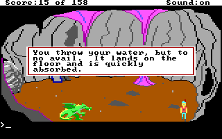
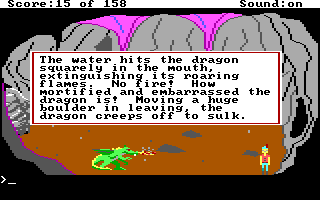

# KQ1: automatically finding the dragon's last-row exception

The dragon-room Z exporter now inspects the original spatial predicates and
reports a thin exception at the bottom of the room. The original water logic
tests Graham's position against an inclusive rectangle, rather than measuring
his distance from the dragon. Its inside and outside branches disagree at
adjacent positions **(130,166)** and **(130,167)**.

Two independent restores of the retained `dragon-before` checkpoint confirmed
those branches in the original DOS interpreter. Both used ordinary keyboard
movement and one pretyped `THROW WATER` command, submitted once. They did not
edit positions, registers, flags, inventory or code.

| Neutral launch position | Original source branch | Completed effects |
| --- | --- | --- |
| 130,166 | Logic 51, print 33 at `0x429` | Water consumed; score 15 → 13 |
| 130,167 | Logic 51, print 34 at `0x45e` | Water consumed; score 15 → 13 → 20 |

See the [paired native evidence](evidence/agi-boundary-exceptions-2026-11-01/native-pair.json).
The [sanitized traces](evidence/agi-boundary-exceptions-2026-11-01/trace-summary.json)
retain the six actual fetch addresses through each original DROP return.
The successful case is a native **branch and transaction** observation. It
stops at the final observed score access; it does not qualify complete dragon
retreat, a fresh-game route or a physical throwing radius. The dragon's actual
pose differs between the two forks.

## What the automatic analysis detects

The AGI adapter recognizes an ego `posn` predicate and its negation under matching
scalar conditions. It retains source offsets, the tested actor and the
original inclusive box. The shared boundary auditor then derives thin
terminal complement bands within the declared coordinate domain. For the
selected original Logic 51, it finds:

```text
AGI room coordinates: 160 × 168; actor x origin and baseline y
Inside predicate:     105 ≤ x ≤ 145 and 96 ≤ y ≤ 166
Matching context:     v75 == 0
Bottom complement:    y = 167, x = 105..145 (41 possible origins)
Adjacent witness:    (130,166) inside → (130,167) outside
```

The conversion to shared mask geometry is explicit: the inclusive source box
becomes half-open `[105,96,146,167)`. The source failure IF is at `0x3df`;
the matching negated IF is at `0x432`. The 41-point row is a **one-pixel
terminal band**, not an isolated point or a disconnected component of the
whole two-dimensional outside region. Only the two recorded x=130 positions
have the paired native qualification; all 41 positions are not thereby
proved reachable or safe.

This is a narrow structural detector. It does not infer intended game design,
discover arbitrary glitches, solve all movement or certify a throw distance.
The explicit request to move closer belongs to the separate dagger response;
the water failure says the water lands on the floor. These responses must not
be conflated into a fabricated distance check.

As a comparator, [ScummVM's `testPosn` implementation](https://github.com/scummvm/scummvm/blob/master/engines/agi/op_test.cpp#L276-L289)
uses the actor origin and inclusive bounds, while its separate `testObjInBox`
includes the actor width. That comparator guided the model; the selected DOS
interpreter's observed adjacent branch outcomes supply the native evidence.

## A predicate witness is not a walking route

The retained normal entrance is `(131,136)`. A naive downward ray at x=131
encounters priority 0 within Graham's six-unit baseline at row 166. The source
picture check exposes this obstruction. At x=130, the baseline is clear along
the proposed downward ray, and the independent native forks reached both
target rows using a one-pixel move left followed by ordinary downward input.

Picture priority alone does not include every live actor, border behavior or
timer. Native guards checked a neutral launch, the exact ego position, carried
water, score 15, unresolved dragon state and the death callback. Each fork
restored the checkpoint independently because the negative test consumes
the water. The first, incomplete attempt failed a restore identity guard
before any route input and remains in the attempt ledger.

The corrected identity check compares the restored CPU with the saved CPU
and restore receipt, while independently binding the original interpreter and
game-data table. A checkpoint parked in the renderer can legitimately have a
temporary CPU DS different from the game-data segment. The controller never
forces that register to a preferred value.

The portable collector is `examples/agi/verify_dragon_boundary.py`, with the
inside-branch observer in `examples/agi/dragon_inside_probe.py`. Run each
target in a fresh private output directory, against the retained native
project and its matching source capture/result:

```sh
PYTHONPATH=src:player:. python -m examples.agi.verify_dragon_boundary \
  --source /private/original-kq1 --backend /private/backend/dosbox-x \
  --project /private/native-route/private.fdb --artifact STATE_ARTIFACT_ID \
  --source-capture /private/native-route/capture.private.json \
  --source-result /private/native-route/result.json \
  --target-y 166 --output /private/new-inside-fork
```

Use `--target-y 167` with another new output directory for the independent
outside fork. The collector checks the saved format, source/game/backend
identities, donor state, CPU restoration, input readiness and final integrity;
it retains failures and never rewrites the donor project. Apply the storage
admission requirement before native captures. The
[portability receipt](evidence/agi-boundary-exceptions-2026-11-01/portable-controller.json)
records that the public controller changes only its module import/neighbor
filename and the probe changes only its docstring from the native-tested
private copies. The public entry point passed authored tests and help checks;
it was not itself rerun natively after that promotion.

## How it appears in Z scenes

The dragon object and its active context automatically show the derived
boundary warning when the exporter recognizes the source pattern. Full
predicate, mask, picture-ray and geometric contrast details stay in the
generated private provenance. No screenshot inference or manually typed
exception coordinate is needed to discover the band.

The historical native note requires matching engine, inventory, Logic 51 and
PIC51 identities, as well as the complete derived predicate/context/band. The
[picture binding](evidence/agi-boundary-exceptions-2026-11-01/source-binding.json)
links the picture to the retained donor capture and the common 24-file source
manifest. A changed picture keeps its new static finding and cannot inherit
the prior native note. This note never upgrades the static reachability mask.

The scene remains the existing eight-action projection with 44 native fields
plus phase. The diagnostic does not add arbitrary movement, alter `use dragon`
to silently take the glitch route or turn its player into an AGI interpreter.
The original fresh-route capture and receipts are preserved. Its previously
published scene/provenance hashes identify the earlier export; the additional
diagnostic changes the current export's descriptions and provenance.

For other point-domain predicates, call the shared auditor directly:

```python
from fdisbull.scene_boundaries import audit_rectangle_boundary

report = audit_rectangle_boundary(
    (105, 96, 145, 166),
    width=160, height=168, convention="inclusive",
    directions=("down",), start=(130, 136),
)
```

The rectangle and coordinate convention are caller declarations. An optional
reachability mask is reported separately and does not imply native execution.
Cell/run limits preserve partial results with `complete: false`. Empty
complements are valid. Unsupported source forms, missing evidence and unknown
reachability must remain explicit.
Completeness covers this supported structural search; an absent match does
not establish that a room has no other boundary exceptions.

The AGI adapter also caps source instructions and shares a source-operation
budget across predicate/effect inspection. A score assignment, indirect write,
logic call or unproved control flow makes the corresponding linear score sum
unknown. Remaining constant ADDN/SUBN sums describe mathematical operands;
runtime byte wrap and the native outcome require their own observations.

## Verification

The final affected suite passed **2,227 tests with 17 skips across 55 files**
on Python 3.13.13/macOS ARM64. Source hashes matched before and after the run.
Optional native/private selectors were removed for this authored suite;
case-sensitive filename coverage also depends on the host volume. See the
[test selection and hashes](evidence/agi-boundary-exceptions-2026-11-01/tests.json).

Genuine installed core/player **0.28.0**, using isolated Python without
`PYTHONPATH`, matched all nine native-derived boundaries, inventory and all
44 typed native fields plus phase in direct and separate-process checks.
Stale/repeated actions, failed preconditions, in-memory restore/token
invalidation and a fresh model's missing checkpoint were checked. The first
process-check attempt used a nonexistent helper path and stopped before any
process action; it is retained in the
[player attempt ledger](evidence/agi-boundary-exceptions-2026-11-01/player-attempts.json).
The corrected fresh model check passed.

All eight action programs remain exactly equal to the earlier sealed export;
only the active dragon context/object descriptions change in the runtime
scene. The final scene bytes are identical to the installed player's tested
input. Scene SHA-256 is
`c364ab45f91ce9275ea7660c706647b4967036a35d44cf933641ddbc256b7caa`;
provenance SHA-256 is
`9d468f7d33729730cf4fdaabfb93e9a9df1ab13e645431b65360554805a615e7`.
See the [verification receipt](evidence/agi-boundary-exceptions-2026-11-01/receipt.json)
and [installed-player checks](evidence/agi-boundary-exceptions-2026-11-01/player-verification.json).

These stored frames show the original branch messages **before** their score
writes. The paired transaction evidence establishes the final scores.





Game files, saved states, project databases, raw native captures and generated
scene content remain private. This follow-up does not release, install or
merge a new version. Hosted Linux qualification is a separate gate from these
local authored tests and original-DOS observations.
