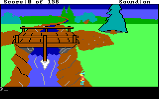
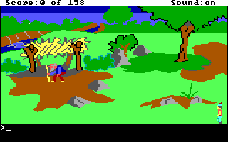

# KQ1: the bottom-row bridge crossing

The supplied AGI 2.917 edition admits the southern boundary route through the
wooden-bridge room. A fresh ordinary-input run walks along **room39, y167**,
then enters room40 without paying or removing the troll, entering water,
changing the score, loading a native state or editing guest coordinates/code.
The separate fresh control reaches the water flag at **(86,166)**. The candidate
samples **(86,167)** dry, with the same normal view0, width6 and step1.

This is a third case alongside the [room41 eastern-edge water-walk](AGI_GOAT_BRANCHES.md)
and [room39 lower bridge-corner clip](AGI_BRIDGE_CLIP.md). The recovered recreation
archives supported the former; this follow-up newly tests the bottom row.

## From static candidate to ordinary gameplay

The [coordinate-domain follow-up](SCENE_COORDINATE_DOMAINS.md) found a fully dry
last priority row beside an all-water inward baseline. Its scanner reports82
candidate origins, x5..86 at y167. A single observed corridor does not qualify
every starting origin, actor mode or game edition.

The collector starts a private new game and follows ordinary arrows through
rooms **1 → 8 → 41 → 42 → 39**. The original stone-bridge approach is reused.
On the east bank of room39 it reaches (110,166), takes one Down step to167,
then walks Left. It observes the western crossing before the normal west exit
and room initialization, and finishes in room40 at (151,167), score0, dry,
alive, actor drawn, direction/control0, and an explicitly idle keyboard queue.
The original room40 blocking greeting is observed and acknowledged normally.
The original game sets `ignore.blocks`; the collector does not set that flag.

| Boundary | Candidate | Separate fresh control |
| --- | --- | --- |
| Starting bank | room39 (110,166), neutral | Same |
| Crossing row |167 |166 |
| Matched sampled origin |(86,167), water flag false |(86,166), water flag true |
| Six source priority values at x86 |15,15,15,15,15,15 |3,3,3,3,3,3 |
| Outcome |room40 (151,167), neutral and dry |Stop on the first observed water flag; no drowning or neutral-motion claim |





The six-unit collision baseline at y167 still lies inside the logical picture
domain `[0,160) × [0,168)`. In the inspected video mapping row167 corresponds
to display row175, inside the complete 320×200 frame. The scene therefore records
a **hazard seam on the last picture row**, rather than claiming a footprint
outside that viewport. The source priority contrast supports an explanation;
the original interpreter's complete water decision was not instruction-traced.

```sh
PYTHONPATH=src:player:. python -m examples.agi.verify_bridge_bottom \
  --source /private/kq1 --backend /private/dosbox-x \
  --output /private/fresh-bottom-row --target-y 167
```

The collector CLI uses `--target-y 167`; for the adjacent control choose166 and
a separate fresh output directory. Source and copied-game manifests are checked
after teardown. The launch helper saves a private baseline but neither replay
loads it. Original files, states, databases and full captures remain private.

## Expected transitions need a bounded pending stage

Two earlier attempts are preserved as collector failures. The first completed
the horizontal walk but stopped at x0/y167 with the expected west-border flag4.
The second reached room40 during normal initialization, before ego was drawn.
These observations establish partial progress; they are not original-game
failures. The final collector admits those specific pending stages within the
existing time budget while retaining its foreign-stop and unsafe-state guards.
The completed final run and adjacent control then passed without interventions.

Intermediate samples can coast across a nominal threshold: the retained
`over-water` snapshot is x79 although the trigger was x≤80. The exporter accepts
a source-supported range there. Row166 versus167 remains exact because that
one-row difference is the subject of the experiment.

## Reusable partial Z scene

`examples/agi/build_bottom_scene.py` produces a separate two-action scene using
the shared IL backend and standalone player:

```text
use edge       # observed (110,166) → (110,167)
use crossing   # observed westward walk → room40 (151,167)
```

It validates source/PIC identities, five ordered observations, complete input
receipts, the intermediate source seam, the completed original dialogue, final
receipt agreement and post-teardown source/copy integrity. Each action guards
all20 modeled variables including phase before updating them. Only authored
response text enters the player scene. The other bridge scene's existing three
programs are unchanged.

```sh
PYTHONPATH=src:player:. python -m examples.agi.build_bottom_scene \
  --source /private/kq1 --capture /private/fresh-bottom-row/capture.private.json \
  --report /private/fresh-bottom-row/result.json \
  --artifacts /private/fresh-bottom-row --output /private/bottom-scene
```

The genuine installed0.29.0 core/player, isolated from this checkout, matches
all20 modeled variables at each captured phase. The same scene also passes the
separate-process player route, early/repeated action refusal, stale-token
rejection and in-memory checkpoint restoration. This does not add durable saves,
autonomous AGI timing, a full game reconstruction or authentication of supplied
capture records.

See the [sampled observation trace](evidence/agi-bridge-bottom-2026-11-01/observations.json)
and [verification receipt](evidence/agi-bridge-bottom-2026-11-01/receipt.json).
The [scene-building notes](SCENE_BUILDING_FRICTIONS.md) separate implemented
behavior from proposed improvements. No release or fDisBull installation change is made.
