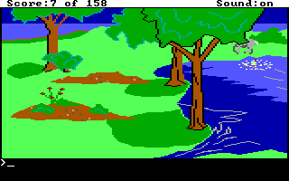
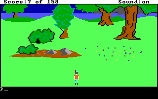
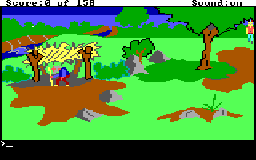
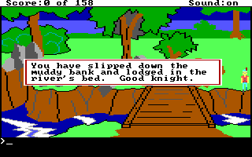

# KQ1 lake branches and the river boundary skip

This follow-up distinguishes three source paths that should not share one
successful-play label. It also reproduces a documented river skip with ordinary
keyboard input. The [sanitized receipt](evidence/agi-goat-branches-2026-10-31/receipt.json)
binds the native runs, source identities, selected frames, traces, scene exports,
solver scope and local checks. Original files, states, databases, raw captures
and generated original-text scenes remain private. Four selected native PNGs
are retained as verification evidence, byte-for-byte with their capture hashes
and without text/EXIF metadata chunks.

## Ordinary lake refusal and departure

From a fresh game, the collector takes the carrot, opens the goat pen, lures
the goat, leaves the pen and walks south from room 9 into room 8. It steps aside
before turning south because the goat can block the immediate pen-exit position.
At the lake it uses the original swimming command and returns to the upper
shore before leaving the room. No debugger coordinate, code, register or data
edits, redirected calls or native-state loads are used. The shared launch helper
saves a private baseline but the replay never restores it.

```sh
PYTHONPATH=src:. python -m examples.agi.verify_goat_branches \
  --source /private/kq1 --backend /private/dosbox-x \
  --output /private/fresh-lake-run
```

The qualified run observed:

| Boundary | Native observation |
| --- | --- |
| Before lake route | Room 9, score 7, carried carrot, following flag set |
| Regular refusal | Logic 103 prints message 1 at `0x0177`, sets f66, and writes actor 13's wandering motion at `0x017d` |
| Motion watch | Native writer `CS:6dcb`, resume `CS:6dcf`, correct actor and source cursor; motion becomes 1 while f66 and f75 are true |
| Leaving room 8 | Source reset of f75 at logic 8 `0x01de`, native writer `CS:7432`, resume `CS:7434` |
| Later commitment | Room 9, score 7, carrot carried, f66/f75 false, f130/f213 true, goat absent from the inspected frame |

Each watched effect retains a separate 32-fetch continuation. Its source logic,
complete loaded code, argument, native writer, source cursor and post-access
state are checked before further execution. A stop at the f75 reset precedes
the later f130/f213 setters, so those later facts have their own bounded state
check. Fetch observations do not certify completion of every instruction.

The ordinary refusal at decimal offset 375 differs from the earlier diagnostic
print at offset 450. The latter is a special f43 path and does not perform the
same post-print wander operation. This collector admits only the regular
occurrence. It does not silently treat one message ID as evidence for both paths.

The legacy `following` field is f75, a story flag. During refusal it remains
true even though actual actor motion is wandering. `goat_wandering` records
native motion 1; that field can remain set on an erased actor. Neither field
establishes visibility. Used frame visibility is assigned by separate inspection
of the stored PNGs, not by the drawn flag or motion value.

Returning to dry land within distance 25 can instead clear f66 and restart
following. The retirement route stays far enough away before taking the north
exit. A recovery outcome must be reported as recovery, not relabeled retirement.
The route has a 420,000 guest-millisecond and 360,000 wall-millisecond ceiling.
Unknown delivery, foreign stops, incomplete observations and blocked movement
remain failures with retained partial evidence.




## Reusable scene exports

The [ordinary capture contract](AGI_NATURAL_GOAT.md) and
[troll extension](AGI_TROLL_BRIDGE.md) remain supported. The exporter now also
accepts these contiguous sequences:

```text
show-carrot -> leave-pen -> lead-to-water
show-carrot -> leave-pen -> lead-to-water -> leave-water
```

The separate player exposes `use carrot on goat`, `use route`, `use water`,
and, when the fourth observation is supplied, `use exit`. It consumes an authored
projection of these recorded transitions, not an autonomous AGI interpreter.
The full export reaches phase 4 in room 9 with the observed score, inventory,
refusal, motion, following and retirement fields.

All used observations include the original five fields plus booleans
`carrot_carried`, `water_refused`, `goat_wandering`, `goat_retired` and
`water_departure`. The regular refusal message must appear exactly once with
logic 103, offset 375 and message ID 1. The final departure requires explicit
frame observation that the goat is absent.

Each new action supplies `native_branch_effect: {path, sha256}`. The raw private
JSON has format `fdisbull-agi-goat-branch-effect-1`, verified/complete status,
native execution, the expected branch and source logic/hash/offset, opcode,
argument, native writer/resume offsets and a hash-bound 32-fetch trace file.
The exporter checks source bytes, fields, occurrence counts and artifact hashes.
Those remain supplied assertions, not an authenticated execution chain. Private
paths and original text are omitted from exported provenance.

```sh
PYTHONPATH=src:. python -m examples.agi.build_goat_scene \
  --source /private/kq1 --capture /private/fresh-lake-run/qualified-capture.private.json \
  --artifacts /private/fresh-lake-run --output /private/new-lake-scene
```

Preserve the raw capture and put visual qualifications in a derived capture
with its parent/frame hashes. To export only refusal, use the three-action
prefix. The output directory must be fresh and outside the source, capture and
checkout trees.

Both three- and four-action exports were checked against their native scalar
observations using the installed 0.28.0 player, directly and with a separate
content process. Stale/repeated actions, in-memory checkpoint restore, token
invalidation and checkpoint absence in a fresh backend were checked. This task
did not change the installation. Durable IL-scene saves remain unimplemented.
Existing one-action, two-action and troll scene/provenance bytes are unchanged
for the authored compatibility fixtures.

## The separate invisible-wander path

Logic 103's message 2 at `0x019d` belongs to a different branch: following is
already active, f79 (invisibility) is true, and f42 is false. That branch resets
f75, wanders actor 13 and may erase it. The earlier synthetic diagnostic invoked
that prepared state; it did not establish a normal player route.

The supplied source prevents the ordinary setters from creating that state:
both successful carrot-lure setters require `!f79`, and the ring setter requires
`!f75`. Rubbing the ring while following takes a refusal branch. Activating
invisibility first also fails the successful-lure guard. No normal-command
witness was obtained for this exact invisible-wander branch.

```sh
PYTHONPATH=src:. python -m examples.agi.check_goat_invisibility \
  --logdir /private/kq1/LOGDIR --volume-dir /private/kq1 --profile 2.917 \
  --steps 8 --output /private/goat-invisibility-check.json
```

The utility binds the exact directory/volumes, enumerates all 90 present logics
at 11,452 established instruction boundaries, checks the 38 relevant literal
and dynamic writer occurrences, and qualifies the setter guards and their local
control-flow dominance. Logic 99 debug edits are excluded; logic 0's admitted
dynamic reset loop covers flags 20 through 44.

Z3 found the initial, induction-step and eight-transition invariant violations
UNSAT in the declared two-flag model. A negative control admitting a debug edit
is SAT. The result is `verified-under-assumptions`: initial flags false, immutable
qualified scripts, atomic admitted effects, normal call returns, no external
state changes or interpreter faults. It is not a whole-game or AGI-engine proof.
The native lake retirement above remains a separately named logic-8 path.

## Historical river water-walking, reproduced

Speedrunners document boundary water-walking separately from a three-pixel
bridge-side clip. The [runner's glitch guide](https://www.speedrun.com/kings_quest_quest_for_the_crown/guides/2r57k)
describes the boundary alignment; the [2021 TAS submission](https://tasvideos.org/7105S)
reports it for KQ1.COM v2.0F. Four published file-size/MD5 anchors match the
supplied interpreter, launcher, logic directory and object file. This is a
four-file identity comparison, not authentication of a complete distribution.

The native reproduction goes from fresh room 1 through room 8 into room 41,
aligns at x154 and walks south to room 40. It finishes with normal VIEW 0,
width 6, score 0, no water/swimming/death state, no troll payment and no troll
removal. The adjacent control at x153 sets the water flag at y109 and produces
the original fatal-river notification. Both cases were repeated with the final
collector; the public receipt identifies the earlier exploratory versions too.

```sh
PYTHONPATH=src:. python -m examples.agi.verify_river_walk \
  --source /private/kq1 --backend /private/dosbox-x \
  --output /private/fresh-river-edge --x 154
# A separate fresh process/copy for the adjacent control:
PYTHONPATH=src:. python -m examples.agi.verify_river_walk \
  --source /private/kq1 --backend /private/dosbox-x \
  --output /private/fresh-river-control --x 153
```

The numeric route is our adaptation of the documented technique, not a claimed
runner-published coordinate recipe. In the decoded PIC 41 control plane, the
six-pixel baseline at (154,120) is `[3,3,3,3,3,15]`; at (153,120) all six values
are 3. This supports the reported whole-baseline water-test explanation. The
original native collision routine was not instruction-traced here, so the
control-plane account remains distinct from that stronger mechanism claim.
The separate three-pixel bridge clip and later mushroom-island crossing were
not reproduced by this follow-up.

The [next bridge-corner follow-up](AGI_BRIDGE_CLIP.md) now qualifies the eastern
bridge clip and its adjacent script-water control separately. Its source-linked
route and reusable scene do not change this earlier receipt's scope.




## MR !8 review and verification limits

The exact-head review at `08daea56` found one P2: a trace-file write failure
prevented trace cleanup, while a cleanup RPC failure prevented persistence of an
already-qualified score-write receipt. The new regressions failed on that source
for those reasons. The follow-up persists known write evidence before trace
work, attempts cleanup independently of artifact persistence, retains cleanup
or persistence errors in incomplete receipts where possible, and assigns final
verified status only after the final proof write succeeds.

Local selected checks passed 581 tests with four skipped on macOS ARM64.
Native runs used the pinned DOSBox backend and genuine Python dependencies.
Linux CI, packaging, an integration merge, a release/tag and installation
activation are separate gates and are not claimed here.
