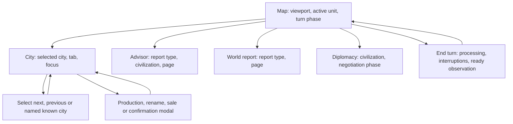

# One food UIL across three originals, and a parameterized Civilization Z design

This extends the [verified builds and source maps](CIVD_VERIFIED_SOURCE_MAPS.md).
The original 474.01, 474.03 and 474.05 executables remain untouched. One fixed
UIL contract and one invoking module select their original food-update bytes.
The experiment executes isolated kernels, including a separate DOSBox oracle;
it does not install a replacement in a running Civilization game.

## Arithmetic and declared boundary

The address-free operation is:

```text
new_stock = signed_word16(stock + produced - 2*population - supported*support_cost)
```

Stock, production, supported settlers and support cost are signed 16-bit ports.
Population is a signed byte, widened before doubling. Support cost is admitted
only in 1..2; the checked source sets it according to government. All additions
and subtractions wrap as physical 16-bit operations. This describes observed
machine arithmetic, including inputs outside ordinary-game reachability; it
does not assign defined ISO C semantics to signed C overflow.

`fdisbull.stock_flow.maintenance_contract()` expresses this with existing
`fdisbull-il-1` operations: widen, add, subtract and an equality branch.
Cost 2 doubles the supported count; cost 1 retains it. There is no new UIL
opcode or game address. `maintenance_module(contract_id)` supplies the single
unchanged `invoke food` program. The UIL identity is
`332f84e5067fa7aee5405a001ac68efb991fd644bcf34cd62a232f453df057ed`.

The selected implementations use the existing snippet, contract, UDL layer and
selection APIs. Each project retains all three original backing snippets and
exact selection IDs; the source is the literal range in the packed original,
cross-checked against its decoded resident module and earlier build map.
No selected instruction bytes change, including 474.01's distinct operands.

## Host and backing adapters

Each host representation decodes into the typed logical ports. The selected
backing adapter places those ports at its own DS fields and SS frame locations,
executes the original 36 bytes, and returns one stock word. The host adapter
commits that word to its own selected city record. City identity is realization
context, not an address in UIL.

| Binding | 474.01 | 474.03 | 474.05 |
| --- | --- | --- | --- |
| Linked data-group paragraph | `2A1B` | `2A80` | `2B01` |
| City array offset | `706C` | `70EC` | `70EC` |
| Food total offset | `705A` | `70DA` | `70DA` |
| Supported-settler count | `F2E6` | `E3C6` | `E3C6` |
| Cost local | `BP-46h` | `BP-48h` | `BP-48h` |

All have a 28-byte city record, signed population at +7, stock word at +12,
and city argument at BP+6. Adapters test records 0, 1, 63 and 127 and frame bases
`8800`/`9000`. They validate the frame's city argument, typed ports and bounds.
Separate isolated data/frame arenas make state ownership explicit; observed
original-game DS, SS and BP values remain a future runtime qualification.

The native provider guards reads and writes, checks the exact exit, and restores
its declared caller-register set. The arithmetic block has one two-byte write.
Other host data bytes remain unchanged. Flags, timing, surrounding growth,
starvation, city management and turn effects are outside this port contract.

## Executed swap matrix

Each cell passed the same **2,018 input vectors** against both original-backed
CPU observations and the shared UIL. Rows are host layouts; columns are
selected original UDC backings.

| Host / backing | 474.01 | 474.03 | 474.05 |
| --- | ---: | ---: | ---: |
| 474.01 | 2,018 / 0 differences | 2,018 / 0 differences | 2,018 / 0 differences |
| 474.03 | 2,018 / 0 differences | 2,018 / 0 differences | 2,018 / 0 differences |
| 474.05 | 2,018 / 0 differences | 2,018 / 0 differences | 2,018 / 0 differences |

There are **18,162 selected native invocations**, plus **6,054 original-block
DOSBox observations**. Vectors include 1,250 signed extrema combinations,
all 256 population encodings at both costs, and 256 fixed-seed random vectors.
These are finite comparisons, not an all-input proof.

The separate oracle uses hash-pinned MASM/LINK and an authored DOS harness.
It supplies the original data/frame layout, calls the untouched block and
records result words. The return instruction after the retained half-open
block belongs to the harness. The originals and their resource directories
are never mounted. Guarded CPU admission checks the reviewed 13-instruction
profile before a DOS process starts. A closed-form word calculation also
cross-checks the original oracle; it is never substituted for original execution.

Negative controls pass in every host: changing ADD to SUB in a disposable byte
copy produces 7 where the contract expects 13; changing the frame-local adapter
causes an undeclared-read refusal. Invalid cost 3 is refused before native
execution. Reopening all three project copies preserves selections, results,
database integrity and byte version 1.

The full runner is checkout-only:

```sh
PYTHONPATH=src python examples/recovery/civd_food_swap.py \
  --mapping-run /private/verified-mappings \
  --tools /private/pinned-period-tools \
  --dosbox /absolute/path/to/dosbox-x \
  --output /private/new-food-swap-run
```

Keep original files, captured code, databases, harnesses, outputs and detailed
receipts private. The [sanitized evidence](evidence/civd-food-swaps/verification.json)
retains identities, scopes and results, while
[shared UIL](evidence/civd-food-swaps/shared-uil.json) contains authored semantics.
Earlier source maps keep their static-only qualification; the new finite tested
snippet relations are separate records.

## Z uses screen families and entity parameters

Civilization needs a strategy interface: an active map, nested views, reports,
entity collections, selection controls, paginated tables, modal choices and
turn processing. A city, unit, opponent or encyclopedia entry is a parameter
of a screen family. It is never a new scene definition.



The shipped `data/civd-z-screen-families.json` defines 38 families:

| Family | Parameters or represented variations |
| --- | --- |
| Boot | Driver selection, introduction, memory warnings |
| Main menu | New, load, Earth, customize, hall of fame |
| World setup | Land mass, temperature, climate, age |
| New game | Difficulty, competition, tribe, leader, introduction |
| Load / save | Separate families; slot, drive, page |
| Map | Active unit, viewport, human/opponent/processing phase |
| Game menu / unit orders / options | Three families with their observed choices |
| Rates | Tax or luxuries selection |
| Find city | Query and known-city results |
| City | City identity, resources/happiness/map/panorama tab, focus |
| Production | Selected city, unit/building/wonder category, page |
| City unit list | Selected city, unit, page |
| Building sale | Selected city, building and confirmation |
| Rename | City, leader or tribe identity |
| Advisor | Six advisors, dossiers and military losses; civilization, page |
| World report | Wonders, top cities, map, demographics, power/history and statistics |
| Civilopedia | Category, entry, page |
| Audience / diplomat | Separate negotiation and unit-action families |
| Research / government | Separate choice and presentation families |
| Spaceship | Civilization, part, construction/launch phase |
| Palace | Section, style, phase |
| Replay / hall of fame / score | Three families with frame, entry or civilization parameters |
| Notification / help / quiz | Three presentation/choice families |
| Resource prompt / confirmation | Separate native prompt families |
| Turn processing / combat | Two transition families; actions only when observed ready |
| Event choice / endgame | Two families for contextual choices and terminal presentation |

The [source inventory](evidence/civd-food-swaps/source-ui-inventory.json) checks
98 function anchors per edition. All 44 C translation units are hash-checked
against each pinned revision. The declared UI-call scan finds 360/361/361
sites. Each scanned site has a candidate ancestor family; this is a syntactic
source relationship, not a reached screen. A labeled explicit-int parsing view
recovers two K&R implicit-int definitions without editing the source. The
original error-bearing trees remain recorded: 26/30/30 files contain parser
errors. Calls outside the vocabulary, macro/assembly behavior and native
reachability are not exhaustively established.

This is coverage of source-backed families, not every possible game state or
an observed playthrough. Native screen visits in this new survey: **zero**.
Event content, entity combinations, debug/oracle-only reports and release
differences still require explicit visibility and native qualification.

## Tested observation and action-plan seam

`fdisbull.strategy_z` accepts a bounded public witness and emits the existing
Z player's observation contract. It carries a view stack, required identity
parameters, public facts, visible controls and true/false/unknown readiness.
The active modal owns the controls. Hidden or unknown visibility is omitted;
unknown or disabled readiness never gains an action verb.

The context ID remains `city` when the selected city changes. Its token binds
the session, revision, complete parent stack, selected city generation, tab,
modal instance and visible action bindings. Changing any of those refuses an
old action. Required city/tab parameters prevent accidental identity omission.
Duplicate names need existing player clarification; stable IDs and pagination
must come from the native provider, including city-slot reuse generations.
Use small visible pages, not a dump of all cities, units or the hidden map.

An authored witness can expose controls such as:

```text
look
examine production
select next city
select previous city
choose happiness
change production
end turn
```

The existing parser resolves ordinary verbs against observed controls.
No new parser or duplicated game simulation is involved. A city-select control
may need a guarded close/find/locate/open sequence: a dedicated next-city
shortcut has not been established in the city input code. Its input path,
ownership/visibility guards, interruption handling and final selected-city
readback are still unqualified.

The shipped service is explicitly **read/plan-only**:

```sh
PYTHONPATH=src:player python -m fdisbull_player \
  --backend-command "python -m fdisbull.strategy_z --witness /private/public-witness.json"
```

It serves the supplied witness, validates requested controls and returns
`pending_adapter` with `native_dispatched:false` in its private plan receipt.
The player reports incomplete execution and no confirmed effect. It never
advances a turn, changes cities, saves a game or invents a successful action.
Tests use authored observations; their city statistics are not original-game
observations. Unknown native effects must never be repaired by automatic replay.

## Native provider qualification plan

For each family, restore a hash-bound original checkpoint, record the original
view and input loop, derive recognition/readiness predicates, then trace one
ordinary input through consumption, state changes and public readback. Keep
recognition, readiness, action completion, presentation and persistence distinct.
Start with map → city → production → city → map and one interrupted end turn.
Then qualify advisor/report paging, modal cancellation, city destruction/slot
reuse, loading and the event queue.

The native provider owns one original session and game-state arena. Select
physical/assisted/story policy explicitly and retain assistance receipts.
Restrict observations to knowledge allowed by the selected policy; do not turn
global city arrays, unexplored tiles or debug reports into player-visible facts.
Read-only Z requests never advance the native clock. End turn is one original
intent with recoverable interruptions; missing completion remains unknown.

Food UIL is a separately qualified analysis/realization block. The Z provider
must obtain city food and turn results from the original engine unless an
explicit experiment selects a replacement and qualifies that larger boundary.
