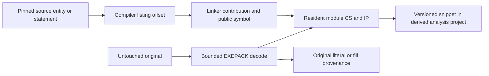

# CivD verified builds and source-to-original mappings

Follow-up: [shared food UIL, original-backed swaps and strategy Z design](CIVD_SHARED_FOOD_AND_Z.md)
adds finite execution evidence without upgrading these earlier static records.

This extends the [source/concept pilot](SOURCE_CONCEPT_SEARCH.md) with actual
period-toolchain builds and persistent mappings to original DOS Civilization
bytes. Three editions were built independently: 474.01, 474.03 and 474.05.
All five pinned output hashes match in every edition: raw LINK output, corrected
game, graphics driver, sound driver and MISC utility.

The three CIV.EXE outputs also match the existing private originals. Those
originals were only read, never mounted in the build environment. No game was
executed. The compiler, assembler and linker ran inside DOSBox-X.

## Build evidence and the explicit exception

| Edition | Source revision | Emulated build time |
| --- | --- | ---: |
| 474.01 | `c425f7ba45411111c7c71d926e1ce8d4fa641571` | 47.60 s |
| 474.03 | `9aefe00fce1b4d014bbc7a1dc9b2a25914cce9e5` | 47.58 s |
| 474.05 | `d9214fcd36aa6003d28aae60c3974b665f752280` | 47.93 s |

Fresh directories contain source copied byte-for-byte from pinned Git objects,
with no pre-existing objects. The recipe uses Microsoft C 5.1, MASM 5.10,
LINK 5.01 and MAKE 4.07. All 54 toolchain/header/library checksums pass before
and after. The exact MAKEFILE preserves flags, segment names, link order and
the CITYMGT low-memory compiler condition. The host emulator is the observed
DOSBox-X 2026.10.01 SDL2 build. The compiler archive matches its pinned SHA-512;
MASM comes from the upstream recipe's pinned Microsoft MS-DOS repository path.

The [upstream build notes](https://github.com/sjmelia/civd/blob/9aefe00fce1b4d014bbc7a1dc9b2a25914cce9e5/book/src/architecture/toolchain_clues.md)
declare a reconstruction exception: four startup-call destination bytes change
in the generated copy. Raw `CIVRAW.EXE` is retained and separately verified.

| Edition | Four corrected generated-file offsets |
| --- | --- |
| 474.01 | `0x205FE–0x20601` |
| 474.03 | `0x1FCB0–0x1FCB3` |
| 474.05 | `0x204CA–0x204CD` |

These are not edits to the user's originals. The catalog checks the exact delta
and refuses a selected compiler mapping if the correction intersects its code.
Matching the outputs does not establish the historical build procedure or
MicroProse's symbol names. CivD remains reconstructed source.

## Mapping packed originals

The originals have EXEPACK-compressed resident images and separate overlay
payloads. Compiler offsets, module addresses and original-file positions differ.



The new reader accepts the 16-byte RB-header profile exercised here. It checks
bounds, run records, relocations and the stub tail. Extended/unexplained profiles
are refused. Its output is a **resident-only static view**, with the original
overlay tail's identity recorded; it is not a qualified runnable game.

For each edition, the entire decoded module and ordered relocation list match
the independent [unEXEPACK decoder](https://github.com/w4kfu/unEXEPACK/tree/db26f9e2d23af37e6508436b62cb98cbbb86a275).
A separate LINK run on the checked objects, with packing disabled, yields exact
matching placements and bytes for all five selected functions. Original-file
literal spans are checked directly.

### Qualified locations

These are **link-relative CS:IP**, not file positions or running-guest addresses.
Add the chosen DOS load segment to CS for a loaded address. The private static
projects use load segment `0x1000`.

Segment names are labels, not final addresses: F0D12 lands at 0C91 in 474.03.
Word-aligned contributions can start within a paragraph. For example, the TURN
contribution starts at module offset 0x2388; object offset 0x8A becomes the
linker's 0238:0092. The mapper checks this arithmetic rather than assuming a
paragraph-aligned contribution or interpreting the segment name as an address.

| Source family | 474.01 | 474.03 | 474.05 |
| --- | --- | --- | --- |
| `tile_yield` | `0D07:68F0` | `0C91:6AB2` | `0D12:6ABC` |
| `add_tile_yield` | `0D07:6761` | `0C91:6923` | `0D12:692D` |
| `city_process` | `0D07:0043` | `0C91:003B` | `0D12:0045` |
| `civ_economy` | `0AD5:0008` | `0A5E:0002` | `0ADE:0006` |
| `game_turn` | `0237:0094` | `0238:0092` | `0238:0092` |
| Food-stock statement, CITYMGT.C:633 | `0D07:14CA` | `0C91:14D4` | `0D12:14DE` |

The food statement emits 13 instructions, 36 bytes, in each edition:

| Edition | Original-file literal start | Unpacked module offset |
| --- | --- | --- |
| 474.01 | `0xE526` | `0xE53A` |
| 474.03 | `0xDDD0` | `0xDDE4` |
| 474.05 | `0xE5EA` | `0xE5FE` |

Stored food gains worked-tile food after deducting citizen consumption and the
home-settler food bill. The source assigns these roles; its compiler-listed
update is located in original bytes. No dynamic inputs or resulting state were
observed.

Native instruction operands confirm 51 selected direct-call sites across:

```text
game_turn → civ_economy → city_process → add_tile_yield → tile_yield
                                      ↘ tile_yield
```

These calls are guarded: economy processing can be skipped on reload, and
city_process also has display/recalculation modes. The witnesses are static,
not a complete call graph or proof that each call executes in a turn.

## Persistence and propagation

The catalog copy contains three checked builds, 18 source/native mappings and
12 transfers from 474.03 into 474.01/474.05. Mappings retain source/build
identities, listing/map hashes, original identity, addresses, decoded-image
identity, packed provenance and immutable native snippet endpoints. Twelve
corresponding links also persist through the existing native snippet API.

Transfer first selects a same-name/path candidate; a statement also requires
an exact stripped source line. It then checks the target's own source, build,
listing and map. **It does not inherit the old address or qualification.**

- The 36-byte food update is byte-identical in 474.03 and 474.05.
- 474.01 has the same selected statement and different native bytes. Its parent
  city_process function differs and is 458 bytes shorter than the other two.
- Several helpers have identical source across editions but different linked
  bytes. Normalizing only DOS load-relocation words does not erase those
  differences; source bodies, statement identity and native identity are
  reported separately.
- Even the two identical blocks require their editions' data/stack environments.
  Byte equality grants neither semantic equivalence nor UDL admission.

The linker/listing/native-operand cross-check gives concrete adapter locations:

| Location | 474.01 | 474.03 | 474.05 |
| --- | --- | --- | --- |
| Link-relative data group | `2A1B` | `2A80` | `2B01` |
| City-array offset in that group | `706C` | `70EC` | `70EC` |
| Food-total offset | `705A` | `70DA` | `70DA` |
| Home-settler-count offset | `F2E6` | `E3C6` | `E3C6` |
| Settler food-cost local | `BP-46h` | `BP-48h` | `BP-48h` |

The city argument is at BP+6; records have stride 28, with population at +7 and
food stock at +12. These are static source/build bindings. Actual DS, SS, BP and
input values were not observed in a running game. The identical 474.03/474.05
instruction stream therefore still needs the appropriate data-group setup.

The city.food.stock concept now has reviewed relationships to these three mapped
source functions as well as its three field declarations. Concept lookup can
lead to native mapping lookup without claiming general source binding resolution.

## Agent interface and reproduction

`source-build` checks a receipt against captured source, staged inputs, artifacts,
output hashes, original identity and generated correction. `source-builds` lists
those witnesses. `source-map-native` maps a function or emitted line; optional
`project` captures the endpoint from that exact derived MZ project's version 1.
`source-native-maps` lists the results. `source-propagate-map` independently
qualifies a candidate in another snapshot, optionally with a target project.
`source-map-transfers` exposes correspondence and byte/source differences.

Compiler execution is an external build witness, not a signed attestation or
an operation performed by catalog import. Old catalogs gain tables only through
explicit build mutations; read queries do not migrate frozen experiments.
The original source snapshot's `build_verified=false` remains its historical
intake status. Query the added build witnesses for the new qualification rather
than rewriting that immutable declaration.

Repository runners: [civd_verified_build.py](../examples/recovery/civd_verified_build.py)
and [civd_native_links.py](../examples/recovery/civd_native_links.py).
The first takes a pinned checkout, checked tools, original, DOSBox executable
and a new directory. The second takes the frozen source catalog, private build
manifest, independent unpacker and a new directory.

For a plain relink, copy LINK.RSP to PLAIN.RSP and change only output names
CIV.EXE/CIV.MAP to PLAIN.EXE/PLAIN.MAP. With the same objects/libraries, run
`LINK /MAP /INF @PLAIN.RSP` in the private build directory. The mapping runner
checks each selected function against that output.

The public [receipt](evidence/civd-source-maps/verification.json) contains sanitized
hashes, locations, transfers, call sites and validation. Sources, tools,
objects/listings, executables, databases and native-code images stay private.
The earlier search experiment is unchanged.

## Scope and remaining work

Catalogs/native projects reopen and pass SQLite integrity; catalog foreign keys
pass. A separate diagnostic project copy retains parent version 1 after a
child-only immediate change; canonical projects remain on version 1.
Immutable snippets still validate. No executable file changes in that check.
SVG/PNG exports show all 13 stored food instructions from each original-derived
view, without a GUI.

Native traversal remains bounded and partial. Overlays, complete source binding
and def-use, gameplay, all-input behavior and UDL equivalence remain unqualified.
A next behavioral test would trace an actual turn under declared inputs and
compare these writes, with explicit data/ABI adapters before substitution.
