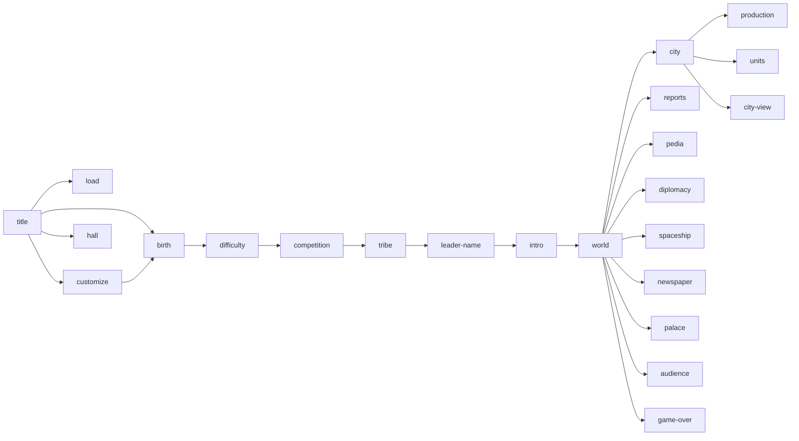

# Civilization game-level UIL scene

Status: **partial, source-linked scene graph and state projection; not a
playable whole-game reconstruction**.

Slice ID: `CIV-GAME-UIL-001`

## Question

Can the DOS game's screen boundaries, navigation actions and visible state be
represented once as executable UIL, using Civ64's DOS scene records for the
screen inventory, civd for source-shaped state, and the pinned `CIV.EXE` atlas
for address identity?

The answer is a bounded **yes**: the committed scene is a valid
`fdisbull-il-scene-1` document with 23 contexts, 95 objects and 47 programs.
It can be driven through the shared IL backend or Z text player. It is not a
claim that the game's simulation, assets, input decoding or save format has
been recovered.

## Files

| File | Role |
| --- | --- |
| `examples/civ/civ_game_uil.py` | deterministic builder, atlas resolver and headless validator |
| `examples/civ/civ_game_scene.json` | committed `fdisbull-il-scene-1` scene |
| `examples/civ/civ_game_scene.provenance.json` | screen/source/address index, state evidence and limits |
| `tests/test_civ_game_uil.py` | scene, transition, evidence and Z-player checks |

The existing city fixture remains the detailed city slice:
[`CIV_CITY_UI_SLICE.md`](CIV_CITY_UI_SLICE.md) and
[`CIV_CITY_UIL_UDC.md`](CIV_CITY_UIL_UDC.md). The game scene carries only the
city controls needed to move between the city, its production chooser, its
unit list and the city view.

## Edition and authority boundary

| Authority | Use here | Boundary |
| --- | --- | --- |
| Packed DOS `CIV.EXE`, SHA-256 `22de2748e3089793644c7e501e2a95b553010ddec34a7ff42f4395cf779c9c2a` | exact target identity | civd labels it 474.05; Civ64's DOS documentation labels the same bytes 475.05. The existing `CIV-EDITION-001` conflict remains open. |
| Generated `CIV_UNP.EXE`, SHA-256 `aa63aa396cfa62519b131ee6c0a231bed02bb9aefce26b955608b5815a569e57` | byte-identical unpacked source for the atlas | not a runtime observation and not copied into the repository |
| civd `d9214fcd36aa6003d28aae60c3974b665f752280` | function names, records and source-shaped behavior | reconstructed source; names and declarations remain claims |
| Civ64 `4e46572d727544722d90c24dc2ce51a9c6d22f15` | DOS scene inventory, geometry and interaction roles | **DOS listing**; Windows counterparts are kept separate |
| `examples/civ/civ_exe_atlas.json` | resolves every screen anchor to a civd function and source file | address resolution only; Windows/PE64 byte equivalence remains 0/21 |

## Scene graph



Dashed/omitted links are deliberate. `game-over` is represented for
inspection but its trigger conditions are outside the model. The diagram is a
navigation aid, not evidence that every original control has a binding.

## Screen inventory and address resolution

All **51** recorded screen anchors resolve to a civd function: **43 at a
function entry and 8 inside a function**. The full per-anchor record is in the
provenance file.

| Context | `$screen` | Civ64 section | civd source | Objects | Resolved anchors |
| --- | ---: | --- | --- | ---: | --- |
| `title` | 0 | SCENES.md 4.4-6 | GAME.C | 4 | R:01A8:0486 `_game_menu` (entry) |
| `load` | 1 | SCENES.md 7.2 | SAVE.C | 2 | O11:0000 `_load_game` (entry) |
| `customize` | 2 | SCENES.md 7.4 | GAME.C | 6 | R:01A8:0591 `_game_menu` (inside) |
| `birth` | 3 | SCENES.md 8 | WORLDGEN.C | 2 | O7:0012 `_make_world` (entry) |
| `difficulty` | 4 | SCENES.md 9.1 | NEWGAME.C | 5 | O5:0031 `_new_game` (inside) |
| `competition` | 5 | SCENES.md 9.2 | NEWGAME.C | 5 | O5:012E `_new_game` (inside) |
| `tribe` | 6 | SCENES.md 9.3 | NEWGAME.C | 3 | O5:0309 `_new_game` (inside) |
| `leader-name` | 7 | SCENES.md 9.4-9.5, 10.4 | NAMES.C | 2 | O23:00D6 `_rename_leader` (entry), O23:0414 `_edit_line` (entry) |
| `intro` | 8 | SCENES.md 9.6 | NEWGAME.C | 2 | O5:0657 `_new_game` (inside) |
| `world` | 9 | SCENES-PLAY.md 1-6 | MAP.C, TURN.C, CONTROL.C, UNITS.C | 14 | R:1AEA:0008 `_reveal` (entry), R:1AEA:03BA `_seen_map` (entry), R:0238:0FEA `_draw_banner` (entry), R:0238:107E `_status_draw` (entry), R:0403:4060 `_uinit` (entry), R:0403:0676 `_ai_turn` (inside), R:0866:0AD6 `_blink_unit` (entry), R:0866:1D55 `_anim_unit` (entry), R:0866:1F69 `_pick_unit` (entry) |
| `city` | 10 | SCENES-PLAY.md 7.1 | CITYMGT.C | 14 | R:0D12:0045 `_city_process` (entry), R:0D12:7045 `_draw_icon` (entry), R:0D12:710D `_tile_panel` (entry), R:0ADE:03EA `_kill` (entry), R:0ADE:0093 `_civ_economy` (inside), R:1459:0597 `_capunit` (inside) |
| `production` | 10 | SCENES-PLAY.md 7.12 | ECONOMY.C | 3 | R:0ADE:0421 `_find_slot` (entry) |
| `units` | 10 | SCENES-PLAY.md 7.1 | CITYMGT.C, CONTROL.C, UNITS.C | 5 | R:0403:4060 `_uinit` (entry), R:0866:1F69 `_pick_unit` (entry) |
| `city-view` | 11 | SCENES-PLAY.md 7.2-7.3 | CITYVIEW.C | 2 | O19:0000 `_city_scene` (entry), O19:167B `_invasion_scene` (entry), O19:18C1 `_riot_anim` (entry), O19:1AE1 `_love_anim` (entry) |
| `reports` | 12 | SCENES-PLAY.md 7.14 | ADVISORS.C, REPORTS.C, TURN.C | 7 | O14:0000 `_advisor_open` (entry), O14:186F `_city_rpt` (entry), O14:03AD `_mil_rpt` (entry), O14:014B `_sci_rpt` (entry), O14:07F1 `_trade_rpt` (entry), O12:0000 `_world_map` (entry) |
| `pedia` | 13 | SCENES-PLAY.md 7.13 | PEDIA.C | 3 | O8:0000 `_civilopedia` (entry), O8:062A `_pedia_show` (entry) |
| `diplomacy` | 14 | SCENES-PLAY.md 7.9-7.10 | AUDIENCE.C, DIPLOMAC.C | 3 | O6:1D2B `_load_leader` (entry), R:1517:04A1 `_set_government` (entry) |
| `spaceship` | 15 | SCENES-PLAY.md 7.16 | SPACESHP.C | 3 | O18:0000 `_spaceship_open` (entry), O18:0F83 `_spaceship_build` (entry) |
| `hall` | 16 | SCENES.md 7.5, SCENES-PLAY.md 7.17 | FAME.C | 2 | O3:002B `_fame_load` (entry), O3:00D7 `_show_fame` (entry) |
| `game-over` | 17 | SCENES-PLAY.md 7.17 | TURN.C, REPLAY.C | 2 | R:0238:0092 `_game_turn` (entry), O9:0DDE `_conquest_replay` (entry) |
| `newspaper` | 18 | SCENES-PLAY.md 7.7 | NEWS.C | 2 | O21:0000 `_news_box` (entry) |
| `palace` | 19 | SCENES-PLAY.md 7.8 | PALACE.C | 2 | O17:0000 `_palace_view` (entry) |
| `audience` | 20 | SCENES-PLAY.md 7.9 | AUDIENCE.C | 2 | O6:1D2B `_load_leader` (entry) |

Function names are civd's; the scene does not treat them as proof that the
full DOS screen behavior is reconstructed. For example, the atlas name
`_reveal` is retained for `R:1AEA:0008` even though Civ64's role is the map
redraw entry.

## State projection

The scene has one typed state shared by all programs. The provenance file
carries every field and its evidence; the important groups are:

| Field | Type | Evidence | Status |
| --- | --- | --- | --- |
| `$screen` | `u8` | UIL scene selector; no DOS symbol | authored |
| `$turn` | `u16` | `R:0238:0092` game loop | declared counter, not a full turn model |
| `$year` | `i16` | DGROUP:B220; Civ64 SCENES-PLAY 5.2 | display state only |
| `$difficulty` | `u8` | DGROUP:6B86 `_cur_tier`; civd GLOBALS.C:15, NEWGAME.C:54-62; Civ64 SCENES-PLAY 5.2 | source-bound 0..4; five menu rows write the field |
| `$competition` | `u8` | DGROUP:D2F4 `_civ_total`; civd GLOBALS.C:113, NEWGAME.C:73-76 | source-bound 6..2; five menu rows write the field |
| `$players` | `u8` | DGROUP:6B8A `_players`; civd GLOBALS.C:17, NEWGAME.C:77 | source-bound mask written with each competition row |
| `$rule_options` | `u8` | DGROUP:E3C4 `_rule_options`; civd GLOBALS.C:186, NEWGAME.C:82 | source-bound constant 15 at new game |
| `$tribe` | `u8` | DGROUP:D7F4 `_civ_tribe_of`; civd NEWGAME.C:141 | representative rows 1 and 9 write 1 and 9; other rows declared |
| `$human_civ` | `u8` | DGROUP:D7EE `_civnow`; civd NEWGAME.C:113-117; Civ64 SCENES-PLAY 7.19 | representative rows 1 and 9 write slot 1 |
| `$treasury` | `i32` | DGROUP:B1D6[civ]; Civ64 SCENES-PLAY 5.2 | declared economy state |
| `$tax_rate`, `$science_rate`, `$luxury_rate` | `u8` | DGROUP:DF0E/B210 and `10-tax-science`; Civ64 SCENES-PLAY 7.20 | declared rates |
| `$view_x`, `$view_y` | `u8` | DGROUP:D4CC/D75E; Civ64 SCENES-PLAY 3 | viewport projection |
| `$selected_city` | `u8` | selector into DGROUP:70EC records | declared index |
| `$selected_unit` | `u16` | selector into DGROUP:81D4 records | declared index |
| `$production` | `i16` | DGROUP:70EC + city*1Ch + 09h; civd `struct_city.md`, CITYMGT.C:1444 | bounded to unit codes 0/1 in this scene |
| `$shield_box` | `i16` | DGROUP:70EC + city*1Ch + 0Eh; CITYMGT.C:1433 | committed as `10*cost` |
| `$money`, `$unit_cost` | `i32`, `u16` | `money[selected_owner]`; `utypes[production].cost`; CITYMGT.C:1405, 1428-1434 | representative 1500 / 10 |
| `$improvement_cost`, `$improvement_index` | `u16`, `u8` | `improvements[-production].cost`; `-production`; CITYMGT.C:1409-1412 | representative 20 / 5 |
| `$buy_price`, `$buy_temp` | `u32` | rush-price scratch; CITYMGT.C:1406-1415 | derived per purchase |
| `$auto_build` | `bool` | DGROUP:70EC + city*1Ch + 06h bit 10h; CITYMGT.C:1380-1381 | source-bound toggle; no live observation |
| `$chooser_open`, `$unit_list_open` | `bool` | key `c` / key `a` contexts | UIL context flags |
| `$unit_count`, `$unit_cursor`, `$unit_last`, `$city_cursor` | `u8` | `unit_count_i` / `choice_f`; record at `[0x70DC]`; CITYMGT.C:1158-1165, 1515 | representative garrison 3; source clamps cursor 0..count-1 |
| `$report` | `u8` | F1-F10 table `R:0403 3B7D..3BFF` | declared selector |
| `$earth_world` | `bool` | DGROUP:D76A; Civ64 SCENES 7.3 | declared branch |
| `$game_over` | `bool` | UIL end-state flag | authored |

The difficulty binding is static/source-bound, not a live observation. civd
`NEWGAME.C:54-62` assigns `cur_tier` from the five menu rows, `GLOBALS.C:15`
declares the field, and the CIV.EXE linker public `_cur_tier` resolves to
DGROUP:6B86. Civ64 `SCENES-PLAY 5.2` reads `[6B86]` as the difficulty level.
The scene's five difficulty objects mirror rows 0..4 and each writes
`$difficulty`; `test_difficulty_menu_binds_all_five_cur_tier_rows` drives all
five through the shared IL backend.

Competition is bound the same way. The five rows display 7..3 civilizations;
civd `NEWGAME.C:73-76` maps row `r` to `_civ_total = clamp(6 - r, 2, 6)`, so
`$competition` is the internal 6..2 count, not the displayed total.
`NEWGAME.C:77` then writes `_players = 255 >> (6 - civ_total)`. The five scene
objects write both `$competition` and `$players` (0xFF, 0x7F, 0x3F, 0x1F,
0x0F); `test_competition_menu_binds_civ_total_and_players_mask` checks each
pair and the transition to `tribe`.

Two representative tribe rows are bound. With `$competition = 4`, `NEWGAME.C`
builds first-group rows 1..5 and second-group rows 9..13. Row 0 maps to
`civnow = 1` and `civ_tribe_of[1] = 1`; row 5 (the first second-group row) maps
to `civnow = 1` and `civ_tribe_of[1] = 9` after the `civnow & 7` and
`civnow + 8` branch. The scene binds both as `$human_civ = 1` with
`$tribe = 1` and `$tribe = 9`; the two tests check state and the transition to
`leader-name`. The remaining rows depend on the competition count and are not
modelled.

The city auto-build object binds `$auto_build` to `townbuf[city].status` bit
`0x10` (record offset `0x06`). The action toggles the bit and reports the new
state; `test_city_auto_build_toggles_status_projection` checks both directions.
City production is bound to record offset `0x09`.

The unit buy object computes
`clamp(10*cost-shield_box,0,999)^2/20 + 2*raw`, doubles it when the shield box
is empty, and requires the treasury to cover it. On commit it sets
`shield_box = 10*cost` and subtracts the price.

The improvement buy object uses the source's separate branch: the clamped raw
is doubled, doubled again when `-production > 21`, and doubled again when the
shield box is empty. A representative `-5` improvement is reachable from the
production chooser. The civil-disorder guard and real improvement/wonder names
are outside the scene.

The unit list exposes `next`, `previous` and `select`. `next`/`previous` clamp
the cursor to `0..unit_count_i-1` like `CITYMGT.C:1500-1515`; `select` stores
the cursor and closes the list. The scene uses a representative three-unit
garrison because `unit_count_i` is a local filled from `armydata`; the source
army-record moves/status/goto writes are not modelled.

The scene deliberately does **not** load a save, render a map, execute a turn,
run AI, resolve combat, advance technology or write a city record. Those are
separate slices.

## Entity index

| Entity | Evidence |
| --- | --- |
| Map | 80x50 world; 15x12 viewport; terrain/unit/improvement page map in Civ64 SCENES-PLAY 1.1 and 2 |
| City | 128 records of 28 bytes at DGROUP:70EC; civd `reference/struct_city.md`; Civ64 SCENES-PLAY 2.3 |
| Unit | `DGROUP:81D4 + civ*600h + unit*0Ch`; civd `reference/struct_unit.md`; Civ64 SCENES-PLAY 2.2 |
| Civilization | DGROUP:D7F0 player civilization; Civ64 SCENES-PLAY 7.19 |

## Reusable rule slices

The game scene links to, but does not duplicate, the qualified slices:

- [city shield step and buy contract](CIV_CITY_UIL_UDC.md#bounded-udc-module)
- [buy price, guard and commit](CIV_CITY_UIL_UDC.md#buy-price-guard-and-commit-module)
- [pathfinding trace](CIV_PATHFINDING_TRACE.md)
- [city input dispatch and static trace](CIV_CITY_STATIC_TRACE.md)

A navigation scene is not a rule engine. Binding a control to a state field
does not prove the original screen's display value or the rule's committed
code path.

## Executable checks

```bash
PYTHONPATH=src python examples/civ/civ_game_uil.py --check \
  --atlas examples/civ/civ_exe_atlas.json \
  --civd-src /path/to/civd/src

PYTHONPATH=src python -m pytest -q tests/test_civ_game_uil.py

PYTHONPATH=src:player python -m fdisbull_player \
  --backend-command "python -m fdisbull.il_scenes examples/civ/civ_game_scene.json"
```

The first command checks the scene against the shared IL validator and rejects
any unresolved anchor. The tests walk the startup path, city subcontexts, all
world overlays, the end-turn counter and the state-reachable game-over context.
The Z-player test uses the committed scene, not an in-memory rebuild.

Observed on this host with the active fDisBull 0.28.0 interpreter:

- `tests/test_civ_game_uil.py`: **14 passed**
- CIV-focused set (`game UIL`, `city UIL`, `atlas`, `city trace`, `city overlay`):
  **45 passed**
- full repository suite: **2,249 passed, 152 skipped, 2 failed, 23 errors**.
  The failures/errors are the existing Apple-toolchain Linux ELF fixture
  boundary (`/usr/bin/gcc` is Apple clang; missing `-z ibtplt` and Linux
  metadata), not this scene.

The scene is validated against the shared interpreter, but the evidence claims
remain static. No DOS screen was run for this slice.

## Limits and non-claims

- Partial scene graph and state projection, not a full simulation.
- No DOS execution, VGA rendering, palette/font/asset loading or input decoding.
- Difficulty and competition rows are bound to `cur_tier`, `civ_total` and
  `players`; tribe rows 1 and 9 are representative bindings; city auto-build
  toggles status bit `0x10`; unit-list navigation clamps over a representative
  3-unit garrison; buy computes unit and improvement rush prices and commits
  shields. Other tribe rows and rename remain declared, and no action has a
  live-screen observation.
- Unit-list navigation is cursor-only; select does not write army-record
  moves/status/goto. Buy uses representative cost/index/treasury reads; the
  disorder guard and real improvement/wonder names are absent. Sell, rename,
  text entry and report paging are absent. The detailed city fixture carries
  more city behavior.
- Turn advance only increments declared counters; economy, AI, movement, combat,
  research, diplomacy and victory conditions are outside the model.
- Game-over is state-reachable for inspection; its trigger conditions are not
  modelled.
- Address resolution is not Windows-to-DOS byte equivalence. See
  [`CIV_DOS_CIV64_CROSSWALK.md`](CIV_DOS_CIV64_CROSSWALK.md).
- The edition conflict between civd's 474.05 and Civ64's 475.05 remains open.

## Next probes

1. Model the remaining competition-dependent tribe rows; rows 1 and 9 are now
   representative bindings but the full dynamic menu is not generated.
2. Replace the representative garrison, treasury, unit cost and improvement
   cost/index with live reads.
3. Add a matched live-screen or DOSBox observation for one setup row so the
   source-bound scene claim can become bounded-observed.
4. Use the atlas's caller graph to add one bounded transition not yet modeled,
   such as the production chooser returning through `_city_process` after a
   commit.
5. Keep the scene at `partial: true` until a matching-edition backend supplies
   a baseline, one controlled action and a committed state change bound to the
   same record.
