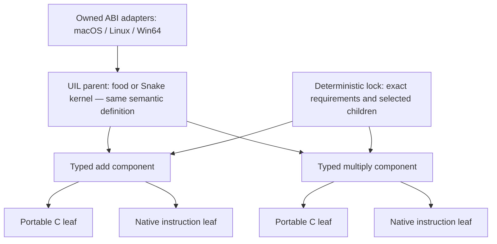

# Common UIL native realization and component linking

The common indexed UIL can be lowered to macOS ARM64, Linux x86-64 and Win64.
The entry points are `uil-link`, `uil-compile`, `uil-build`, `uil-seal` and
`uil-components`. Existing Python/JavaScript output remains available.

This profile realizes typed computation and planned effects. A native computation
probe is an executable with a bounded streaming protocol. It is distinct from an
OS window, a physical input device, audio playback and a complete game process.
The native pilots' portable-C kernel seam, compiler recipes and native image
checks are reused; their old source-selection database is not a dependency.

## Identity and responsibility

UIL describes meaning with indexed typed slots, functions, imports, control and
effects. Presentation supplies concrete values/resources. The existing
orchestration document selects a semantic implementation and owns argument/result
copies. A separate native link lock selects target realizations and their exact
intrinsic requirements. Changing a C/assembly component changes this lock and
the executable closure; it does not rewrite the UIL or its parent definition.

The native closure binds all four common documents, the link lock, target, ABI,
generator and dataflow profile. Source generation, compilation, image admission
and execution have separate receipts. A hash proves identity, not source
correspondence or that an executable was run.

## Nested components

A high-level operation can be a parent with replaceable child requirements.
For example, an image operation can declare decoding, layout and blitting
components, whose terminal implementations may be individual instruction
mappings. Component boundaries are typed interfaces with explicit effects and
requirements, rather than historical register names.

`describe_components` / `uil-components` returns a finite cascading graph of
eligible providers and their child requirements. The authored show-image →
decode/blit → atomic test is a metadata example; it does not implement or
qualify an image decoder. Describing a provider grants no execution authority.
The native builder admits only locally reconstructed built-in providers.

The executed native example is arithmetic: `add`, `sub`, `mul`, `and`, `or` and
`xor` each have portable-C and native-assembly children. A function can select
C for `add` and assembly for `mul` while retaining its parent semantic ID.
Other core operations currently use the fixed C realization. Register-only
assembly helpers use the target compiler's C ABI prologue/epilogue; clobbers are
declared and the logical fixed-width result is wrapped explicitly.



Each choice is per function or selected import, so different modules can use
different children. The same intrinsic contract is independent of the source
binary and origin language. Native counters record the children that execute;
the compiler can remove physical value copies while retaining logical charges.

## Deterministic requirements

Requirements, modules and providers have content-addressed identities.
Resolution checks exact intrinsic version, port types, target, ABI, ownership,
numeric profile and effects. Selected providers' own requirements are resolved
recursively. Missing or ambiguous providers, stale identities, conflicting
versions, cycles, incompatible or unused pins and exceeded graph budgets refuse.
There is no filesystem-first, latest-version, faster-provider or agent-generated
fallback policy.

The built-in contracts cover numeric operations, owned frame copying, budget
accounting and the version-1 planned text/image/sound/music services. A module
requiring `sound.play@2` refuses; version 1 is not silently substituted. The
planned-service contract grants no physical playback or callback completion.
Adding a foreign-language provider requires an admitted implementation and ABI
adapter, not merely a language label in metadata.

Per-module requirements use this form:

```json
{
  "functions": {
    "0": {"arithmetic": "portable-c"}
  },
  "implementations": {
    "implementation:<exact digest>": {
      "arithmetic": "portable-c",
      "components": {"add": "portable-c", "mul": "native-asm"},
      "requires": [{"intrinsic": "sound.play", "version": 2}]
    }
  }
}
```

The example intentionally requires an unavailable service version to demonstrate
refusal. Omit that requirement for the supported mixed arithmetic realization.
Function keys are decimal zero-based indices; imported-module overrides use
exact selected implementation IDs. Shorthand requirements refer to known typed
contracts; a new intrinsic needs its full typed contract.

## Instruction correspondence and copy pruning

The bounded x86 source adapter admits same-width general-register MOV in
addition to INC/ADD/ADC. MOV preserves every declared flag. Memory, privileged
registers, arbitrary instruction streams, register alias merges and traps are
not inferred. Independent instruction descriptions can remain recoverable
children when a larger UIL operation is established.

Native scalar lowering uses deterministic value numbering for straight-line
set/require/return bodies and transparent groups. A copy of a slot refers to an
immutable value ID; overwriting its original slot later cannot change that
snapshot. The lowering omits the temporary physical copy, retains its logical
execution charge and materializes every final logical slot, including flags.
The source function and its hash remain unchanged; source paths and eliminated
copy mappings are retained in the native source record. A budget exhaustion
therefore refuses at the same logical boundary. Arrays, effects, calls and
control flow retain the ordinary lowering rather than an unproved propagation.

This implements value transfer independently of EAX/EBX/ECX placement. It does
not claim arbitrary 6502↔68000 instruction equivalence, nor authorize dropping
observable carry, memory, ordering or device behavior.

## Build and observe

Choose a new private output directory outside Git. Apply the workspace's storage
admission policy before builds and keep temporary output on the admitted pool.

```sh
fdisbull uil-link program.json --presentation presentation.json \
  --catalog catalog.json --orchestration orchestration.json \
  --target macos-arm64 --arithmetic native-asm

fdisbull uil-compile program.json --presentation presentation.json \
  --catalog catalog.json --orchestration orchestration.json \
  --target macos-arm64 --arithmetic native-asm --output /private/new-native
```

Use `--module-requirements requirements.json` for per-child choices. Targets are
`macos-arm64`, `linux-x64`, and `windows-x64`. Default compiler recipes use clang
with an explicit Apple ARM64 triple, Linux x86-64 GCC, and x86-64 MinGW GCC.
The final image and relocatable objects are checked for the requested format
and architecture. Win64 is a console probe, not a GUI application.

For compilation in another prepared environment, add `--source-only`, transfer
the private generated directory, then use `uil-build OUTPUT`. Alternatively,
`uil-seal OUTPUT` admits externally compiled objects and the executable against
the retained source/ABI/profile. External compiler evidence is a declaration;
image admission alone does not prove compiler correspondence or execution.
Sealed source identities, recipes and generator profiles are revalidated.
Compiler temporary storage must remain the owned `OUTPUT/tmp` directory.

An effects-free entry with one matching u32-array input/output also exports the
existing native arena ABI, `FdbBlockResult fdb_block(uint32_t *words)`, declared
in generated `native-core.h`. The adapter widens into owned typed state and
commits back only on completion. Refusal preserves the caller's arena. The
result retains step count and `cut=0`; local capture is unsupported. Compile
with `FDB_NATIVE_NO_MAIN` when linking it into an existing C host. This is an
ABI-compatible computation seam, not qualification of a new AppKit, X11 or
Win32 window. Other entry shapes explicitly report this adapter unavailable.

`run_native_records` in `fdisbull.uil_native_codegen` encodes typed entry inputs,
runs an explicit command and decodes identity-bound result records. The bounded
protocol uses unsigned 64-bit little-endian carriers with explicit logical
width/sign checks. It refuses truncation, wrong counts, stale identity, invalid
typed bodies and trailing bytes. Refusal returns original state; effects return
`pending_host` with original committed state and separate proposed state.

Numeric/bool/resource slots and fixed arrays are admitted. Text-typed slots
refuse; text resources can still appear in planned effects. Calls expose actual
implementation identity, status and arity, with a declared
`identity-and-counts-only` diagnostic profile. Full import argument snapshots are
not part of that native ledger. Real entry state/results remain complete.
Per-operation counters establish which C/assembly helpers actually ran.

## Qualification

The public authored fixtures select closed food and memory kernels through an
actual indexed import. They compare the common reference with native output,
verify that the selected import and arithmetic helpers executed, and preserve
program/presentation/catalog/orchestration identity while choices change.
The mixed-component test executes C addition and native multiplication under
one parent contract. Native test output uses an explicitly admitted external
directory through `FDISBULL_NATIVE_TEST_ROOT`.

Private original-food qualification executes three original 36-byte kernels on
2,018 vectors. The original Snake instruction route observes 600 cells plus 14
scalars (614 fields). Its 342 prepared cases and 26 carried route calls are
separate from full 70,000-word model comparisons, rendering and normalized
keyboard/pointer actions. Neither edge is a complete original game process.
The [common conformance guide](COMMON_UIL_CONFORMANCE.md) explains the earlier
source/model/output edges; dated native receipts qualify their exact source
hashes and runtime environments only.

The dated [sanitized native receipt](evidence/common-uil-native-2026-11-01/verification.json)
records the six final executions: three targets, each with C and assembly
providers. Each profile completed 124 native processes and 2,420 records, with
6,054 food-source comparisons, the full retained Snake model/action checks and
368 original Snake kernel/route comparisons. All profiles used identical common
program digests and reported zero mismatches. Provider counters establish the
selected helpers actually executed; they are not instruction counts or speed
measurements.

macOS ran ARM64 Mach-O processes on the Mac. Linux ran x86-64 ELF processes in an
AMD64 Linux container using Rosetta. Win64 ran AMD64 PE console processes under
Wine 10 in that environment; Microsoft Windows OS execution remains unqualified.
Strict GCC 14 and MinGW builds also compiled all five large bodies with both
providers. GCC/Clang portability fixes retained strict warnings rather than
weakening compiler checks. Original executables remained byte-identical.
