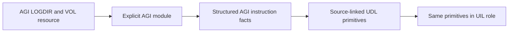

# Direct source decoder modules

Interpreted game code is an input in its own instruction language. The DOS
interpreter executable is a different input. AGI logic and Z-machine story
instructions can be inspected without an x86 disassembly or native project.
ASM-backed recovery remains useful when the guest language is unknown or when
investigating the interpreter itself.



## Implemented foundation

`fdisbull.decoder_modules.DecoderRegistry` registers trusted Python module
objects explicitly. A descriptor pins identity, contract version, source format
and capabilities. Each opener supplies a processor, its own address space/unit,
an immutable built-in source snapshot and a candidate entry. Changed registered
module or opened processor descriptors are refused. No input file can name a
Python import, and installed packages are not scanned for executable plugins.
Registered code runs with the application's privileges; this is not isolation.

Two independent built-ins are registered:

| Identity | Input | Available operations |
| --- | --- | --- |
| `fdisbull.agi.2.917.subset` | Explicit uncompressed AGI v2 LOGDIR/VOL resources | Partial instruction facts/static successors; scalar conditions, acyclic branches and captured direct calls to UDL/UIL |
| `fdisbull.zmachine.v3` | Structurally/checksum-qualified raw v3 story, independent of filename | Existing Z-machine processor facts/static successors; this module has no semantic lifter |

The `2.917` profile is a caller selection, not detection of a target's interpreter
revision. Unsupported opcodes retain unknown successors; a budget stop, malformed
encoding, missing target or overlapping encoding keeps analysis incomplete.
`complete` covers selected static edges, including a closed cycle. It proves
neither termination nor runtime reachability. An explicitly selected offset is
a candidate boundary. Analysis currently requires exact byte spans; registration
and the underlying processor seam also admit other named address units, which
need their own traversal adapter.

The snapshot key binds the module and processor revisions, source metadata,
entry and captured program-byte digest. AGI locations identify a logic ID and
payload digest; identical payloads in different containers can share a local
location. **Use `(snapshot, location)` for a source occurrence.** The separate
LOGDIR and complete VOL digests distinguish those occurrences. Payload-relative
instruction ranges, code-relative offsets and VOL-file offsets are retained
separately. Source metadata is finite, bounded JSON and is returned as a copy.
Opening a source captures bytes once; changing the files requires another open
and does not silently alter an existing input.

## Commands and Python

```text
fdisbull decoder-modules
fdisbull module-analyze fdisbull.agi.2.917.subset /private/game/LOGDIR \
  --volume-dir /private/game --logic 1 --profile 2.917 --max-instructions 40
fdisbull module-analyze fdisbull.zmachine.v3 /private/story --max-instructions 40
fdisbull module-lift fdisbull.agi.2.917.subset /private/game/LOGDIR \
  --volume-dir /private/game --logic 1 --profile 2.917 \
  --state-file /private/touched-state.json
```

These projectless JSON methods also work through `request` or an existing
`serve` connection. They do not inherit its default native project. The CLI uses
the core output limits/artifact handles. JSON `module-lift` accepts an
`initial_state` object instead of `state_file`; supplying both is an error.

```python
from fdisbull.decoder_modules import builtin_registry, analyze_input, lift_input

source = builtin_registry().open(
    "fdisbull.agi.2.917.subset", "/private/game/LOGDIR",
    volume_dir="/private/game", logic=1, profile="2.917")
facts = analyze_input(source, max_instructions=40)
# For an admitted fragment that touches only variable 7 and flag 4:
projection = lift_input(source, initial_state={"$agi_v7": 12, "$agi_f4": False})
```

Implement another front end by registering an object with `info` and
`open(source, **options) -> DecoderInput`, using `capture_input` to bind the
processor, immutable program, entry, metadata and optional lifter together.
Normal copies with altered provenance or a mismatched inherited lifter refuse
analysis, lifting and snapshot identity. This is an API consistency guard, not
protection against arbitrary registered Python replacing that guard. Extensions
with other program representations own their immutability/revision checks.
Use a fresh registry in tests, retain
the actual source encoding, declare capabilities truthfully and implement the
[processor seam](PROCESSOR_MODULES.md) for instruction facts. Container parsing,
instruction decoding, semantic lifting, execution and UDC emission have
separate contracts. A container variant should reuse the matching decoder.
For byte programs, source metadata must include the actual `program_sha256`;
an inconsistent source/program pair is rejected when constructed.

## AGI scalar components and logic calls

The AGI processor/module contract revision is `2`. The existing straight-line
`assignn`/flag set/reset interface and its v1 projection remain available. New
controlled projections use `fdisbull-agi-state-projection-2`, lowering to the
same `fdisbull-il-1` UDL/UIL primitives. The shared numeric condition `lt` is
additive; it compares mathematical typed integer values and refuses booleans.

The supported scalar subset includes assignments/copies, wrapping byte add/sub,
saturating increment/decrement and flag set/reset/toggle. Conditions support
`equaln/equalv`, `lessn/lessv`, `greatern/greaterv` and `isset`, with pure AND,
OR and NOT. OR lowers through AND/NOT; runtime parser predicates such as `said`
are refused. Both branches are compiled even when the initial witness would
select only one. No target or control path is guessed from that witness.

An acyclic goto/if graph lowers to structured `if` and ordered primitives.
Shared joins may be expanded into multiple IL instances with unique IDs;
evidence still refers to the original resource span. A direct `call` lowers
with an explicit return stack, shared variables and the correct caller resume
offset on each returning path. `call.v`, recursion and cyclic control flow
remain unqualified. Generic `module-analyze` retains the external call edge as
unresolved; the semantic lifter separately binds explicitly captured resources.

**Every callee needs a scan-entry witness.** AGI can resume cached logic at its
`sIP`; entering at byte zero is not always correct. `--callee-entry LOGIC:OFFSET`
captures the callee and supplies that code-relative entry. Engine payload `sIP=2`
corresponds to code offset `0`. Snapshots with inconsistent LOGDIR or VOL bytes
are rejected. Calls do not mutate these entry witnesses; scan-start-changing
opcodes are outside the admitted subset.

Nonzero root/callee entries and stop points must also be candidate instruction
boundaries established through known static edges from code zero. An operand
byte cannot be relabeled as an entry. Unknown lengths are not guessed; failure
to establish a boundary or exhausting that separate 4096-instruction/256 KiB
evidence budget refuses the component. `boundary_checks` retain source/revision,
basis and unresolved-path counts. These checks establish static candidates;
the caller's claim about the cached runtime `sIP` remains an explicit assumption,
with `runtime_observed: false` rather than an invented runtime observation.

```text
fdisbull module-lift fdisbull.agi.2.917.subset /private/game/LOGDIR \
  --volume-dir /private/game --logic 27 --profile 2.917 \
  --entry-offset 92 --callee-entry 103:0 --stop-point 103:0 \
  --state-file /private/empty-state.json
```

That example declares a component ending at the callee's entry; it does not
claim to execute or recover its body. `--stop-offset OFFSET` declares a root
boundary; `--stop-point LOGIC:OFFSET` declares one in any captured resource.
**A boundary inside a callee ends the whole component there. Its caller does
not resume.** `exits` retains the suspended caller stack and marks its
continuation `not_executed`. Omitting that boundary requires the full reachable
callee body to be supported and return normally. Boundaries are explicit
observation contracts, not inferred scene readiness or original-runtime stops.

JSON/Python use `entry_offset`, root `stop_offsets`, `stop_points` as integer
logic/offset pairs, and `callee_entries` as a logic-to-entry object. Python
`lift_logic` additionally receives immutable resources in `callees`; the module
opener captures them from the selected directory/volumes. All reads and writes
across reachable alternatives require exactly typed `$agi_vN` u8 and `$agi_fN`
bool initial values. Unobserved globals are outside the projection's state
frame. Unsupported paths are rejected before a program is qualified, including
paths inactive for that particular witness.

Root returns retain an unknown external caller continuation. The projection
describes scalar state and selected source control at its declared boundary,
not engine workarounds, asynchronous observations, scheduling, parser, room,
graphics, sound or other runtime effects. `block_sources` identifies source
entries for executed IL `visited` IDs; true `require` markers retain call,
goto, return and component-stop locations. This is a source-model trace, not
an original-interpreter instruction trace. These scalar operations were
cross-checked against ScummVM's AGI
[command implementations](https://github.com/scummvm/scummvm/blob/f7403b6efaae2f033e8abea80b3fb6bee5303369/engines/agi/op_cmd.cpp)
and [predicate implementations](https://github.com/scummvm/scummvm/blob/f7403b6efaae2f033e8abea80b3fb6bee5303369/engines/agi/op_test.cpp).
Authored independent finite-state tests cover byte inputs/constants, flags and
ordered repeated writes. Call/return and component-stop tests, an independent
private reference interpreter and a bounded Z3 model check have separate scopes;
none establishes original-game equivalence. Source instructions (128), call
depth (8), path depth (256), expansion (4096), IL nodes (1024), document bytes
(65536) and IL nesting (32) are separately bounded. Exhaustion refuses the lift;
no partially built program is returned as qualified. An `execute_il` refusal or
step-budget stop is not successful source execution.

## Next independently qualified modules

Extend loops, dynamic calls and engine actions against independent semantics
and original-interpreter observations. Define a versioned structured
source interchange when its meaning and provenance are agreed; no language
called SDL is invented here. Scene/Z recovery can consume these source facts
without going through the DOS interpreter's ASM. Reuse the container extraction
work in PR #53 and source-intent recovery in PR #32 where applicable.

Generic persistence needs a separate source/multi-space database migration with
restart, version and stale-link tests. UDC output needs its own resource/engine
contract and behavior checks. This foundation does not implement a complete AGI
interpreter, AGI regeneration, room converter or whole-game reconstruction.
Private resources, byte-retaining snapshots, state witnesses and output
artifacts belong outside the checkout and distribution.
