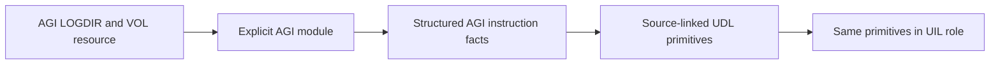

# Direct source decoder modules

Interpreted game code is an input in its own instruction language. The DOS
interpreter executable is a different input. AGI logic and Z-machine story
instructions can be inspected without an x86 disassembly or native project.
ASM-backed recovery remains useful when the guest language is unknown or when
investigating the interpreter itself.



## Implemented foundation

`fdisbull.decoder_modules.DecoderRegistry` registers trusted Python module
objects explicitly. A descriptor pins identity, contract version, source format
and capabilities. Each opener supplies a processor, its own address space/unit,
an immutable built-in source snapshot and a candidate entry. Changed registered
module or opened processor descriptors are refused. No input file can name a
Python import, and installed packages are not scanned for executable plugins.
Registered code runs with the application's privileges; this is not isolation.

Two independent built-ins are registered:

| Identity | Input | Available operations |
| --- | --- | --- |
| `fdisbull.agi.2.917.subset` | An explicitly selected uncompressed AGI v2 LOGDIR/VOL logic resource | Partial instruction facts/static successors; qualified straight-line state projection to UDL/UIL |
| `fdisbull.zmachine.v3` | Structurally/checksum-qualified raw v3 story, independent of filename | Existing Z-machine processor facts/static successors; this module has no semantic lifter |

The `2.917` profile is a caller selection, not detection of a target's interpreter
revision. Unsupported opcodes retain unknown successors; a budget stop, malformed
encoding, missing target or overlapping encoding keeps analysis incomplete.
`complete` covers selected static edges, including a closed cycle. It proves
neither termination nor runtime reachability. An explicitly selected offset is
a candidate boundary. Analysis currently requires exact byte spans; registration
and the underlying processor seam also admit other named address units, which
need their own traversal adapter.

The snapshot key binds the module and processor revisions, source metadata,
entry and captured program-byte digest. AGI locations identify a logic ID and
payload digest; identical payloads in different containers can share a local
location. **Use `(snapshot, location)` for a source occurrence.** The separate
LOGDIR and complete VOL digests distinguish those occurrences. Payload-relative
instruction ranges, code-relative offsets and VOL-file offsets are retained
separately. Source metadata is finite, bounded JSON and is returned as a copy.
Opening a source captures bytes once; changing the files requires another open
and does not silently alter an existing input.

## Commands and Python

```text
fdisbull decoder-modules
fdisbull module-analyze fdisbull.agi.2.917.subset /private/game/LOGDIR \
  --volume-dir /private/game --logic 1 --profile 2.917 --max-instructions 40
fdisbull module-analyze fdisbull.zmachine.v3 /private/story --max-instructions 40
fdisbull module-lift fdisbull.agi.2.917.subset /private/game/LOGDIR \
  --volume-dir /private/game --logic 1 --profile 2.917 \
  --state-file /private/touched-state.json
```

These projectless JSON methods also work through `request` or an existing
`serve` connection. They do not inherit its default native project. The CLI uses
the core output limits/artifact handles. JSON `module-lift` accepts an
`initial_state` object instead of `state_file`; supplying both is an error.

```python
from fdisbull.decoder_modules import builtin_registry, analyze_input, lift_input

source = builtin_registry().open(
    "fdisbull.agi.2.917.subset", "/private/game/LOGDIR",
    volume_dir="/private/game", logic=1, profile="2.917")
facts = analyze_input(source, max_instructions=40)
# For an admitted fragment that touches only variable 7 and flag 4:
projection = lift_input(source, initial_state={"$agi_v7": 12, "$agi_f4": False})
```

Implement another front end by registering an object with `info` and
`open(source, **options) -> DecoderInput`, using `capture_input` to bind the
processor, immutable program, entry, metadata and optional lifter together.
Normal copies with altered provenance or a mismatched inherited lifter refuse
analysis, lifting and snapshot identity. This is an API consistency guard, not
protection against arbitrary registered Python replacing that guard. Extensions
with other program representations own their immutability/revision checks.
Use a fresh registry in tests, retain
the actual source encoding, declare capabilities truthfully and implement the
[processor seam](PROCESSOR_MODULES.md) for instruction facts. Container parsing,
instruction decoding, semantic lifting, execution and UDC emission have
separate contracts. A container variant should reuse the matching decoder.
For byte programs, source metadata must include the actual `program_sha256`;
an inconsistent source/program pair is rejected when constructed.

## First AGI semantic slice

The implemented lifter accepts a complete straight-line fragment containing
`assignn`, flag `set` and `reset`, followed by a final `return`. It consumes
validated structured AGI facts directly. There is no native ASM intermediate.
Variable indices retain 8-bit values; flags retain booleans. The caller supplies
exactly the touched `$agi_vN`/`$agi_fN` initial values with correct types. The
lifter never invents a runtime state. Ordered shared `set` primitives retain
the source span and original encoding in their evidence. UDL and UIL use the
existing `fdisbull-il-1` structure; their role distinguishes source abstraction
from output behavior.

The return is an explicit external boundary with an unknown caller
continuation. The projection describes scalar state at that boundary, not
engine workarounds, intermediate debugger observations, scheduling, parser,
room, graphics, sound or other runtime effects. These scalar operations were
cross-checked against ScummVM's AGI
[command implementations](https://github.com/scummvm/scummvm/blob/master/engines/agi/op_cmd.cpp).
Authored independent finite-state tests cover byte inputs/constants, flags and
ordered repeated writes. They establish this bounded projection, not game
equivalence. Branches, calls, unsupported operations, truncation, stale source
metadata, trailing code and exhausted budgets refuse the lift. No partial
program is returned as qualified. Original game logic usually requires more
operations than this initial subset.

## Next independently qualified modules

Extend AGI conditions/control, calls and engine actions against independent
semantics and original-interpreter observations. Define a versioned structured
source interchange when its meaning and provenance are agreed; no language
called SDL is invented here. Scene/Z recovery can consume these source facts
without going through the DOS interpreter's ASM. Reuse the container extraction
work in PR #53 and source-intent recovery in PR #32 where applicable.

Generic persistence needs a separate source/multi-space database migration with
restart, version and stale-link tests. UDC output needs its own resource/engine
contract and behavior checks. This foundation does not implement a complete AGI
interpreter, AGI regeneration, room converter or whole-game reconstruction.
Private resources, byte-retaining snapshots, state witnesses and output
artifacts belong outside the checkout and distribution.
