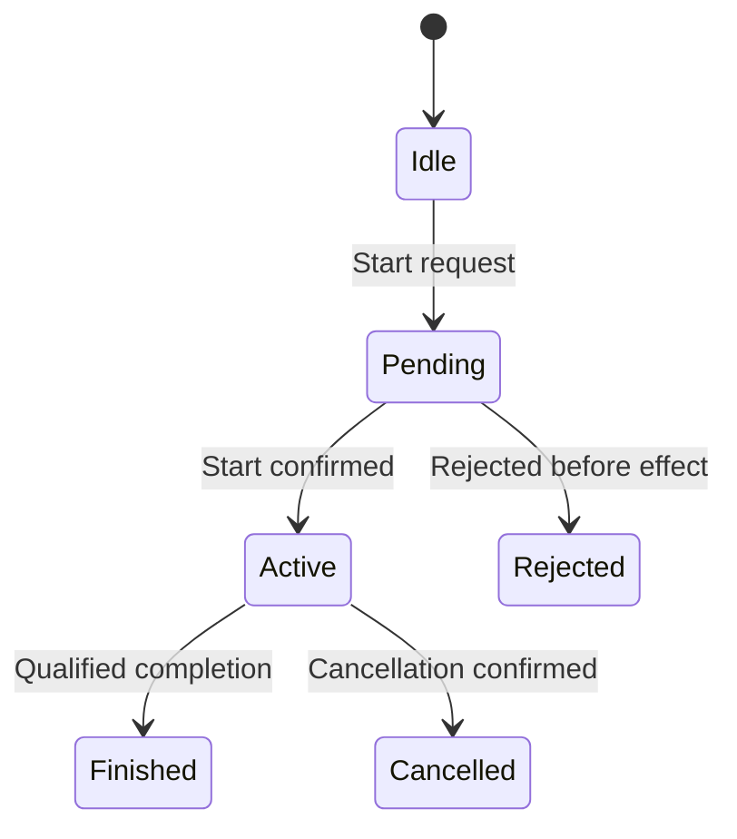

# Factorio, UIL, and a Python host media boundary

Research and design note, 2026-11-05. Repository evidence is pinned to
[`242e5343f5aa55dec95af3a49668a71ae14982c6`](https://gitlab.com/brewster-jennings-group/fdisbull/-/tree/242e5343f5aa55dec95af3a49668a71ae14982c6).
Factorio findings below come from Wube's public engineering articles and API
documentation. No Factorio executable was lifted, patched, or run for this note.
The proposed media provider is not an implemented or qualified backend.

## Recommendation

Use a portable, explicit media contract and let a persistent Python provider
realize it through host libraries. Keep Python as one possible UDC implementation.
UIL should describe the operation and its observable behavior without requiring
Python, a particular audio library, or an original machine's device interface.

This concentrates platform work in reusable adapters. It does not reduce the
remaining dependencies to CPU, architecture, and OS: the retained original code,
calling convention, memory model, Python runtime, native media libraries, codecs,
drivers, input, clocks, and persistence still need declared support.

There is already a useful starting point. The
[common UIL contract](COMMON_UIL_CONTRACT.md#orchestration-shims-and-effects)
defines `sound.play`, `music.start`, and `image.show`. These produce ordered
effect plans and `pending_host` results; they do not play audio or open windows.
The next implementation would qualify a host executor for those plans. Animation
requires recovered timing and lifecycle semantics before choosing a representation.

## 1. What Factorio contributes to the UIL model

### Language and division of work

Wube identifies Factorio as C++ with a custom engine and Lua modding. Its mod
lifecycle separates startup prototype construction from runtime scripting; mods
also have a defined load and event order.
[Sources: press kit](https://factorio.com/support/press-kit),
[data lifecycle](https://lua-api.factorio.com/latest/auxiliary/data-lifecycle.html).

The useful research question is which behaviors a portable representation must
preserve. The following is an analytical decomposition, not recovered Factorio
class layouts or a proposed replacement for its C++ engine:

| Behavioral concern | State the representation must retain | Observable transition |
| --- | --- | --- |
| Production | Recipe selection, ingredients, output capacity, progress, energy and relevant modifiers | Start, advance, block, finish, or interrupt work |
| Transport | Item identity/order, position or equivalent progress, capacity and connectivity | Transfer ownership or advance an item without changing required ordering |
| Networks | Membership, connectivity, available resources and pending requests | Reconnect, supply, allocate, reserve, release or invalidate dependent work |
| Agents and vehicles | Task, route, progress, reservations and interaction state | Move, arrive, load, unload, fight or choose another task |
| Scripts and players | Ordered commands, script state and event handlers | Apply an action or deliver a specified event |
| Persistence and replay | Logical time, random state and any pending work needed for continuation | Resume the same admitted behavior after a restore |

These concerns compose into a world that continues evolving between player
actions. Scheduling matters because operations share resources and observe one
another's state. A throughput-only model can be useful for planning, but equal
average output does not establish equivalent item ordering, interruptions,
transient state, or interaction behavior.

### Time and update order are behavior

The public runtime API defines normal speed as 60 updates per second and exposes
map tick, pause, and bounded tick advancement. A simulation tick, rendered frame,
network packet and elapsed wall-clock interval are distinct quantities.
[Source: LuaGameScript](https://lua-api.factorio.com/latest/classes/LuaGameScript.html).

For reasoning, write the authoritative transition as
`W[t+1] = F(W[t], ordered_actions[t], rules)`. This is mathematical shorthand,
not an existing UIL instruction. `W` includes hidden state needed for subsequent
behavior, including relevant RNG state and work in progress. The exact engine,
mods, prototype data and settings identify the selected rules.

This notation does not imply that every subsystem reads an immutable old world
and publishes simultaneously. A recovered contract must say when writes become
visible, how competing operations are ordered, and which ties are observable.
Changing these rules can change behavior even if every individual calculation
looks correct. A concrete example of order sensitivity appears in Wube's
[2.0 fluid-design article](https://factorio.com/blog/post/fff-430); that article
describes a particular historical design, not a universal fluid specification.

### Efficient scheduling need not reproduce every original update

Wube's engineering history gives three useful examples:

- Adjacent belt sections can be represented as transport lines, with spacing
  between items reducing repeated position work
  ([FFF-176, 2017](https://factorio.com/blog/post/fff-176)).
- Sleeping inserters and deterministic processing of transport-line wake-up
  requests reduce unnecessary updates while preserving reproducibility
  ([FFF-364, 2021](https://factorio.com/blog/post/fff-364)).
- Robot movement intentions let rendering derive intermediate positions, and
  inactive roboports can avoid most updates until work arrives
  ([FFF-421, 2024](https://factorio.com/blog/post/fff-421)).

The UIL implication is an inference: describe the state changes, ordering,
observations and wake-up conditions that matter, then permit a realization to
batch or defer internal work only when those observables are preserved.
Do not add a general scheduler opcode merely because Factorio has many updates.
Start with bounded recovered operations and compose them under explicit timing
and ownership contracts.

### How multiplayer propagates the world

Wube describes deterministic replication: clients simulate their own world from
the same input actions, with the server coordinating the tick in which actions
apply. The canonical Game State is distinct from a smaller Latency State used
for responsive local prediction.
[Source: FFF-302, 2019](https://factorio.com/blog/post/fff-302).

A joining client first loads a map snapshot while retaining incoming actions,
then simulates forward to catch up. This is initial state transfer followed by
continued input replication, rather than sending every factory consequence as
an entity update. Messages can contain multiple actions; simulation frequency
does not specify packet frequency.
[Source: FFF-149, 2016](https://factorio.com/blog/post/fff-149).

Consistency checks and desync recovery are separate mechanisms. A matching
checksum is a useful divergence check, not a proof that two implementations
match the original on all inputs. No fixed checksum cadence or current wire
format is claimed here.
[Sources: FFF-188](https://factorio.com/blog/post/fff-188),
[LuaGameScript force_crc](https://lua-api.factorio.com/latest/classes/LuaGameScript.html#force_crc).

For fDisBull, this suggests two distinct future experiments:

| Experiment | Authority | What it could establish |
| --- | --- | --- |
| Observe an original engine through an adapter | The original engine owns the world | Bounded input/output and state-transition evidence |
| Run equivalent recovered transitions on several hosts | Each admitted realization evolves the same logical state | Deterministic replay and cross-backend agreement within a qualified scope |

The second does not automatically prove the first. Nor does Factorio's
multiplayer distribute different pieces of the factory simulation among clients.
The design depends on replicas reaching consistent results.

The Factorio Learning Environment is a relevant observation precedent: its
authors describe Python tools controlling an original headless Factorio server
through Lua/RCON. That is an external control and observation layer, not a
Python reimplementation or evidence of renderer replacement. Treat observations
as belonging to a specified simulation time, and pin the supported game version.
[Source: FLE author paper](https://jackhopkins.github.io/factorio-learning-environment/assets/documents/paper.pdf).

## 2. Reuse the existing UIL service boundary

At the inspected revision, the definitions in
[`common_uil.py`](../src/fdisbull/common_uil.py) admit the following mapping:

| Requested Python-facing name | Existing common UIL service | Current scope |
| --- | --- | --- |
| `play_sound` | `sound.play(resource)` | Ordered request using a sound resource |
| `start_music` | `music.start(resource, looping)` | Ordered request using a music resource and Boolean loop argument |
| `show_image` | `image.show(resource)` | Ordered request using a graphic resource |
| A music stop operation | `music.stop(resource)` | Ordered stop request |
| `start_animation` | No corresponding service in this profile | Recover the contract, then decide on composition or a separately versioned capability |

The Python names could be convenience aliases in a future adapter. They are not
additional existing UIL operations or currently callable host APIs.
Position, layer, volume, playback handles, duration and completion callbacks
must not be silently appended to today's strict signatures or schemas.

The [current runtime contract](COMMON_UIL_CONTRACT.md) stages effects in order.
With effects present it returns `pending_host`, the original committed state,
and a separate proposed state. Failure discards staged, unexecuted plans.
There is no implication that a speaker emitted sound or a window displayed an
image. Host execution, lifetime management and recovery after a partial physical
effect remain separately qualified capabilities.

Also preserve the repository's terminology: **presentation** in this contract
means concrete program/data realization, including constant and resource
bindings. It is broader than a renderer. This proposal uses **host media
provider** for the component that realizes audiovisual effects.

### Where the language switch occurs

A bounded hybrid substitution follows this sequence:

1. Retained original code reaches a verified call or instruction boundary.
2. The source adapter captures arguments, permitted memory and the continuation
   using the original ABI and execution context.
3. It translates pointers, handles or resource indices into the admitted logical
   request, retaining required provenance and ownership.
4. The selected provider computes the result or accepts the media request.
5. The adapter writes only permitted results/state, preserves required registers,
   flags and stack behavior, and resumes at the qualified continuation.

A fully realized UIL program can issue the same logical service without
retaining the original call boundary. These are different execution routes,
with different qualification obligations.

Python embedding in a C/C++ application is supported, but the application still
needs a bridge that initializes the interpreter, converts arguments and invokes
the chosen callable. An already-compiled game does not acquire this connection
merely because a Python function exists.
[Source: CPython embedding documentation](https://docs.python.org/3/extending/embedding.html).

For retained DOS code, guest segmented pointers and guest execution state remain
the adapter's responsibility. A host callback cannot call a guest far pointer
directly. The existing [hardware-boundary analysis](UDC_HARDWARE_BOUNDARIES.md)
explains this distinction for mouse, timer and audio interfaces.

## 3. The RNG precedent and its limits

The retained experiments support three useful, distinct precedents. They do not
identify the exact remembered live native-to-Python-to-native handoff.

| Experiment | What the checked-in evidence establishes | What it does not establish |
| --- | --- | --- |
| Five Dice Python reference | Provider selection inside an authored Python game model | Python executing inside, or returning into, the DOS game |
| Five Dice DOS variants | Selected native RNG bodies and explicit byte placement/state adapters | A Python interpreter invoked during a DOS turn |
| Snake recovered RNG region | Recorded finite qualification and implementation switching for one recovered state update | General native stack/local transport or arbitrary live Python substitution |

### Five Dice: reference provider and native splice are separate

The [oracle README](../fixtures/freeware-games/five-dice/original/oracle/README.txt)
explicitly says that changing the Python binding does not change the DOS binary.
Both the surrounding `Game` and its `Provider` live in
[`demo.py`](../fixtures/freeware-games/five-dice/original/oracle/demo.py).
It is an authored reference, not an executed fDisBull UDC binding or a verified
recovery of the native game.

That reference still makes the boundary concrete: the provider owns a 16-bit
seed/state; LCG16 updates it as `(state * 25173 + 13849) & 65535`; the alternative
xorshift16 uses shifts 7, 9 and 8 with 16-bit masking. Both map the result to a die
with `state % 6 + 1`. The caller requests dice in index order, skipping held dice.
The [tests](../fixtures/freeware-games/five-dice/original/oracle/test_demo.py)
cover repeatability, bounds and scripted game transitions, and the retained
[host receipt](../fixtures/freeware-games/five-dice/original/oracle/evidence/host-tests.txt)
records PASS. Those are historical results, not tests rerun for this research.

The separate [LCG16](../fixtures/freeware-games/five-dice/blocks/lcg16-ax.asm)
and [xorshift16](../fixtures/freeware-games/five-dice/blocks/xorshift16-ax.asm)
bodies are native x86-16 modules with AX input/output, other registers and stack
preserved, and arithmetic flags clobbered. The
[selection pilot](UDL_LAYER_PILOT.md) records selected DOS splices matching
separately native-tested artifacts. This is native-body replacement with a
declared continuation; it is not evidence of Python running during that call.

### Snake: a bounded recovered operation can change implementation

The [Snake qualification receipt](evidence/snake-rng/verification.json) records
`finite_original_match_and_intentional_variant`. Its recovered RNG region is a
one-store update in `step`, reading and writing word 606 with unsigned 16-bit
bounds. It records original LCG and intentionally different LFSR16 choices,
Wasm/WebGPU endpoints and a switching scenario. The receipt records unchanged
original-byte and canonical-program identities. Original CPU observations qualify the
baseline separately; the receipt explicitly limits general continuation
transport and native keyboard claims.

The [Python study builder](../examples/recovery/prepare_snake_rng_study.py)
prepares alternative models and expectations through `execute_memory_uil`.
That use of Python does not itself demonstrate a foreign call from a retained
native instruction stream. Likewise, the common profile's `python-u16` catalog
adapter parses restricted masked assignments into a model; it does not execute
arbitrary Python with `eval` or `exec`.

These experiments support explicit operation boundaries, implementation
selection and separate qualification of source, model, target and continuation.
A media executor would extend that approach with persistent instances, timing,
callbacks and partial-effect recovery. The exact remembered live Python handoff
remains unidentified in the inspected repository evidence.

Finally, a different RNG algorithm is an intentional behavioral variant under a
contract admitting different sequences. Faithful substitution must preserve the
observable RNG sequence and state effects, including seed interpretation,
width/wrap semantics and draw order. A different internal representation is
acceptable only when the boundary mapping preserves those observations. Equal
output ranges or superficially random-looking dice are not equivalence; the
Five Dice modulo mapping also makes no fairness or quality claim.

## 4. Media needs a lifetime, not only a function call

The following are proposed contract questions. They are not new fields added to
`fdisbull-common-uil-1`.

| Operation | Questions that must be answered before qualification |
| --- | --- |
| Sound | What identifies the sample? Does success mean accepted, started or finished? Can instances overlap? What happens on exhaustion, interruption, mute or failure? |
| Music | Which track and logical position? What are the loop points, replacement policy, pause behavior, markers and stop semantics? |
| Image | Which pixels/palette and dimensions? Where and for how long does it exist? Does a later draw replace it? Are screen reads or interaction regions observable? |
| Animation | Which frame timeline and start time? Which markers affect gameplay? What are looping, cancellation, completion, pause and restore semantics? |

For asynchronous work, accepting a request is a different event from finishing
it. A source that waits for completion cannot safely be resumed immediately just
because the host API returned. Conversely, blocking the whole simulation while
a cosmetic sound plays can introduce behavior the source never had.

### Keep logical time separate from device time

Consider an illustrative animation that enables a control after 12 simulation
ticks. The game can schedule the enabling event at its logical tick while the
renderer displays available frames. A slow display may miss a visual frame;
it must not independently delay the gameplay event. This is an example policy,
not a claim about a particular recovered game.

If the original instead depends on device completion, driver polling or a
hardware timer, recover that dependency. A faithful solution may model the
relevant device timing or record completion as an explicit external input.
Choosing a new deterministic timeline is a behavioral change unless separately
qualified against the original.

Existing fDisBull research already records a reason for this caution:
[DinoPark's prepared-food-order investigation](UDL_UIL_EFFECT_ISOLATION_FINDINGS.md#3-whole-intents-can-cross-multiple-effects-and-processes)
observed the calendar advancing during an animation. The same note separates a
bounded arithmetic effect from the larger intent containing reservation,
animation, release and expense. Moving only the final field update does not
establish equivalence of that larger action.

Also check whether drawing, sample choice, animation variation or polling
consumes shared random values. Removing apparently cosmetic calls can shift
later gameplay RNG. Preserve the original state/draw sequence where it belongs
to the selected contract; splitting RNG streams would be an intentional change.

### Asset identity and decoding belong to the contract

Use stable resource slots bound to a specific catalog and resource version.
The current profile already distinguishes graphic, sound and music resources.
Host paths, codec objects and device handles belong behind that binding.

Record the metadata required for the fidelity being claimed: image dimensions,
palette or transparency rules, audio sample rate/count, loop points, frame
durations and gameplay markers. A visually similar image or convenient compressed
audio encoding is not automatically interchangeable where the original observes
pixel values, sample positions or exact duration.

Keep source timing metadata, or an appropriate canonical decoded representation,
when verifying duration. Do not derive authoritative completion solely from a
host player's wall-clock callback. A synthetic or redistributable fixture is
enough to qualify the bridge initially; original game assets remain private.

### Submission, cancellation and failure

Use one host coordinator to own the admitted ordering, commit decision and media
lifecycle. The existing `prepare_execution`/`finish_execution` tickets guard
pure computation against stale context and selection. They do not provide
transactional rollback of sound that has already played or graphics already
shown. The host must serialize its own check and commit.

A future executor needs explicit outcomes for rejection before an effect,
acceptance, cancellation, completion and uncertain partial execution.
If a provider crashes after starting a sound but before acknowledging it,
automatic retry may play it twice. A generation and ordered effect identity can
help deduplicate commands, but cannot make a physical device effect atomic.
Report uncertainty and apply the declared recovery policy.

Do not start real effects speculatively and then call a discarded UIL proposal
"rolled back." A preview backend can record plans without issuing them.
After physical submission, compensation such as stopping a track is a new
effect with its own semantics.

### Save, restore, replay and networking

Persist logical state needed for continuation: active effect identity, start or
progress, loop state, pending gameplay markers and their ordering. Reconstruct
host caches, device handles and decoder objects where the contract permits.

Restoring an earlier state must invalidate commands from the abandoned future,
rebuild continuing effects and avoid accidentally replaying historical one-shot
sounds. Epochs and effect identities are proposed host bookkeeping, not
undeclared additions to the current UIL format.

For deterministic replicas, clients can derive media requests from the same
authoritative transitions and realize them differently on their local devices.
Callbacks may enter the authoritative world only through the defined,
reproducible input/event boundary. Local volume or dropped visual frames should
not change factory state when those are admitted presentation differences.
Media that the source itself observes requires a stronger contract.

## 5. Which dependencies the Python layer changes

| Dependency | What can move behind the boundary | What still has to be supported |
| --- | --- | --- |
| Original instruction set and ABI | Argument/result conversion and original call interception | Original execution or emulation while original instructions remain |
| Original hardware interface | Recovered sound, display and driver operations | Any timing, memory or callback behavior visible to the game |
| Host OS and window system | A reusable host provider | Event-loop ownership, supported APIs and resource lifetimes |
| Host CPU and architecture | Backend builds and native extensions | ISA/ABI compatibility, numeric semantics and adequate execution performance |
| Graphics/audio devices | Native rendering and mixing libraries | Available devices, drivers, buffering and declared output tolerances |
| Python and native dependencies | A packaged provider environment | Interpreter, extension ABI, library and codec versions |
| Input, time, files and networking | Separate service adapters | Their own recovered contracts; four media calls do not cover them |
| Game content and persistence | Resource catalogs and logical state | Asset fidelity, supported formats, version identity and restore behavior |

CPU architecture specifies the instruction set and architectural features. The
target data model and ABI also depend on the OS and toolchain; the processor model
determines performance and additional supported features. The OS is a
software-platform dependency. A portable contract can keep these details out of
game semantics, while each executable provider still runs in a concrete
environment.

For example, pygame's mixer depends on SDL_mixer and plays sounds asynchronously
using background mixing. Python dispatches the operation; native libraries and
host devices perform substantial media work.
[Source: pygame.mixer documentation](https://www.pygame.org/docs/ref/mixer.html).
Thread rules also depend on the selected backend: SDL3 documents main-thread
ownership for `SDL_PollEvent`. That is a reason to qualify backend ownership,
not a claim that pygame uses SDL3.
[Source: SDL3 SDL_PollEvent](https://wiki.libsdl.org/SDL3/SDL_PollEvent).

## 6. A practical execution design

Use a persistent provider with bounded requests and explicit ownership.
Do not start an interpreter process for every sound or frame. Cache decoded
resources within their declared lifetimes and batch commands where batching
preserves the required ordering and timing.

| Route | Benefit | Cost or qualification concern |
| --- | --- | --- |
| Existing Python-hosted runner | Reuses an established place to select providers | Its current supported execution scope may be much narrower than a whole game |
| Embedded Python in a native host | Direct calls and less serialization | Interpreter lifecycle, native ABI, thread ownership and shared failures |
| Persistent helper process | Clear process ownership and restart boundary | IPC latency, serialization, queue limits and uncertain effects after failure |
| Native provider implementing the same contract | Suitable for hot paths or specialized platforms | Separate implementation and behavioral qualification |

Choose the route that matches the retained execution environment. "Offloading"
here means delegating responsibility; it does not by itself imply another core,
GPU acceleration or a faster simulation.

Keep hot simulation work in its current qualified implementation initially.
Factorio illustrates why: a large world can need efficient specialized data
structures and memory access. A Python media command dispatcher does not require
routing every belt item, pixel, sample or machine update through individual
Python calls. Rendering and mixing can remain native behind the provider.

This proposal also does not establish a supported way to replace Factorio's
renderer or inject a provider into its executable. That would be a separate
source/API or binary-boundary investigation. Factorio is the architectural case
study; fDisBull's bounded provider machinery is the implementation starting point.

## 7. Qualification plan for a subsequent implementation

The first implementation should execute one existing service, such as
`sound.play(resource)`, through both a recording backend and a real provider
using a synthetic asset. Qualify that path before expanding into persistent
music, screen composition and animation callbacks.

| Gate | Decisive evidence | Claim it permits |
| --- | --- | --- |
| Original to contract | Pinned original boundary, observed arguments, return/continuation, state writes, timing and ordered effects | Fidelity within the observed source boundary and admitted domain |
| Contract to provider | Same logical requests/results under explicit resource and backend bindings | Provider realization of that contract |
| Composition | Original or generated caller continues correctly; preserved stack/registers/memory and larger interaction | The replacement works at the selected caller boundary |
| Lifecycle | Overlap, stop, pause, cancellation, failure and resource release | The tested asynchronous behaviors |
| Restore and stale work | Save mid-effect, restore, reject abandoned work, resume markers without duplicate effects | The tested persistence/replay behavior |
| Physical output | Captured image/audio or direct display/listening evidence under stated tolerances | Actual media output, separately from command-plan correctness |

Use controlled RNG/state and include cases where media affects time or input.
Use a deliberately wrong duration, adapter or event order as a negative control.
Compare authoritative gameplay traces separately from audiovisual output.
Agreement between two new backends alone does not prove either matches the
original source.

The source adapter, program, concrete data/resource bindings, selected catalog,
orchestration, provider and backend versions form the relevant execution
identity. Preserve this closure in a companion receipt using existing contracts;
do not add speculative evidence fields to strict UIL documents.

## 8. State-machine reasoning makes the boundary more precise

A user-supplied video transcript, opening with "Finite state machines, states and
transitions", provides a useful analysis method for this proposal. Its strongest
connection is the need to identify retained state, input meaning, transition
conditions and observable output timing separately from implementation encoding.

Source provenance: `Pasted text(5).txt`, WEBVTT captions, ending at 18:53;
SHA-256 `2055e48d8185c9c2baa61139da2f3b3f05e1ec49f91707f48a8d90b2f8ec7835`.
The source-video URL and author were not supplied. The analysis below refers to
the supplied text and timestamps, not unseen diagrams. It adds authored research
to this note; the complete transcript is not reproduced.

### Retained state is whatever the future can distinguish

At 00:22-00:38 the transcript defines state through the past information needed
for future behavior. For a claimed deterministic model, that gives a practical
recovery test: if two supposedly identical recovered states produce different
admitted behavior under the same future inputs, the state description or its
environmental assumptions are incomplete.

For example, two machines can both be labelled `processing` while having
different progress, reserved output space or pending interruptions. Two identical
images can hide different timers or queued events. Recover the values needed to
predict the next observation; a descriptive mode name is only part of the state.

A useful game model combines:

| Part | Illustrative contents |
| --- | --- |
| Control mode | Waiting, processing, blocked or paused |
| Typed data | Inventory, progress, energy, position and relevant RNG state |
| Relationships | Input/output connections, network membership, ownership and reservations |
| Pending work | Timers, queued events and continuation information |
| Observation rules | Which state/effects become visible, at which phase and to which observer |

This is an analytical decomposition, not a new UIL record schema or a recovered
Factorio object layout. Different objects can need different subsets; static
terrain or an inventory record need not have a separately authored state machine.

State encoding is a separate issue. The transcript's binary and one-hot examples
at 08:18-10:00 illustrate how the same control choices can use different storage.
Likewise, a recovered phase can live in source bits, a generated integer, or a
Python object while retaining the same admitted observable behavior. The mapping
must still account for source-visible width, flags, aliasing and memory effects.

### Compose object behavior without enumerating the whole world

For a large game, use small control descriptions plus data and explicit
interactions. Ten independent objects with four control modes already have up to
`4^10 = 1,048,576` combined mode configurations before counting their data.
Coupling can restrict which combinations are reachable; the product is an upper
bound, not a requirement to enumerate them all.

Represent interactions explicitly: one object's transition may change a shared
resource, invalidate a reservation, or deliver an event to another object.
Scheduling determines when those consequences are observed. A collection of
local state diagrams alone does not specify shared-memory conflicts, event
priority or same-tick write visibility.

Established statechart notation provides nested and concurrently active states,
guards and entry/exit/transition actions. SCXML also specifies transition
selection and execution order; its parallel states do not require separate
threads. This is a useful reference for the questions to answer, without adopting
its execution semantics or XML format for UIL.
[Source: W3C SCXML, sections 3.1 and 3.13](https://www.w3.org/TR/scxml/).

Factorio's tick boundary must not be assumed equivalent to a synchronous circuit
in which every component samples an unchanged old state and commits together.
Retain the selected source's update phases and visibility rules. An optimization
may alter internal scheduling only within the qualified observable contract.

### A request, a state output and a completion event are different

The transcript's Moore/Mealy discussion at 04:20-06:00 is useful here. A Moore
output depends on the current state; a Mealy output can also depend on the input.
Their observation phase must be specified. This does not imply that one software
form is universally one tick faster.

For media, distinguish a persistent desired condition from a one-time action.
"Motor sound should remain active while processing" is a state-dependent
condition. "Emit the arrival chime on this transition" is an occurrence.
Calling a one-shot playback function on every update in the active state would
change the latter behavior into repeated playback.

The following is an illustrative lifecycle view for one media instance. It is
not today's `pending_host` state machine or an exhaustive service specification:

Queue acceptance alone need not confirm physical start. A returned call need not
mean completion. A timeout is not evidence of rejection or cancellation. The
selected contract must define any pause, retry, overlap, looping and uncertain
outcome paths omitted from this small diagram.

Completion may be a recovered logical deadline, a script marker, or an explicitly
modelled external event. A device callback must enter the qualified simulation
boundary with the correct instance and ordering; it must not silently replace
the game's time model. For example, after effect A is cancelled and B starts, a
late completion from A must not complete B. The identifiers and guards needed to
enforce that rule belong in the proposed host protocol, not undeclared fields
added to the current UIL service signatures.

This extends the existing
[semantic-contract guidance](../src/fdisbull/skills/fdisbull-investigate/references/semantic-contracts.md):
state assignment, a sampled predicate, an event occurrence and a retained queue
are different mechanisms. Recover which one the source uses.

### The transcript itself supplies a useful counterexample

The captions at 17:08-17:17 list `1 1 0 1 1`, but the following explanation adds
another final one and says the sequence contains five ones overall. Under its
stated reset-on-zero rule, these are different traces:

| Input samples, starting at Idle | States after each sample | Final Moore output |
| --- | --- | --- |
| `1,1,0,1,1` | One, Two, Idle, One, Two | 0 |
| `1,1,0,1,1,1` | One, Two, Idle, One, Two, Fire | 1 |

The six-sample trace matches the narrated conclusion. This is a discrepancy in
the supplied captions; it does not establish whether the video or transcription
introduced it. The caption spellings "more" and "mele/mely" refer to Moore and
Mealy in this context.

Also distinguish three sampled high values from three distinct button clicks.
A held button may produce several high samples. A click-based contract must
define event extraction, edges and any relevant debounce; a sampled-level
detector has a different input alphabet and timing rule. Define the behavior
after Fire explicitly, including whether subsequent input is consumed while
rearming and whether detections may overlap. Under the transcript's unconditional
Fire-to-Idle rule, a continuous stream of ones fires at samples 3, 7, 11 and so
on, because the reset sample is consumed. Nonoverlapping groups of three would
instead fire at 3, 6, 9. The same successful six-sample example does not distinguish
these rules; a longer run of ones does.

### Turn the idea into a repeatable recovery method

Use the existing semantic-contract investigation records and supported evidence
fields. No FSM opcode, SCXML importer or new strict document format is proposed.

1. Identify the entity/context and candidate retained fields through existing
   layout, reader/writer, control-flow and observation evidence. Keep a mode-name
   hypothesis distinct from a verified encoding.
2. Define inputs precisely: action occurrence, sampled level, tick, timer,
   resource change or callback. Include the relevant time and RNG assumptions.
3. Recover each transition's guard, read/write footprint, ordered effects,
   continuation and observation boundary. Preserve unknown outcomes and opaque
   source-backed behavior.
4. Apply the recovered structure to other instances as candidates, then check
   variant parameters, ownership and exceptional paths. Shared layout alone does
   not prove shared behavior.
5. Compare complete admitted traces, including nonzero initial progress,
   rejection, cancellation, repetition and restoration. Compare effect order and
   observation phase as well as final fields.
6. Change the implementation only after defining the state mapping and the
   observations that it must preserve. Intermediate original steps may be hidden
   only where the admitted observer and continuation contract permit it.

The final point is the connection to Python substitution. An RNG replacement
must preserve its observable sequence and state effects for the selected
contract. A media replacement must preserve its longer-lived interactions as
well. Matching one final value or screenshot does not establish either property.

Useful discriminating sequences for a future media fixture include start(A),
cancel(A), start(B), then late-completion(A); repeated start while active; and
save/restore midway through an animation. Compare the input and output sequence
at aligned logical boundaries, as the transcript recommends at 18:18-18:36.
A restored label such as `Active` is insufficient if progress, pending markers,
RNG or source continuation state is missing. These are proposed checks, not new
execution results.

## Evidence status

- **Verified by source inspection:** the current common UIL services and their
  plan-only contract; the repository precedent described in section 3.
- **Public developer research:** Factorio language, tick model, selected
  optimization examples and multiplayer architecture. Historical blog posts
  describe their respective versions; current API pages are moving references.
  Pin exact game/mod versions before any behavioral experiment.
- **User-supplied conceptual source:** the caption transcript discussed in section 8;
  its trace discrepancy is retained explicitly. The proposed lifecycle diagram
  and recovery method are authored analysis, not source-game observations.
- **Proposed:** a host executor, Python media provider, asynchronous lifecycle,
  animation representation and backend qualification work.
- **Not performed here:** a Factorio run or lift, whole-game substitution,
  media-provider execution, device-output tests or new native/emulated gameplay
  verification of the historical RNG experiment.

This document adds research and design rationale. It does not change a runtime,
introduce a new profile, or promote a pending effect to a completed device action.

