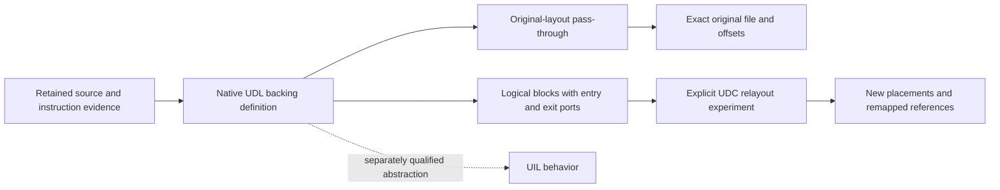

# Native UDL-to-UDC pass-through and logical code blocks

UIL represents behavior. The packing of source instructions, overlapping byte
roles and output offsets belong to the source backings and UDC implementation.
Direct UDL-to-UDC pass-through does not require first inventing or recovering a
UIL operation for every instruction.

## Preserve the baseline before moving code

The default `original-layout` mode reproduces the retained **entire original
file**. Shared bytes occur once at their original offsets. Headers, relocation
records, unknown areas and surrounding data retain their original bytes too.
It does not concatenate logical blocks or insert a duplicate into the source.

The authored `A8 AA` / `AA` example therefore stays two shared physical bytes
in the baseline, even though its logical backings contain three encoding-byte
occurrences. Duplicating AA in place would shift subsequent offsets and break
references; that is a different transformation, not pass-through.



`original-layout` is available for static version 1 when the original file
bytes exist and match the recorded source hash. A patched image version is not
silently emitted using the unchanged original file. Captured definitions pin
their source version; selecting an old definition still selects that version.

Exact output can be available even when analysis is incomplete: unknown code
remains unchanged source code. That establishes byte identity, not knowledge
of all behavior. Info and exact output recheck the captured graph; when its
facts have drifted or cannot be verified, `graph_complete` is null and
`graph_validation` is `unverified`. Exact source bytes can still be verified.
Relayout instead requires a complete, freshly validated graph.

## Splitting is logical; placement is a later step

`Project.code_backings` retains complete individual instruction interpretations.
`Project.code_blocks` / `group_code_backings` derives multi-instruction blocks
after merging all requested entry graphs. A block begins at:

- Every requested entry and branch target.
- A join, a known incoming edge from outside the captured set, or a context boundary.
- An explicit caller-selected instruction boundary.

It follows only a unique explicit fallthrough to a contiguous instruction in
the same context. It ends at a transfer, ambiguous/missing continuation,
noncontiguous boundary or another block entry. An instruction encoding is
never cut in half. A separately decoded entry inside that encoding is retained
as its own interpretation and complete backing.

Each block has a stable logical entry identity, instruction/backing revisions,
complete local encoding, per-occurrence source mappings and explicit exits.
The plan declares `source_layout_modified: false` and `group_placement: unplaced`.
Its concatenated encoding is an independent source backing with placement
obligations; relative branches do not become relocatable merely by copying it.

For the overlapping example, separate A and B blocks share source provenance
and both name J as their continuation. Original-layout pass-through keeps the
physical overlap. Independent materialization supplies complete A8-AA and AA
encodings, and relayout handles their different placements and edges.

A basic block is not automatically an intent. One recovered action can use
several basic blocks. The eventual standard DOS UDC can bind that behavior to
an implementation region with declared ports, or select another qualified
implementation. Source entry identity, behavior identity, backing revision
and output placement must remain separate.

## Persist and compile without UIL

```python
from fdisbull.project import Project

with Project('/private/analysis.fdb') as project:
    # These entries refer to the authored example loaded at 0x1000.
    definition = project.udc_native_capture('overlap-baseline',
                                            [0x1002, 0x1003], version=1)
    exact = project.udc_native_compile(definition['id'])
    assert exact['qualification'] == 'original_bytes_only'
    assert exact['original_file_offsets_preserved']
    assert not exact['source_layout_modified']
    # The caller may save bytes.fromhex(exact['bytes']) in its private workspace.
```

Equivalent CLI/JSON operations are `udc-native-capture`, `udc-native-info` and
`udc-native-compile`. The CLI takes repeated `--entry` values at capture:

```text
fdisbull code-blocks /private/analysis.fdb --entry 0x1002 --entry 0x1003
fdisbull udc-native-capture /private/analysis.fdb overlap-baseline --version 1 --entry 0x1002 --entry 0x1003
fdisbull udc-native-info /private/analysis.fdb DEFINITION
fdisbull udc-native-compile /private/analysis.fdb DEFINITION
```

`--split-at` takes an exact captured instruction ID. Definition inspection is
compact by default; `--full` includes retained private code and source evidence.
Returned byte payloads use the normal output-limit/artifact-handle policy.
No host file is written by these methods. Keep byte-retaining replies,
artifacts, saved projects and caller-written binaries in private workspaces.

Definitions are immutable and require the latest same-name `parent` when
revised. Original source blobs are deduplicated by content hash. Reopening a
project and removing the original input file do not remove the retained source
backing. The native definition family is separate from the existing restricted
UIL-qualified [original DOS compiler](UDC_DOS.md).

## Relayout and future replacement

Relayout must be requested explicitly with `mode='relayout'` or `--mode relayout`.
It requires the five [code-layout assertions](CODE_BACKINGS.md) about code
aliasing, computed entries, address observation and timing. A complete local
graph and valid bytes alone cannot prove those environmental assumptions.

`block_order` / `--block-order FILE` selects each logical block exactly once;
`order` / `--order FILE` is the separate instruction-order test seam. They are
mutually exclusive. The output records the selected placement, stable block
IDs/revisions, instruction occurrences, output entries and branch/glue fixups.
The current conservative emitter retains explicit fallthrough jumps between
instructions, including within a group. The original definition remains
unchanged across these layout experiments.

The relayout result is raw code labeled `structural_only`. Original file offsets
are not preserved or used as new output identities. Known direct near branches
and explicitly supplied entry references are remapped; unknown computed
references, unsupported transfers and observable code-alias dependencies are
refused. A full regenerated executable with all references repaired belongs to
the forthcoming standard DOS UDC, not this bounded raw-code emitter.

Replacing an implementation will require preserving its admitted behavior and
state/effect interface, binding its entry/exit ports, choosing placement and
repairing all affected references. An unchanged logical behavior does not
require unchanged native offsets or code size. Arbitrary replacement is not
implemented by declaring a new digest or treating one offset as one output
address. UIL needs no instruction-overlap operation for any of this.

## Layer-by-layer testing

| Stage | Observation required |
| --- | --- |
| Original-backed pass-through | Full source/output byte and hash equality, including original offsets and shared storage. |
| Native block extraction | Every source interpretation has complete local bytes, preserved provenance and explicit ports; grouping leaves physical source unchanged. |
| Placement experiment | Stable logical IDs across different placements, explicit occurrence maps and repaired admitted transfers; unresolved dependencies remain visible. |
| Native behavior | From both entries and declared initial states, compare flags, memory, index updates and continuation; a naive duplicate must fail the negative control. |
| Behavioral abstraction | Qualify each UDL/UIL mapping at its observable boundary; a physical-overlap detail does not become a UIL requirement. |
| Future replacement/compiler | Qualify the selected implementation, interface adaptation, container and all reference repairs before claiming whole-program parity. |

The authored native tests save/reopen the definition, verify exact whole-file
pass-through, then execute source and relaid-out code through DOSBox. Bounded
Z3 checks use a separately described ISA model. See the
[verification record](VERIFICATION-OVERLAP-ENGINE-2026-10-30.md) for the actual
tested scope and host limitations.
