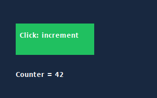
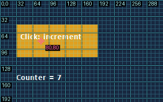

# PE64 debugger integration verification — 2026-10-23

The development integration passed a real authored PE64 GUI workflow on the ARM64 Mac using QEMU TCG, an offline x86-64 Linux guest, Wine 9.0 and the packaged Win32 debugger agent. This qualifies the original main image and the GDI fixture; arbitrary Windows games and full DOS feature parity remain outside this result.

The [machine-readable receipt](../experimental/wine/evidence/2026-10-23/pe-integration/verification.json) binds the tested wheel, production sources, authored fixture, kernel, runtime image, guest agent and returned evidence to SHA-256 hashes. The wheel's nine production source/resource files were compared byte-for-byte with the working tree. This is an **unreleased development build**, based on main commit `70631fa97bb7b9a043e7c54aadb89bccd61b3e5a` plus the recorded uncommitted changes. The published 0.11.0 release was not replaced.

| Gate | Result | Receipt |
| --- | --- | --- |
| Installed wheel, real Wine/QEMU PE64 sessions | **5 passed, no skips**, 498 seconds | [Log](../experimental/wine/evidence/2026-10-23/pe-integration/native-acceptance.log), [JUnit](../experimental/wine/evidence/2026-10-23/pe-integration/native-acceptance.junit.xml) |
| Full ordinary suite in Linux/QEMU | **763 passed, 29 skipped**, 776 seconds | [Log](../experimental/wine/evidence/2026-10-23/pe-integration/ordinary-linux.log), [JUnit](../experimental/wine/evidence/2026-10-23/pe-integration/ordinary-linux.junit.xml) |
| Existing Mac DOS backend regression | **45 passed, no skips** | [Log](../experimental/wine/evidence/2026-10-23/pe-integration/dos-regression.log), [JUnit](../experimental/wine/evidence/2026-10-23/pe-integration/dos-regression.junit.xml) |
| Full ordinary suite on macOS | 736 passed, 31 skipped, **2 failures and 23 setup errors** | Same pre-existing Linux ELF compiler/linker fixture failures; raw log retained locally |

The ordinary Linux suite's skips include native backends that were not configured in that run. The separate PE gate used `FDISBULL_REQUIRE_PE=1`; the DOS gate used `--require-native`. The one ordinary Linux warning concerns pytest's cache in the read-only source tree. These are local verification runs, not a new GitHub CI/release claim.

## Observed workflow

The authored fixture is [tests/wine_gui_fixture.c](../tests/wine_gui_fixture.c). No game files are needed. The [acceptance test](../tests/test_wine_debugger.py) imports the real executable, analyzes its exported checkpoint, creates an isolated static patch version, and exercises the original version through the public debugger factory.

| Capability | Observed postcondition |
| --- | --- |
| Launch and mapping | Stopped at the PE entry; observed main-module base mapped to project virtual addresses through RVAs. |
| Disassembly breakpoint | Byte-verified breakpoint at project `0x140001480`; execution stopped there. |
| Guarded memory editing | Wrong expected bytes rejected. Counter at `0x140003000` read **7**, then an edit/readback changed it to **41**. |
| Bounded scripting | A stored read/assert script observed the edited bytes `29000000`. A DOS-only state operation is rejected before a PE script can mutate the target. |
| Actual mouse input | An 8px click-frame labeled client point **80,80**. Resuming processed a Win32 input click, changed the counter to **42**, and hit the rearmed checkpoint. A second click reached **43** and hit it again. |
| Instruction trace | Four completed instructions with pre-instruction registers, observed bytes and project mappings: `push rbp`, `mov rbp,rsp`, `nop`, `nop`. |
| Screenshots | Actual **320×200** client pixels; clean PNG, derived 8px grid and target label stored separately. The post-click image contains the green button and counter 42. |
| Timeout | With the execution breakpoint removed, a 100ms run returned a stopped timeout session rather than claiming completion. |
| Persistence | Closed the VM and project, reopened the project, and exported the screenshots and trace without starting an emulator. |
| Restart and JSON interface | A second fresh VM launched through `debug-launch`; `debug-breakpoint` and `debug-run` stopped correctly. `debug-memory` read the original **7**. `debug-write-memory` edited it with a guard. `debug-stop` reported the QEMU process reaped. |
| Static patch isolation | The child static version was refused for implicit launch; the original disassembly remained byte-for-byte unchanged. |

[Stored trace](../experimental/wine/evidence/2026-10-23/pe-integration/checkpoint.json), [script](../experimental/wine/evidence/2026-10-23/pe-integration/route.fdisbull.json), [script result](../experimental/wine/evidence/2026-10-23/pe-integration/route-result.json), [artifact hashes](../experimental/wine/evidence/2026-10-23/pe-integration/acceptance.json).

The click-frame still displays 7 because the guarded memory edit itself does not ask the program to repaint. The subsequent actual click executes the fixture's increment/repaint path and displays 42. The screenshot is an observation of the program's pixels, not a rendering of the debugger's counter value.

## Runtime setup corrections and limits

Earlier packaged-runtime attempts exposed a Wine-prefix initialization timeout and a separate Linux initramfs unpack failure. The failures were retained rather than counted as debugger passes. The finalized setup compacts unused probe/test components, explicitly selects `rootfstype=ramfs` to avoid the default tmpfs-root unpack quota, waits for Xvfb readiness, fingerprints all guest sources, and retains bounded diagnostic tails on failure. The final wheel then passed two fresh sessions with the **4 GiB** VM configuration. [Runtime preparation receipt](../experimental/wine/evidence/2026-10-23/pe-integration/runtime-preparation.json).

This does not qualify PE32/WoW64, managed source breakpoints, child-process following, DLL launching, arbitrary game compatibility, DirectX/fullscreen or multiple-window capture. Data watchpoints, code layers and resumable editable native states remain DOS-only. Trace stepping holds existing peer threads and is a debugging observation, not a scheduler-faithful replay or complete memory-access trace.

See [PE64 usage and runtime preparation](WINE_DEBUGGER.md) for the public Python and JSON commands. Game files, saved states, Wine prefixes and project databases are absent from this evidence directory and all built tool packages.
