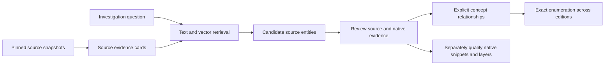

# Source intake and concept search

The source catalog adds a private, collection-wide view of source revisions,
syntax candidates and logical concepts. It searches editions without merging
native address spaces. The first experiment uses three pinned
[CivD](https://github.com/sjmelia/civd) DOS reconstructions.

This is source-assisted investigation. CivD has inferred names, comments and some
types. Retrieval and matching upstream output checksums do not verify a build,
source-to-machine mapping, or interchangeable UDL implementations.

A later [verified-build stage](CIVD_VERIFIED_SOURCE_MAPS.md) now qualifies
selected resident source/native correspondences across the three editions.
The search measurements below remain the earlier source-assisted experiment.

## Implemented boundary

The new SQLite catalog is separate from native `.fdb` projects. Source snapshots
retain explicit relative paths, exact bytes/hashes, repository/revision
declarations, edition, source role, parser identity and optional native target
hash. The original target is only read for hashing. Source snapshots survive
checkout changes or deletion; identical payloads are stored once.

API revision labels are caller declarations. The pilot separately compares
captured files against immutable Git objects at each pinned commit. It checks
the **CIV.EXE entry** of the pinned checksum file, which also lists CIVRAW.EXE
and other outputs. That verification remains separate from a source build.

The optional Tree-sitter C frontend identifies function definitions, named
struct/union/enum definitions, fields and macros. Identifier occurrences inside
functions retain exact spellings and byte positions. These are syntactic
occurrences, without preprocessing, symbol binding, def-use analysis, read/write
classification or target-specific C layout.

Other formats remain retained, unparsed inputs. Invalid UTF-8 has an
unsupported-encoding status. Syntax errors remain visible per file and entity.
No source, build script, compiler or emulator is executed during import.

## Agent workflow

Install the optional frontend in a suitable local environment:

```bash
python -m pip install ".[source]"
fdisbull methods
```

These projectless methods take `catalog`, independently of a native `project`:

```bash
fdisbull request '{"method":"source-create","params":{"catalog":"/private/sources.sqlite"}}'
fdisbull request '{"method":"source-import","params":{"catalog":"/private/sources.sqlite","root":"/private/pinned-checkout","paths":["src/CIV.H","src/CITYMGT.C"],"repository":"https://github.com/sjmelia/civd","revision":"PINNED_SOURCE_COMMIT","edition":"474.03","source_role":"reconstructed-source","target_path":"/private/game/CIV.EXE"}}'
fdisbull request '{"method":"source-snapshots","params":{"catalog":"/private/sources.sqlite"}}'
fdisbull request '{"method":"source-files","params":{"catalog":"/private/sources.sqlite"}}'
fdisbull request '{"method":"source-entities","params":{"catalog":"/private/sources.sqlite","name":"food_box","kind":"field"}}'
fdisbull request '{"method":"source-occurrences","params":{"catalog":"/private/sources.sqlite","name":"food_box"}}'
fdisbull request '{"method":"source-search","params":{"catalog":"/private/sources.sqlite","query":"accumulated food kept by a city","kind":"field"}}'
```

Replace paths and the revision. `declared_output_sha256` is accepted only if it
matches the supplied target's actual hash; the relationship remains a declared
build output with `build_verified=false`. Without it the association is
unqualified. `parse_c=false` retains sources without requiring a frontend.

`source-text` reads an entity by returned ID with bounded byte offset/size.
Inventory, occurrence and binding queries support pagination. Search replies
return locations, parser status and ranking metadata; source text is requested
separately.

## Retrieval and explicit meanings



Cards contain entity names, owners, paths, adjacent source comments and bounded
source windows. They contain no generated behavioral summaries or concept answer
labels. Identical card text shares an embedding while edition/entity identities
remain separate.

Text search uses SQLite FTS5. Vector search exhaustively ranks explicitly
imported, normalized float32 vectors by cosine similarity. Hybrid search uses
reciprocal rank fusion, k=60, then selects the best window per entity.
Entity ties use name, path and byte position before snapshot identity. This is a
small-collection prototype, not an ANN service or a whole-database scaling claim.

`source-model` records a model, revision, dimension and preprocessing description.
`source-cards` exports bounded batches, optionally only missing vectors for a
model. Fetch pending batches at offset zero after each import, since that set
shrinks. `source-embed` imports card/vector pairs. A changed vector for an existing
model/card is rejected; changed encoding requires a new model/profile identity.
Discover saved model profiles with `source-models` and logical meanings with
`source-concepts`, optionally filtered by a concept key.
The tool does not download/run encoders or contact embedding services.
Query vectors must use the corresponding encoder/profile.

`source-concept` registers an immutable description and unit under a logical key.
`source-link` records `represents`, `mentions`, `implements` or `related`
relationships to exact source entities, with authored evidence and assurance.
A changed definition needs a new revision key. Assurance text does not confer
proof status. `source-bindings` exactly enumerates recorded claims.

Concept labels are excluded from retrieval cards. Keep source-assisted/oracle
material in separate catalogs or explicitly selected snapshot sets. Embedded-card
coverage does not establish token coverage, recovered meaning or native coverage.
Unmapped concepts and editions remain unknown.

## CivD experiment

The repository runner is
[source_search_pilot.py](../examples/recovery/source_search_pilot.py), with frozen
[questions](../examples/recovery/civd_source_queries.json). It takes a private
manifest of roots, paths, commits, editions and native targets, an already
downloaded encoder directory and a new output directory. The public
[receipt](evidence/source-search-pilot/verification.json) contains sanitized
measurements. Source, vectors and full rankings stay outside Git.

The experiment imports 119 files per edition: 474.01 at `c425f7ba4541`, 474.03 at
`9aefe00fce1b`, and 474.05 at `d9214fcd36aa`. Across three snapshots: 357 file
records, 165 distinct payloads, 2,731 entities and 1,741 distinct cards.
There are 202 syntax-indexed file records, 101 partially parsed records and
54 assembly/include records retained without parsing.

The local encoder is `sentence-transformers/all-MiniLM-L6-v2`, revision
`1110a243fdf4706b3f48f1d95db1a4f5529b4d41`, CPU float32, attention-mask mean
pooling, L2 normalization, 256-token limit. Longer windows can be truncated.
Artifact hashes and runtime versions are part of the recorded profile.

Ten investigator-selected questions are evaluated in each edition, with the
same entity-kind filters for all modes:

| Method | Selected target first | First three | First ten | MRR at ten |
| --- | ---: | ---: | ---: | ---: |
| FTS text | 15 / 30 | 24 / 30 | 30 / 30 | 0.669 |
| Vector | 15 / 30 | 27 / 30 | 30 / 30 | 0.692 |
| Hybrid | 21 / 30 | 30 / 30 | 30 / 30 | 0.833 |

This supports a hybrid retrieval pilot. It establishes no advantage at top ten,
general analysis accuracy, or cross-architecture/language effectiveness.
The editions share much source; these are not 30 independent examples.
The investigator selected questions/targets after source inspection.

A negative control asks about TCP/IP multiplayer matchmaking. All modes still
return candidates. The ranker has no calibrated abstention/existence test, and
scores are not probabilities that the requested concept exists.

After evaluation, `city.food.stock` is related to `struct city` field `food_box`
at `src/CIV.H:38` in all three editions. Its source comment describes accumulated
food. Three exact bindings and 21 spelling occurrences in parsed functions are
retained. These occurrences do not resolve field identity or enumerate every
runtime read/write, including macro expansions.

Restart preserves snapshots and relationships; SQLite integrity and foreign keys
pass. All three native hashes match before/after. No target was run or source
built. The receipt records query encoding separately from search time; timings
are observations from this local run, not a controlled performance benchmark.

## Frictions and next qualifications

- **Period C:** `far` declarations, macros and old calling forms need explicit,
  versioned preprocessing/target profiles and source maps, or a suitable compiler
  frontend. Preserve originals and unresolved interpretations.
- **Source-to-machine placement:** qualify builds with source/toolchain hashes,
  flags, headers, linker maps/listings, overlays, relocations and output readback.
  Link exact source entities to validated native snippet endpoints with evidence,
  domains and adapters before propagating native names or types.
- **Variable meaning:** add scopes, field/type resolution and def-use evidence.
  Keep stock, production rate, consumption and capacity distinct, with units.
  A C `int` spelling does not establish host-width layout.
- **Revision changes:** share unchanged payloads/vectors while retaining separate
  identities. Changed behavior preserves older evidence and needs new
  qualifications; similarity cannot admit a replacement UDL layer.
- **Compiler ports:** additional frontends can contribute source entities and
  resolved references to the same concept registry. Compiler contracts also need
  mutation, object identity, allocation, aliasing, caches and diagnostics.
  Current scalar UIL experiments do not cover an entire compiler.
- **Ranking ties:** initial fusion ties used entity digests. Adding unrelated
  provenance metadata changed ordering and the preliminary top-one score. The
  final policy uses source name/path/position instead, with a regression check.
  The table and receipt use that corrected policy.
- **Scale and evaluation:** retain false matches, add independently labelled
  cases and different ports, measure encoding cost, and add ANN only when actual
  collection size warrants it. Keep derived indexes private and rebuildable.
