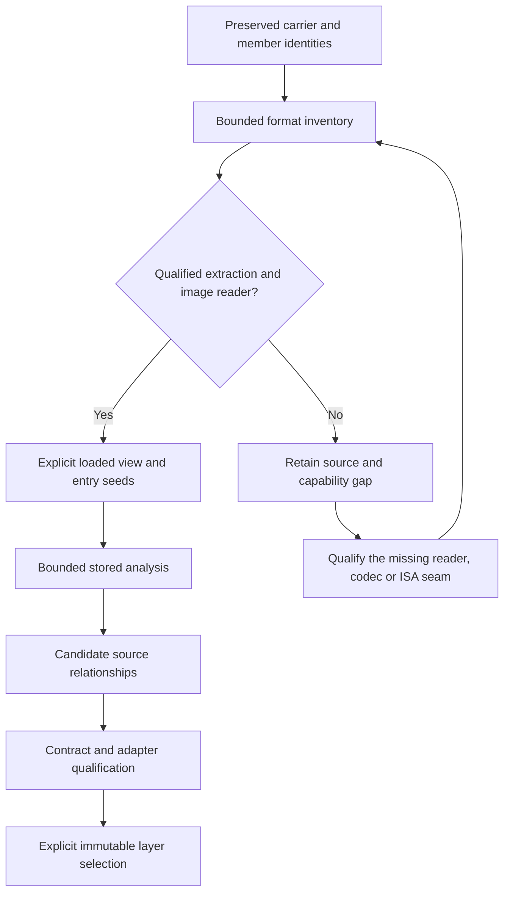

# Collection intake, formats and version relationships

Intake preserves an input and establishes what can be done with it. A collection
and a later single-game addition use the same per-artifact procedure. The batch
adds a manifest and a completeness check; it does not weaken the checks for an
individual file.

The `intake-inventory` command now implements the shared filesystem/header
inventory phase for one game or a batch. Extraction, program import, analysis,
roster acceptance and semantic version classification remain separate operations.
The workflow below connects that inventory with the existing project/snippet/UDL APIs.
Original programs, source/oracle packages, media and byte-retaining databases
stay in a private workspace outside the source checkout.

## Run the shared inventory first

```text
fdisbull --output-artifact-dir /private/reports intake-inventory /private/game --catalog /private/formats.sqlite
fdisbull --output-artifact-dir /private/reports intake-inventory /private/game-a /private/game-b --catalog /private/formats.sqlite
```

The same per-file kernel handles both calls. The persistent catalog contains
versioned format descriptions and links to statically shipped readers; source
payloads are not written into it. It must be outside every inventoried input
root and must not alias an input member. Enumeration and alias checks precede
persistent catalog initialization. If enumeration stops early, the report uses
an in-memory catalog and explicitly records `not-written-incomplete-enumeration`
for the requested persistent path. It never silently writes into the source tree.

`files`, `roots`, `skipped`, `errors`, budgets and `recovery_queue` account for
observed inputs. `complete` covers only the stated filesystem inventory. File,
read, entry and depth limits, I/O errors and untraversed directory links remain
explicit partial results. Regular-file links retain requested/resolved paths and
opened-descriptor identity. Archive members, embedded resources, decoding and
native execution remain unqualified even after complete directory enumeration.
A one-byte read budget cannot be exceeded by admitting a larger probe first.

The recovery queue groups unknown signatures/context candidates, invalid or
unsupported profiles, unexpanded containers, unqualified embedded media and
missing decoders separately from available readers awaiting validation. Module
`decoder_role` is a static shipped capability, not a database API execution rule.
Unknown `.DAT` or `.TXT` does not mean corrupt media. Use its consumer/context
and the requested analysis to select the next recovery question.

Large replies use the existing output-artifact protocol. Redirecting stdout alone
may save only an artifact reference. Retain that reference, inspect it through
`output-info`/`output-read`/`output-select`, and preserve the external artifact;
do not repeat intake just because its full report did not fit inline.

See [observed media profiles and gaps](INTAKE_MEDIA_COVERAGE.md) and
[format catalog contracts](FILE_FORMAT_REGISTRY.md). Filename/consumer profiles
are candidates and never turn a suffix into header proof. Explicit FLI inspection
uses `media-inspect --adapter flic`, with `--index-path` for a selected TFTD IDX.

## Preserve identity before choosing a decoder

Record the supplied files before extraction: size, SHA-256, source/provenance,
container membership and the reader/tool revision. Keep filename edition,
language and patch labels as attributed claims until corroborated. Different
downloads can contain identical programs; identical-looking names can contain
different programs. A matching whole-file hash establishes byte identity only.

Retain every relevant edge through a nested package. For example:

```text
ZIP/source hash
  -> floppy member/hash
  -> FAT file CIV.EX$/hash
  -> decoded CIV.EXE/hash + codec/options
  -> NE logical image/version/hash + loader profile
  -> source-bound instructions/snippets
```

Extraction, decompression and relocation have different identities. Keep the
original carrier bytes and transformation records even if the resulting file
matches an existing target. Preserve overlays, resource forks and unmapped tails.
Map archive names to safe private destination paths explicitly; never interpret
member names or a supplied README as instructions to execute or overwrite files.

Keep independent capability observations rather than one ambiguous ready flag:

| Observation | Evidence required | Does not establish |
| --- | --- | --- |
| Received | Source identity and available bytes | Complete archive or known format |
| Catalogued | Bounded member/header inventory; CRC/read coverage stated | Extracted or executable |
| Extracted/decoded | Output identity, reader/options and checked extents/lengths | Correct image mapping or runtime behavior |
| Mapped | Selected image/ISA/mode, loader profile, entry, regions and fixups | Reachability of every mapped byte |
| Analyzed | Seeds, budget, stored facts and remaining work | Whole-game recovery or native execution |
| Runtime observed | Exact image, backend, inputs, observations and completion | Untested paths or cross-version parity |
| Related/selected | Exact endpoints, domain, contract, adapters and qualification | Automatic equivalence from a stored link |

Use explicit unknown/unsupported/not-run values for missing observations. An
exhausted analysis budget remains incomplete even when it returned useful facts.

## Batch collections and piecemeal additions

For a collection, inventory the outer files first, then build a member tree and
group candidates by game, platform, language, edition and role. The grouping is
an authored hypothesis; preserve aliases and unresolved labels. Distinguish main
programs, code modules, installers/patchers, resources, saves, documentation,
preservation images, unrelated bundled software and unknown members.

For each selected candidate:

1. Bind its source/member identities and look for an exact existing artifact.
2. Extract into a new private staging directory, using the least transformation
   needed for analysis. Never execute an installer merely to list its contents
   when a qualified reader can recover them.
3. Verify the complete intended output set, hashes and format-specific bounds.
   Mark partial reads explicitly. Keep partial attempts and diagnostics separate
   from accepted targets; do not register an incomplete tree as a complete game.
4. Record the accepted source artifact or provenance alias in the private intake
   manifest. Import a supported
   image into its own project, then perform one bounded entry analysis and reopen
   it to verify persistence. A later pass needs a new frontier or question.
5. Classify relationships to earlier inputs and retain their exact identities.
   Candidate links do not automatically create executable backings.
6. Update the private selected-program roster and rebuild/check its archive.
   Verify earlier entries remain unchanged and every selected member has the
   expected hash. Keep media, full installers, source oracles and databases out
   of an executable-only archive.

The shared roster/archive has one writer. Stage and verify each member before
registering it; emit one final collection receipt distinguishing accepted,
exact-existing, unsupported, invalid and incomplete members. An unsupported
member should not hide successful intake of an unrelated member. Conversely,
success for some members is not whole-collection loading or runtime support.

A piecemeal addition runs the same steps against the existing manifest. If the
program and supporting payloads are exact matches, add the new provenance edge
and an idempotent receipt rather than duplicate binaries or fabricate another
version. If bytes differ, preserve both artifacts before comparing them. Earlier
receipts remain dated evidence; do not rewrite their historical archive hashes.

Keep environment failures separate from format refusals. If a source or private
destination volume disappears, stop writes, verify its resolved identity when
it returns and recheck source hashes before resuming. Do not create replacement
directories beneath a missing mount or label an I/O failure as a corrupt or
unsupported game format. Resume from verified member receipts.

The current private package has its own `AGENTS.md` and
`tools/update_target_executables.py`. Follow that package's actual maintenance
contract. These are local package tools, not a generic public intake command.
Nonstandard programs need explicit reviewed roster selections; `.exe` suffix
discovery alone misses guest bytecode, Amiga programs and Mac resource forks.
Do not promote every bundled OS utility or unrelated demo into the game roster.

Useful receipt fields are source/member hashes, roles and claims, extraction
profile, output identities, selected loader/ISA, project/version IDs, capability
observations, analysis budget/pending work, relation/contract/layer IDs, archive
verification and unresolved questions. This is guidance for a receipt, not a
new JSON method or database schema.
Collection membership and provenance aliases currently live in the private
intake manifests; project databases provide image, snippet, contract and layer
records. This document does not add a general collection registry to the DB.

## Analyze the format at the boundary that is missing

Separate the archive/filesystem, compression/packer, executable image, ISA and
mode, runtime ABI, interpreted guest language, and resource/media format. Support
for one does not imply support for the others. Start with `intake-inventory`,
`file-identify` and `format-modules`, then use `fdisbull identify`,
`fdisbull inspect`, the installed method catalogue and the selected loader's
documented restrictions before planning analysis or execution.



| Missing capability | Appropriate work | Avoid |
| --- | --- | --- |
| Archive/filesystem reader | Recover bounded directories, extents, forks and member identities; compare independent reads where available | Calling extracted bytes a loaded program |
| Compression or packer | Recover its declared lengths, dictionary/chunks, checksums and termination; retain carrier/output identities | Disassembling only the unpacking stub as recovered game logic |
| Executable container, supported ISA | Implement a loader with sections/segments, permissions, entry/export seeds, zero-fill, overlays and relocations | Replacing the existing ISA processor because the wrapper changed |
| New ISA/mode/endian context | Add and qualify decoding, flow and address identity as well as the image mapping | Forcing unfamiliar code through x86 raw mode |
| Interpreted program | Identify its consumer and add a separate guest processor/address space where needed | Treating VM offsets as native addresses |
| Data/media format | Recover schema, indexes and consumer dependencies; validate parsing and effects separately | Renaming, zeroing or arbitrarily truncating unknown data |

Begin with representative headers and tables. Establish byte order, alignment,
count/size limits, offset bases, entry semantics and relocation rules. Check all
derived extents against both the declared structure and available bytes. Keep
raw records and explicit refusals for unsupported variants. Qualify readers with
authored valid, truncated, contradictory and unsupported examples before treating
a successful parse as a reusable capability. Record shared dependencies when
comparing readers; two wrappers around one parser are not independent evidence.

Unknown input is still a valid intake artifact. Record a tentative type and its
supporting ranges, or leave the type unknown. Preserve the complete source and
state exactly which observation is unavailable. Prefer a narrow format-recovery
question before attempting a universal decoder. Implement a missing production
capability as its own code/test change, with an explicit profile and refusal
boundary; do not silently turn that recovery into a prerequisite for cataloguing
the rest of a collection.

Physical storage can share immutable content without merging source identity.
Use exact-content aliases or copy-on-write storage where available. A delta
representation is acceptable only with its exact base identity and verified
reconstruction of each complete original. The current project byte-version
API is not a general release-delta store; retain a complete recoverable source
instead of an unbound sparse patch.

Headerless DOS COM files require explicit selection, for example
`fdisbull import /private/game.com /private/game.fdb --image com`. This selects
an x86-16 COM model; the suffix is not a magic signature. A valid NE view remains
separate from its DOS stub and from native Win16 execution. See
[format/media guidance](../src/fdisbull/skills/fdisbull-investigate/references/formats-and-media.md)
and [NE loading](NE_LOADING.md) for those boundaries.

Carrier size and executable-loader limits are different constraints. The current
native image loader admits sources up to 64 MiB; a larger collection image can
still be inventoried and its legitimate program members selected with a qualified
reader. Chopping a carrier into arbitrary chunks does not produce valid programs.

## A newer file is not automatically a layer

Three mechanisms answer different questions:

| Mechanism | Purpose | Identity rule |
| --- | --- | --- |
| New source artifact/project | Preserve an independently supplied release, platform port or rebuilt file | New source hash; its own original bytes and mapping |
| Child byte version | A declared controlled edit within the current project's mapped image | Parent and earlier byte versions remain intact; mapping/export restrictions still apply |
| Selectable UDL backing | Choose a qualified implementation of a fixed logical contract | New immutable layer ID plus any source-snippet IDs; selections pin exact IDs |

`Project.patch` creates a mapped-byte child within an existing region. It does
not import an arbitrary release, replay a patch installer or remap a changed
container. In particular, NE/LE memory patches do not reconstruct inverse
fixups or rewrite the original executable. Import a newly supplied file
separately even when it appears to differ by only a few bytes. A controlled
child-version experiment may then test a proposed local change without replacing
either original. Source images, mapped byte versions and runtime interventions
must remain distinguishable.

Use the following decisions after preserving the source artifact:

| Comparison | Relationship and reuse decision |
| --- | --- |
| Same complete payload hash | Exact-content alias with separate provenance; no invented new code version |
| Different wrapper, same decoded member | Keep both carrier identities and codec evidence; share the identical decoded content |
| Layout/relocation/compiler changes | Separate mapped captures; candidate correspondences first, followed by normalized control/data-flow and behavior checks |
| Changed code, same admitted behavior | A new backing may implement the same fixed UIL contract after source, domain and adapter qualification |
| Bug fix or changed rule affecting admitted outputs/effects | Record a behavior-change relation; version the contract/UIL, or explicitly choose a revised policy. Preserve the old behavior and regression witnesses |
| Resource/localization changes | Link exact resource identities and qualified consumer mappings; an exact visible-text contract changes when its promised text changes |
| New ISA, major rewrite, remake or uncertain family | Keep separate projects and only the independently supported family/snippet/resource relations |

Byte similarity helps choose comparisons; it cannot decide semantic equivalence.
One changed carry condition or table value can alter behavior despite a tiny
diff. A compiler, packer or ISA change can produce very different files while a
particular operation remains equivalent. Retain what a normalization hides.
No fixed whole-file similarity percentage admits a replacement.

For a reusable backing, establish typed inputs/outputs, widths and wrapping,
flags/liveness, locals versus caller state, pointer and memory ownership,
initialization, calls/effects, failure behavior and the admitted domain. Capture
each source span with its project/version/context; attach ABI and representation
adapters. Test changed cases and preserved cases against an appropriate original
consumer or independent reference. Record model proof, finite native comparison
and unsupported observations separately. A stored relation is an authored claim;
it does not itself prove equivalence, and equivalence does not propagate through
a chain of candidate links.

Source captures are needed for source-backed correspondence claims, not every
authored descriptor. The supported UIL, C and service profiles can omit native
snippets; native16 also admits explicit authored bytes with its required adapter.
Keep that authored/model provenance explicit instead of claiming original-source
fidelity. Domain and adapter fields follow each backend's actual schema/profile.

Candidate layers may be registered with their current assurance. Put unresolved
notes in supported evidence fields or a snippet relation's `unknowns`; `unknowns`
is not a supported top-level layer-registration field.
`register_layer` validates descriptors and `select_layers` pins IDs; neither
operation proves behavior. `run_layer` performs its bounded comparison, while
native shell construction requires its supported admission/qualification profile.
Source correspondence and actual emitted execution remain separate evidence.
Admit a replacement under the same contract only to the qualified scope, and
pin its immutable ID explicitly. Earlier selections keep their former backing.
If the newer behavior is intentionally different, do not weaken the old exact contract just
to keep the UIL label unchanged. A higher-level intent may have both versions as
separately named behaviors, with a caller explicitly choosing between them.

If a contract deliberately parameterizes a resource key or admits configurable
presentation, a different data binding may preserve that logical UIL interface.
Record the selected payload and consumer profile. This does not make an exact
text promise configurable retroactively, or introduce a general resource-layer
backend where the installed tool has none.

For example, ADD and ADC need carry and flag obligations checked before sharing
an addition contract. A bounded dice-output policy may admit different RNGs,
while an exact seeded-sequence contract usually distinguishes them. Range checks
alone do not establish period, unbiased dice, fairness or equal game outcomes.
Policy prose is not an implemented verifier. Backends can refuse a policy/domain
they cannot enforce; native shell admission remains narrower than persistence.

See [persistent snippets and UDL layers](UDL_BLOCK_LAYERS.md),
[DOS UDC](UDC_DOS.md), and [Linux/C realization](UDC_LINUX_AND_C.md). A qualified
x86-16 snippet is not automatically an x86-64 pass-through. The current native
shell profiles require supported lowerings and explicit adapters; arbitrary
ported binaries, service sweeps and foreign-code insertion remain separate work.

## When the files are vastly different

Do not force a binary patch, shared address model or whole-program layer. Keep
separate projects, then identify small observable counterparts: one production
rule, turn-state transition, resource lookup or input/output boundary. Different
ISAs need their own decoders and adapters. Different save formats, allocation
models, UI effects and scheduler behavior remain explicit obligations.

Shared asset hashes, strings and structural tables are useful alignment anchors,
not code-equivalence proofs. Preserve an uncertain relation as a candidate and
select the next discriminating probe. If the newer edition changes the rules,
model that change rather than manufacturing equivalence. A synthetic program
may combine qualified implementations from several lineages; its source,
contract and adapter identities must describe that new construction explicitly.

## Concrete intake examples and limits

The private Civilization batch contained 32 top-level files across six platform
families. The English-labelled CD also held German/French game trees; the
Windows floppy main matched the supplied v1.2 upgrade; Mac/Windows resources
provided exact data anchors without establishing code equivalence. Only selected
game/code inputs entered the maintained program archive. Unsupported preservation
formats and unselected media retained their source identities and capability
status. These are local intake observations, not a public redistributable corpus
or a whole-game/native-compatibility claim.

The later Tic-tac-toe/Five Dice bundle illustrates a piecemeal repeat: its two
learner COM files matched existing target hashes, so the private package gained
provenance receipts and the roster stayed unchanged. Both explicitly selected COM views
received fresh bounded analysis/reopen checks. Supplied descriptions of prior
native tests, upstream adaptations or RNG demonstrations remain attributed
reports until independently exercised.

That bundle separates learner games/controls/licenses from source/test oracles.
Preserve this access boundary at intake: inventory/hash the source packages and
retain them separately from learner projects and program-only deliveries.
Document any later oracle consultation. A current clean intake cannot certify
the context of an earlier investigation, and learning source answers changes
what a later blind reconstruction claim can mean.

For ISO/movie-heavy inputs, use the qualified media procedure: source-preserving
data extraction, format-aware valid derivatives and paired-index rebuilding,
followed by decoder and actual consumer checks. A program-only delivery can
exclude media while preserving its single original carrier; it need not create
a second reduced image just to list executable targets. Native runs must consume
changed media before they qualify the integration.


## Local ripping skill

The versioned [dos-target-media-rip skill](../skills/dos-target-media-rip/SKILL.md)
contains the catalog-first intake, recovery and bounded media transformation
procedure plus its disc helper. It is a local host skill, separate from the two
bundled `agent-skill` selections. Keep the host copy at
`~/.codex/skills/dos-target-media-rip` aligned with this reviewed directory when
installing updates. The skill follows caller storage rules and authorization;
it does not introduce another approval flow or modify the shared tool installation.
