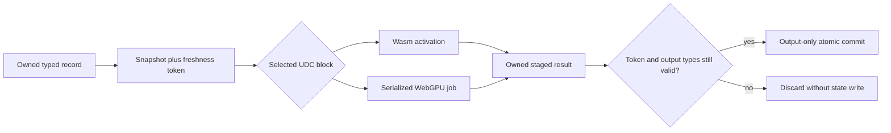

# Minimal browser shell over unchanged module UIL

`build-web-shell` builds an interactive browser shell with interchangeable
`wasm32-scalar-1` and `webgpu-wgsl-scalar-1` implementations. It consumes two
persisted selections, the same module UIL, and a separate typed host plan.
The module itself is unchanged. This profile implements one pure invocation;
it does not interpret every operation of the existing native-shell profile.

The shell supplies one record view with entity and backend selectors, editable
inputs, Run and Cancel. Cities are record identities in that view. The UI
contains no food formula or original executable address. Titles/labels and
input/output adapters come from the host plan.

## Build and bind

```python
from fdisbull.udc_web_shell import build_web_shell

receipt = build_web_shell(project,
    selections={"wasm": wasm_selection, "webgpu": gpu_selection},
    plan=host_plan, destination=new_private_directory)
```

The JSON method uses `selections`, `plan`, `destination` in a normal project
request. Both selections must resolve to the same canonical module UIL and
contract, with equal effective admission domains. A narrower selected-layer
domain on one backend is refused rather than called interchangeable.

The plan format is `fdisbull-web-orchestration-1`. It declares logical cell
types/initial values, complete input/output port maps and the fixed
`latest-request-wins` concurrency policy. The food plan maps `stock → stock`
on input and `new_stock → stock` on output. Optional labels/title affect only
presentation. The builder validates every map and type, rejects output aliasing,
assigns compact little-endian record offsets and records the full plan/hash.
This host adapter does not change the module's `$new_stock` output binding.

Outputs include `index.html`, `app.mjs`, `shell.mjs`, `block.mjs`, both block
bundles and `shell.json`. Construction is build-only. Existing destinations,
unsupported plans and mismatched provider domains refuse before emission.
Artifacts, module UIL, contract and orchestration identities remain explicit.

## Snapshot, compute, guarded commit



The freshness token includes session, entity ID, entity generation, state
revision, view epoch, binding epoch, operation ID and provider epoch. Revisions
and epochs increase even when a value/entity/backend returns to its earlier
value. An A→B→A change cannot revive an old result.

`start()` owns a snapshot and returns an opaque ID plus a readiness promise.
Readiness stages computation without committing it. `finish(id)` is one-use:
it waits for computation, checks freshness and validates every logical output,
then copies only mapped output cells and increments the record revision. No
await or external callback occurs between the final check and commit.
`step()` is the convenience start/finish pair.

Completion and commitment are separate. A complete numeric calculation can be
discarded because the state, entity or implementation changed. Refusal, invalid
output, provider failure, cancellation and stale responses never commit partial
state. Overlapping requests follow latest-request-wins; this is not a queue of
ordinary game turns. Sequential committed calls do read the previously committed
stock. Ordered multi-effect turn orchestration remains outside this pure profile.

## Ownership and resource lifetime

| Resource | Owner and boundary |
| --- | --- |
| Record arena | Shell-private ArrayBuffers; reads and descriptions return copies |
| Invocation input | Owned snapshot; callers cannot mutate it while work waits |
| Wasm activation | Import-free function locals; no shared linear memory |
| GPU buffers/readback | Provider job until physical settlement, including cleanup |
| GPU scheduling | FIFO per device within this orchestrator module |
| Application commit | Shell only, after freshness/type validation |
| Device | Explicitly owned or borrowed; borrowed devices are never destroyed implicitly |

Cancellation invalidates the logical operation, not already submitted GPU work.
That work retains its device lease and buffers until it settles. A newer GPU
request waits in the device queue; a newer Wasm request can run independently.
Queued jobs recheck provider closure/loss before dispatch. Failed computations
are not retried and do not silently switch backend.

Disposal invalidates the shell synchronously, clears its arena and drains owned
provider work. Owned devices are destroyed; borrowed devices remain caller-owned.
Failed loading releases a transferred device even if GPU source loading fails
before provider assignment. Device-loss listeners hold weak provider references,
avoiding retention of disposed shells by long-lived borrowed devices.

An already-started `finish` returns a discarded receipt on disposal. After
disposal completes, unconsumed tickets expire and `finish` rejects them as
unknown/consumed. There is no persistence or replay protocol in this profile.
Borrowed-device callers must coordinate unrelated device users and validation
scopes; the queue coordinates providers using this module instance.

## Public runtime interface

`createWasmProvider`, `createGPUProvider` and `createShell` bind checked artifacts
to a shell. A provider wrapper belongs to one shell; distinct wrappers can share
a borrowed device through the device queue. `loadShell` fetches only relative,
same-origin artifacts, validates their hashes and creates an owned device when
available. Backend availability is explicit; a failed GPU job has no fallback.

The shell exposes `addRecord`, `editRecord`, `removeRecord`, `selectEntity`,
`selectBackend`, `snapshot`, `describe`, `capabilities`, `start`, `finish`,
`step`, `cancel` and `dispose`. `describe()` supplies copies of the exact validated
plan/interface used by the engine, avoiding a second, potentially drifting UI
plan fetch. State edits validate their complete patch before any byte changes.

## Original-backed qualification

The shared food module remains
`332f84e5067fa7aee5405a001ac68efb991fd644bcf34cd62a232f453df057ed`.
Fresh baseline observations execute 2,018 inputs on each of CivD 474.01, 474.03
and 474.05, in both a guarded CPU and DOSBox: 6,054 calls per engine.

A separate 24-step sequence derives each next stock from the preceding original
474.05 observation. It crosses signed-word overflow, then is independently
validated against all three original CPU blocks and fresh DOSBox harnesses.
That adds 24 derivation calls, 72 CPU validation calls and 72 DOSBox calls.
No authored food formula supplies these chain expectations.

The shell study compares committed outputs and exact non-output arena bytes
against those originals, on both backends and host runtimes. It also exercises
the real browser controls and reports computation versus commitment separately.
See the [sanitized receipt](evidence/civd-browser-shell/verification.json).
Original executables, retained kernels, period tools, FDBs and raw observations
remain private. Whole-game behavior, flags, timing, arbitrary native-shell plans,
graphics/audio/files and persistent browser saves remain unqualified.

The authored runtime checks cover state/view/provider ABA, entity recreation,
concurrent finish, out-of-order results, cancel-and-replace, shared borrowed-device
queues, owned/borrowed disposal, failed-load cleanup and actual device loss with
explicit Wasm recovery. A deliberately corrupted Wasm output of 40000 for an
i16 result is rejected before any record write.

## Reproduce

Use the matching source environment and fresh original/chain packages described
above. Keep every output outside Git:

```sh
PYTHONPATH=src:. python examples/recovery/civd_browser_shell.py prepare \
  "$FRESH_ORACLE_ROOT" "$NEW_BROWSER_OUTPUT"
node examples/recovery/run_browser_shell.mjs \
  "$NEW_BROWSER_OUTPUT" "$PRIVATE_NPM_ROOT" "$CHROME_EXECUTABLE"
PYTHONPATH=src:. python examples/recovery/civd_browser_shell.py verify \
  "$FRESH_ORACLE_ROOT" "$NEW_BROWSER_OUTPUT"
```

The qualification runner owns its finite loopback server and isolated Chrome
profile. It serves an exact list of authored shell assets and synthetic vectors,
not a source directory, original program or FDB. Browser test instrumentation
observes the real adapter and public UI API. Node's optional GPU checks require
the explicit `webgpu@0.6.2` dependency root and non-fallback hardware.

Relevant platform contract: [WebGPU device loss and lifetime](https://www.w3.org/TR/webgpu/#dom-gpudevice-lost).
