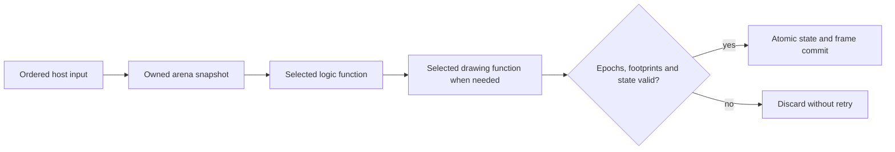

# Recovered array state, drawing and input in a browser

The bounded-memory profile extends the earlier scalar food experiment with
indexed arrays and bounded control flow. It uses the same explicit UIL for
Wasm and WGSL. No Snake operation, DOS address or original byte sequence is
implemented by the compiler. The Snake recovery recipe expresses game rules,
input admission and raster drawing as ordinary arithmetic/load/store/control
nodes. Original-code fidelity and generated-code execution are separate gates.

This is a new, deliberately finite profile. It does not change the existing
`fdisbull-il-1`, scalar contracts or scalar web backends, and it does not claim
that every native instruction or operating-system service is convertible.

## Memory UIL

`fdisbull-memory-uil-1` contains a `role` (`udl` or `uil`), a fixed
`memory:{words:N}`, typed local `variables`, named `functions` and optional
source `evidence`. Changing the role preserves every operation and source
reference. Each function declares its body and an execution budget.

The arena contains unsigned 32-bit carriers, with at most 131,072 words.
Expressions support local reads, indexed loads, unsigned arithmetic, comparisons
and bit operations. Statements support local assignment, indexed stores,
conditions, bounded loops and return. Logical 16-bit rules use explicit masks;
unsigned overflow is modulo 2^32. Divide by zero, out-of-bounds access and
exhausted loop/statement budgets refuse atomically. A refusal returns the
unchanged invocation input. The full program is validated, including untaken
branches. The reference interpreter and both emitters count the same statements
and loop-condition evaluations. There is no solver claim for these loops.

`udc_web_memory.validate_memory_uil`, `execute_memory_uil` and
`build_memory_block` are the Python entry points. Targets are
`wasm32-memory-1` and `webgpu-wgsl-memory-1`. Wasm is encoded directly, without
an external compiler. WGSL executes one sequential invocation per arena; this
experiment makes no GPU speedup claim. No implicit host effect occurs inside
either realization.

## Persistent contracts and selected layers

Memory blocks use the existing immutable contract/layer/selection storage with
their own strict validators. The behavior kind is `memory-uil`, and the typed
port is an explicit `u32-array` arena. The scalar validators reject this profile
rather than interpreting it as scalar ports or ignoring adapters.

Discover these JSON methods in the matching source environment:

```text
store-memory-block-contract
store-memory-udl-layer
select-memory-udl-layers
run-memory-udl-selection
build-memory-web-block
build-memory-web-shell
```

Every function is bound to an exact contract and layer. Selections retain the
complete module UIL. Resolution checks the program, function, target and
contract identities again; unsupported adapters/domains and unknown layer
fields refuse on read as well as on registration. A retained snippet identifies
the original source span. It is evidence of identity, not automatic equivalence.
Project restart must preserve selections and their endpoint hashes.

## Orchestration, ownership and device lifetime

The separate `fdisbull-memory-orchestration-1` plan declares named bindings,
input words, output footprints per function, committed ranges, scratch ranges,
state guards, rendering condition, indexed palette and browser event adapters.
Optional array guards establish bounds, uniqueness and grid adjacency for an
active prefix and exclude a conditional value such as food from that prefix.
Snake's plan guards every DOS word and cell as well as these relational
preconditions; invalid diagnostic replacement refuses before changing state.
Scratch can be modified during a transaction but is not committed. The font,
strings and other undeclared ranges remain read-only. Kernel output that changes
an undeclared word, exceeds a state guard or contains an unknown palette index
fails before any application state change.



Each stage can independently select Wasm or WebGPU while retaining the same UIL.
The shell owns mutable state. Snapshots, descriptions and invocation inputs are
copies. Provider registries are copied at construction. The shell validates
provider target, module identity, function and arena size.

`start` stages work and `finish` consumes the ticket once. Readiness is not a
commit. Session, generation, revision, binding epoch and provider epoch/loss are
checked at commit, with no await or callback between the final check and write.
`dispatch` processes ordinary inputs FIFO, capturing game state at the input's
turn. A replacement or backend change invalidates active and older queued input;
it is never silently replayed. Requests and queues are bounded to 64 operations.
`discardPending` invalidates the current input context and drains its physical
tail. Pointer motion is coalesced, and a release refused by an overloaded queue
uses this explicit cancellation boundary before admitting a fresh release. The
UI reports that discarded backlog; a held button is not left latched silently.

GPU providers serialize compilation and jobs per device within their runtime
module. Inputs are validated before numeric narrowing. Readback is copied before
unmapping, canaries are checked, and buffers remain leased until submitted work
settles even if logical work is cancelled. The browser loader centrally owns its
device; per-function providers borrow it. Disposal invalidates application state,
drains all providers and only then destroys that owned device. A borrowed device
survives direct shell disposal. Unrelated users of a shared device must coordinate
validation scopes themselves. Provider failure never selects a fallback backend.

## Browser services

The canvas host implements service adapters only: keyboard events to declared
logical input words, pointer coordinates/buttons, a monotonic clock adapter and
indexed-pixel presentation. Game-specific bindings and geometry are plan/model
data. The logic and drawing selectors are independent, permitting mixed backings.
Pointer coordinates account for CSS scaling and canvas borders. A press is
distinct from its release; the recovered UIL owns button-edge semantics.

Only keys declared in the host plan are admitted. Tests of the declared controls
do not establish a complete PC keyboard/IME translation. The clock adapter
supplies BIOS-equivalent tick values; input/state/frame checks do not establish
identical wall-clock scheduling, native firmware behavior or performance across
hosts. Cursor overlays are excluded from the raster comparison. On quit, the
browser releases its services; DOS restores text mode and terminates its process.
Ctrl/Alt/Meta combinations remain browser commands. Focus/capture loss ends the
pointer gesture, and a backend change admits a fresh release under the new
binding epoch. Canvas geometry follows its declared intrinsic dimensions.
Reload starts a new browser session. There is no saved-game persistence protocol.

## Snake recovery and reproduction

The original is the private 3,851-byte known-source DOS fixture. This recovery
is explicitly source-assisted. Compiler-listing boundaries, stored disassembly,
native CPU executions and real guest input bind its logical model to retained
source snippets. The original executable remains unpatched. General/segment
register preservation and the near-call stack are native adapter obligations;
arithmetic FLAGS are clobbered and are not logical results.

The recovered functions are reset, one game step, input/clock processing and
indexed rendering. State contains the complete 600-cell body array and logical
word fields. The original live font and palette are private runtime data, not
bundled tool resources. Complete cursor-free VGA rasters, including text, are
compared at the 320x200 indexed projection, followed by actual canvas RGBA checks.
A declared RAM-state intervention tests the full-board win separately from
ordinary play. Source/model cases do not imply ordinary reachability.

Use a matching source environment and new private destinations. The installed
system candidate and this source branch can have different method inventories.

```text
snake_original.py --help
snake_model.py --help
snake_browser.py --help
```

The recipes under `examples/recovery/` take explicit original, tool and output
paths. Compile outside Git, including outside a private guard repository.
`run_snake_browser.mjs` owns a finite allowlisted loopback server, isolated
Chrome profile and actual Node/Chrome GPU qualification. It does not serve the
original executable, project database or a source directory. The delivered
browser bundle is separate from its qualification payload and profiles.

See the [sanitized qualification receipt](evidence/snake-browser/verification.json)
for actual case counts, backend identities, failures detected, equality boundary
and remaining limits. Whole-binary recovery and all-input equivalence are not
claimed from finite comparisons.

The qualified Snake corpus contains 342 original CPU cases and 69 native
observations. Node and Chrome compare both backends and five carried
logic/drawing combinations, including alternating bindings. Two additional
production-canvas arms use trusted CDP game keyboard/mouse events and compare
every Canvas RGB byte. Native backend-selector popup operation and native
window blur were unavailable in the headless Mac profile: selector handlers use
explicit DOM change events, and blur-handler acceptance uses a labelled
synthetic lifecycle event. Native pointer-capture loss is exercised separately.
