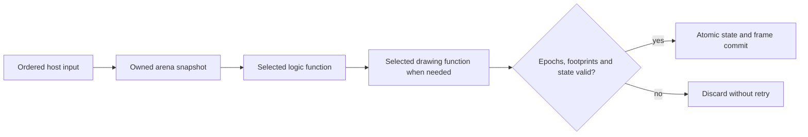

# Recovered array state, drawing and input in a browser

The bounded-memory profile extends the earlier scalar food experiment with
indexed arrays and bounded control flow. It uses the same explicit UIL for
Wasm and WGSL. No Snake operation, DOS address or original byte sequence is
implemented by the compiler. The Snake recovery recipe expresses game rules,
input admission and raster drawing as ordinary arithmetic/load/store/control
nodes. Original-code fidelity and generated-code execution are separate gates.

This is a new, deliberately finite profile. It does not change the existing
`fdisbull-il-1`, scalar contracts or scalar web backends, and it does not claim
that every native instruction or operating-system service is convertible.

## Memory UIL

`fdisbull-memory-uil-1` contains a `role` (`udl` or `uil`), a fixed
`memory:{words:N}`, typed local `variables`, named `functions` and optional
source `evidence`. Changing the role preserves every operation and source
reference. Each function declares its body and an execution budget.

The arena contains unsigned 32-bit carriers, with at most 131,072 words.
Expressions support local reads, indexed loads, unsigned arithmetic, comparisons
and bit operations. Statements support local assignment, indexed stores,
conditions, bounded loops and return. Logical 16-bit rules use explicit masks;
unsigned overflow is modulo 2^32. Divide by zero, out-of-bounds access and
exhausted loop/statement budgets refuse atomically. A refusal returns the
unchanged invocation input. The full program is validated, including untaken
branches. The reference interpreter and both emitters count the same statements
and loop-condition evaluations. There is no solver claim for these loops.

`udc_web_memory.validate_memory_uil`, `execute_memory_uil` and
`build_memory_block` are the Python entry points. Targets are
`wasm32-memory-1` and `webgpu-wgsl-memory-1`. Wasm is encoded directly, without
an external compiler. WGSL executes one sequential invocation per arena; this
experiment makes no GPU speedup claim. No implicit host effect occurs inside
either realization.

## Persistent contracts and selected layers

Memory blocks use the existing immutable contract/layer/selection storage with
their own strict validators. The behavior kind is `memory-uil`, and the typed
port is an explicit `u32-array` arena. The scalar validators reject this profile
rather than interpreting it as scalar ports or ignoring adapters.

Discover these JSON methods in the matching source environment:

```text
store-memory-block-contract
store-memory-udl-layer
select-memory-udl-layers
run-memory-udl-selection
build-memory-web-block
build-memory-web-shell
```

Every function is bound to an exact contract and layer. Selections retain the
complete module UIL. Resolution checks the program, function, target and
contract identities again; unsupported adapters/domains and unknown layer
fields refuse on read as well as on registration. A retained snippet identifies
the original source span. It is evidence of identity, not automatic equivalence.
Project restart must preserve selections and their endpoint hashes.

## Orchestration, ownership and device lifetime

The separate `fdisbull-memory-orchestration-1` plan declares named bindings,
input words, output footprints per function, committed ranges, scratch ranges,
state guards, rendering condition, indexed palette and browser event adapters.
Optional array guards establish bounds, uniqueness and grid adjacency for an
active prefix and exclude a conditional value such as food from that prefix.
Snake's plan guards every DOS word and cell as well as these relational
preconditions; invalid diagnostic replacement refuses before changing state.
Scratch can be modified during a transaction but is not committed. The font,
strings and other undeclared ranges remain read-only. Kernel output that changes
an undeclared word, exceeds a state guard or contains an unknown palette index
fails before any application state change.



Each stage can independently select Wasm or WebGPU while retaining the same UIL.
The shell owns mutable state. Snapshots, descriptions and invocation inputs are
copies. Provider registries are copied at construction. The shell validates
provider target, module identity, function and arena size.

`start` stages work and `finish` consumes the ticket once. Readiness is not a
commit. Session, generation, revision, binding epoch and provider epoch/loss are
checked at commit, with no await or callback between the final check and write.
`dispatch` processes ordinary inputs FIFO, capturing game state at the input's
turn. A replacement or backend change invalidates active and older queued input;
it is never silently replayed. Requests and queues are bounded to 64 operations.
`discardPending` invalidates the current input context and drains its physical
tail. Pointer motion is coalesced, and a release refused by an overloaded queue
uses this explicit cancellation boundary before admitting a fresh release. The
UI reports that discarded backlog; a held button is not left latched silently.

GPU providers serialize compilation and jobs per device within their runtime
module. Inputs are validated before numeric narrowing. Readback is copied before
unmapping, canaries are checked, and buffers remain leased until submitted work
settles even if logical work is cancelled. The browser loader centrally owns its
device; per-function providers borrow it. Disposal invalidates application state,
drains all providers and only then destroys that owned device. A borrowed device
survives direct shell disposal. Unrelated users of a shared device must coordinate
validation scopes themselves. Provider failure never selects a fallback backend.

## Selectable blocks inside a function

An inline copy of a function does not automatically call its selected backing.
To establish that boundary without rewriting the accepted UIL, pass an optional
`cuts` document to `build-memory-web-shell` or Python `build_memory_shell`:

```json
{
  "format": "fdisbull-memory-cuts-1",
  "module_uil_sha256": "<canonical program digest>",
  "cuts": [{"caller": "owner", "entry": "owner.node-id", "callee": "math"}]
}
```

The entry identifies the first statement of a contiguous region equal to the
entire named callee body. Equality removes only statement IDs and evidence; it
does not infer semantic equivalence. The original program, its hash and its
persisted selections remain unchanged. `lower_memory_cuts` produces a separate
`fdisbull-memory-cut-lowering-1` derivation and exact phase programs. Both target
compilers consume those ordinary UIL programs; neither knows game rules.

This first profile refuses overlapping cuts, ambiguous IDs, recursive calls,
more than 16 active function frames, loop ancestors, returns inside a cut,
callee local live-ins and continuation local live-ins. It does not serialize a
general native stack. A continuation executes its remaining lexical tails once,
without reevaluating the branch condition that selected the cut. Static bounds
must establish that every phase fits the backend budget, including its two
adapter statements. A callee budget that could add a refusal to the original
inline caller is also refused at build time.

The caller yields through a private captured local. This does not add an
application word: indexed loads and stores retain the original arena bound.
Optional `build_memory_block(report_steps=True, capture_locals=[...])` receipts
expose exact statement/loop-condition charges and owned captured-local values.
Default compiler artifacts and receipts retain their previous bytes. Wasm uses
private exported globals; GPU readback metadata follows the application arena
and precedes the canaries.

The shell captures every binding for the whole transaction. A yielded caller
invokes that captured callee selection and resumes on its captured caller
backend. All phases, nested blocks and rendering remain private until the
existing final commit check. Each complete logical function must respect its
declared output footprint. Application state guards run at the public logical
function boundary, not between private phases. One source caller budget covers
its prefix, child and continuation, subtracting only the two introduced adapter
charges. A phase may complete bounded pure computation before aggregate budget
exhaustion is detected; the public result is discarded atomically. Identical
failure timing and instruction scheduling are not claimed.

Cut-enabled transaction receipts include the actual invoked functions,
backends, phases, statuses and charges. Verify these as well as output equality:
matching results alone do not prove a selected nested backing ran. Phase
wrappers share the shell's ownership, availability, epoch and disposal rules.
Changing a binding while a child is pending invalidates the entire result;
there is no mixed-epoch resume, fallback or retry.

## Named regions and deliberate behavior variants

`store-memory-region-contract`, `store-memory-region-layer` and
`select-memory-region-layers` retain independently selectable source regions in
the existing immutable database. Their strict `memory-region` consumer is
separate from the exact `memory-uil` contract. Existing validators still reject
an implementation that differs from its exact contract.

This first region profile names one source store by function, node ID and
count 1. Its contract declares literal read indices and one output word with a
range. A realization is an ordinary one-store UIL expression with no locals or
effects. Both source and implementation therefore charge exactly one statement;
arbitrary multi-statement variants require a separately defined charging policy.
The backend contains no generator or game-specific implementation.

The `fdisbull-memory-regions-1` plan supplies named slots, an exact default and
labelled variants, each pinned to persisted Wasm/WebGPU selections. A layer must
declare `exact-source-region` or `intentional-behavior-variant`. Exact layers must
match the original expression after stripping only IDs/evidence. A differing
expression requires both the latter assurance and explicit
`allow_behavior_variants: true`. Every stored endpoint is revalidated on read.

Pass this plan as the optional `regions` parameter of `build-memory-web-shell`,
along with a `fdisbull-memory-cuts-2` document. That cut document retains the
canonical source digest and may name virtual region callees; its callers must
belong to the canonical source. The builder preserves `manifest.program` and
`module_uil_sha256`, then derives a separately hashed execution view containing
the original region export. Phase programs and region implementations retain
their own true UIL digests. No artifact is relabelled with the canonical digest.
The loader verifies the source/view relationship, topology, policies and hashes.

`selectRegionImplementation(name, variant)` changes the chosen realization;
`selectBackend(backend, [name])` independently changes its compute backend.
Snapshots expose owned `implementations` selections. Both maps are captured
before the operation begins. A choice change, including an original/alternative/
original cycle, invalidates pending work. A region result must preserve every
other arena word and satisfy its own output range before the caller resumes.
All variant wrappers remain subject to normal ownership and disposal rules.

Preserving the source UIL does **not** make a deliberate variant equivalent to
its precise source expression. It is an explicit override at the declared
behavior boundary. Qualify exact-mode fidelity and alternative-mode behavior
separately, and retain the original route as the default.

`snake_browser.py --rng` exposes the seed update as `rng` and composes
action → selected step → selected RNG → continuation. The original recurrence
is `(seed * 25173 + 13849) & 65535`. The alternative is a Galois LFSR16 with
feedback mask `0xB400`; zero maps to `0xACE1`. Both are ordinary UIL expressions.
The game draws once when it needs new food, then scans forward to a free cell.
It skips the generator on a full-board win. Browser controls independently
select the algorithm and backend, preserving the current seed and game state.

`prepare_snake_rng_study.py` derives private comparison data from the frozen
corpus and a separately recorded numeric/original-CPU probe. Alternative models
are intentionally changed private references, not replacements for the accepted
UIL. The replay tests original fidelity, alternative state/raster behavior,
one-word seed transitions, current-seed switches and a common input route whose
outcome differs. The modified food positions, snake lengths and collision
outcome are expected differences; they are not parity failures or statistical
quality results.

The [RNG qualification receipt](evidence/snake-rng/verification.json) records
actual Node/Chrome execution on Wasm and Metal GPU. Original mode preserves the
342 accepted cases; the LFSR intentionally changes 84 of them. Four additional
alternative carried arms per host compare complete state and rasters, and four
production-canvas arms exercise both algorithms and backends. A 26-move route
ends in death with the original generator and survival with the LFSR because
different meals change body length. A focused production-loader replay switches
after the first meal without editing the board or seed: food remains 389, then
the second meal consumes current seed 10589 through the LFSR, producing 41134
and food 334. See `run_snake_rng_switch.mjs` for that separate finite check.

## Browser services

The canvas host implements service adapters only: keyboard events to declared
logical input words, pointer coordinates/buttons, a monotonic clock adapter and
indexed-pixel presentation. Game-specific bindings and geometry are plan/model
data. The logic and drawing selectors are independent, permitting mixed backings.
Pointer coordinates account for CSS scaling and canvas borders. A press is
distinct from its release; the recovered UIL owns button-edge semantics.

Only keys declared in the host plan are admitted. Tests of the declared controls
do not establish a complete PC keyboard/IME translation. The clock adapter
supplies BIOS-equivalent tick values; input/state/frame checks do not establish
identical wall-clock scheduling, native firmware behavior or performance across
hosts. Cursor overlays are excluded from the raster comparison. On quit, the
browser releases its services; DOS restores text mode and terminates its process.
Ctrl/Alt/Meta combinations remain browser commands. Focus/capture loss ends the
pointer gesture, and a backend change admits a fresh release under the new
binding epoch. Canvas geometry follows its declared intrinsic dimensions.
Reload starts a new browser session. There is no saved-game persistence protocol.

## Snake recovery and reproduction

The original is the private 3,851-byte known-source DOS fixture. This recovery
is explicitly source-assisted. Compiler-listing boundaries, stored disassembly,
native CPU executions and real guest input bind its logical model to retained
source snippets. The original executable remains unpatched. General/segment
register preservation and the near-call stack are native adapter obligations;
arithmetic FLAGS are clobbered and are not logical results.

The recovered functions are reset, one game step, input/clock processing and
indexed rendering. State contains the complete 600-cell body array and logical
word fields. The original live font and palette are private runtime data, not
bundled tool resources. Complete cursor-free VGA rasters, including text, are
compared at the 320x200 indexed projection, followed by actual canvas RGBA checks.
A declared RAM-state intervention tests the full-board win separately from
ordinary play. Source/model cases do not imply ordinary reachability.

Use a matching source environment and new private destinations. The installed
system candidate and this source branch can have different method inventories.

```text
snake_original.py --help
snake_model.py --help
snake_browser.py --help
```

The recipes under `examples/recovery/` take explicit original, tool and output
paths. Compile outside Git, including outside a private guard repository.
`run_snake_browser.mjs` owns a finite allowlisted loopback server, isolated
Chrome profile and actual Node/Chrome GPU qualification. It does not serve the
original executable, project database or a source directory. The delivered
browser bundle is separate from its qualification payload and profiles.

`snake_browser.py --nested-step` identifies the two exact recovered inline step
regions in `action`, calls the selected `step` backing, then executes the source
continuation. This is a separate build; the earlier frozen baseline stays
intact. The replay adds owner/step backings selected independently in both
directions, and an alternating arm where step uses the opposite backend. The
canonical recovered UDL/UIL and original executable remain the same.

The [nested-step qualification](evidence/snake-nested-step/verification.json)
records 342 original-derived step cases per backend in each of Node and Chrome,
plus ten carried-play combinations per host. Each arm compares 69 observations
over 79 input events, with 38 actual nested step invocations and 117 caller
phase invocations. Two additional production-canvas arms retain trusted game
keyboard/mouse events. Original DOS observations are reused from the frozen,
identity-checked corpus; this continuation does not claim a fresh DOS session.

See the [sanitized qualification receipt](evidence/snake-browser/verification.json)
for actual case counts, backend identities, failures detected, equality boundary
and remaining limits. Whole-binary recovery and all-input equivalence are not
claimed from finite comparisons.

The qualified Snake corpus contains 342 original CPU cases and 69 native
observations. Node and Chrome compare both backends and five carried
logic/drawing combinations, including alternating bindings. Two additional
production-canvas arms use trusted CDP game keyboard/mouse events and compare
every Canvas RGB byte. Native backend-selector popup operation and native
window blur were unavailable in the headless Mac profile: selector handlers use
explicit DOM change events, and blur-handler acceptance uses a labelled
synthetic lifecycle event. Native pointer-capture loss is exercised separately.
