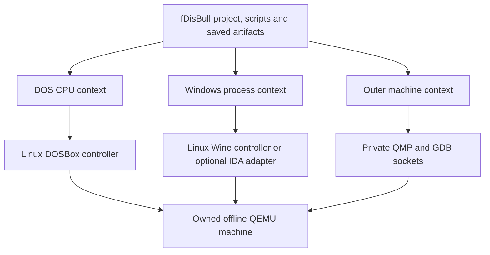

# Shared machine and target debugging (unreleased)

DOS and Windows now use the same owned QEMU machine lifecycle while retaining
their target-specific debugger engines. DOSBox runs as a Linux process inside
the machine; Wine runs Windows processes inside that Linux environment. A
separate outer-machine context reaches the emulated CPU before an operating
system or guest controller is available.

This is local development after 0.13.0. Published 0.13.0 packages do not contain
these profiles. No new release or hosted CI result is implied by the local
verification below.



## Profiles and context boundaries

| Backend | Default context | Outer machine | Qualified scope |
| --- | --- | --- | --- |
| `dosbox` | `dos-cpu` | None | Existing native DOSBox API |
| `dosbox-qemu` | `dos-cpu` | `machine` | Linux DOSBox, native DOS states, RAM/fetch layers, watches, scripts, screenshots and input |
| `wine-qemu` | `process` | `machine` | Existing PE64 Wine debugger, watches, layers and editable whole-machine states |
| `ida-wine-qemu` | `process` | `machine` | Optional IDA 9.4 adapter; see its separate feature limits |
| `qemu-machine` | `machine` | The default context | Raw x86 boot image, bounded CPU control, physical/virtual memory and display capture |

`debug.contexts()` lists the contexts. `debug.context("dos-cpu")` or
`debug.context("process")` returns the target session; `debug.context("machine")`
returns the outer machine controller. The shorthand `debug.machine` is
available on QEMU-backed target sessions. Machine addresses refer to the
selected QEMU vCPU and its page tables. They are not DOS disassembly addresses,
Windows process addresses, or inferred operating-system thread identities.

All vCPUs stop when the outer machine is paused. The initial machine API
inspects and steps the first vCPU. It does not enumerate Linux tasks, Wine
threads or NT kernel objects. The target debugger retains its existing thread
handling. Target RPC calls are rejected while the outer machine is explicitly
paused, because its Linux controller cannot execute then.

## DOSBox inside Linux/QEMU

Prepare a new runtime using a trusted Linux base that contains the required
DOSBox shared libraries and an explicitly selected patched Linux x86-64
DOSBox-X executable:

```bash
python -m fdisbull.dos_runtime \
  --base-initramfs /private/runtime/base.cpio.gz \
  --dosbox /private/backend/linux-dosbox-x \
  --output /private/runtime/dos-current.cpio.gz
```

The preparer adds the small DOS controller and records resource hashes. It
does not build DOSBox, install dependencies, or include a game. The handshake
checks the current controller sources against the prepared runtime. Reprepare
the runtime when those resources change.

```python
from fdisbull.project import Project

with Project("/private/projects/dino.fdb") as project:
    with project.debugger(
        "/private/backend/qemu-system-x86_64",
        "/private/games/dinopark",
        backend="dosbox-qemu",
        kernel="/private/runtime/linux-amd64",
        initramfs="/private/runtime/dos-current.cpio.gz",
        files=["DINOPARK.EXE", "VARS.DAT"],  # Supply the actual required asset list.
    ) as debug:
        print(debug.contexts())
        debug.run(guest_ms=35000, fast_forward=True, timeout_ms=120000)
        debug.screenshot("menu.png", grid=True, grid_step=8)
        debug.click_frame(75, 160, name="new-game.png", grid_step=8)
        debug.machine.pause()
        print(debug.machine.registers())
        print(debug.machine.memory(0x5000, length=16, space="physical"))
        debug.machine.resume()
```

The asset names above illustrate an allowlist, not a complete DinoPark install.
The reproducible repository example `examples/dinopark/verify_remote_endpoint.py`
constructs the explicit list for the tested original game. It can select
`--backend dosbox-qemu --executable QEMU --kernel KERNEL --initramfs RUNTIME`.
Its output must be outside Git. The real run reached New Game and the bank
screen through the binary remote endpoint, with an 8px click-frame, a
relocated patchless breakpoint and 512 fetch records.

Uploads are bounded to 1,024 files and 64 MiB, with relative paths, target hash
checks, no symlinks and no implicit directory mount. Databases and state files
are rejected as launch assets. The guest has no network interface. Large game
bundles use the explicit bounded five-minute asset/start request and a
ten-minute remote launch budget in the replay example; startup is not included
in trace timings.

Native DOS state files describe DOSBox CPU/device state, with the guest file
manifest checked separately. They do not checkpoint the surrounding Linux VM.
Restore requires the same QEMU, kernel, prepared runtime and compatible guest
files. The native gate restores a state after replacing the owned VM. A
restored framebuffer is invalid until DOSBox completes a new frame; a rejected
capture preserves the live session. State files and the project database
remain private local inputs.

## Boot and outer-machine debugging

Import the original raw x86 disk image with an explicit bitness, base and
entry. `project.machine()` verifies that exact original source hash, starts
QEMU halted before firmware execution, and uses a private temporary disk write
overlay. The source image remains unchanged.

```python
from fdisbull.project import Project

with Project.create(
    "/private/projects/boot.fdb", "/private/boot.img",
    arch="x86", bits=16, base=0x7c00, entry=0x7c00,
) as project:
    with project.machine(
        "/private/backend/qemu-system-x86_64", boot_image="/private/boot.img",
    ) as debug:
        bp = debug.breakpoint(0x7c00)
        stopped = debug.run(timeout_ms=15000)
        debug.delete_breakpoint(bp["breakpoint_id"])
        print(debug.registers())
        debug.trace("boot-trace.json", count=3, timeout_ms=10000, bits=16)
        debug.screenshot("boot.png", grid=True, grid_step=8)
```

The current raw-boot profile accepts a source image up to 64 MiB, boots one
vCPU with 128 MiB of RAM, and supports x86 instruction widths 16/32/64.
`memory(..., space="physical")` reads physical bytes;
`space="virtual"` uses the selected vCPU's current mapping. Execution
breakpoints and `r`/`w`/`rw` data watches use QEMU's GDB controls without
replacing guest instruction bytes. Bounded run interrupts on timeout and
leaves a stopped machine. Uncertain transport failure closes the owned VM
instead of replaying a mutation.

Guarded edits require expected bytes or register values:

```python
debug.write_memory(0x5000, "2900", expected_hex="0700", space="physical")
debug.write_registers({"rax": {"expected": "0x0", "value": "0x1234"}})
```

Remove machine breakpoints before `debug.machine.resume()` returns control to
guest services. Use bounded `machine.run()` while those breakpoints remain
active. The controller disconnects the GDB channel before resuming guest RPC,
so asynchronous stop packets cannot become replies to later requests.

The foreground JSON interface accepts `context: "machine"` on supported
operations, plus `debug-contexts`, `debug-pause` and `debug-resume`. The
`qemu-machine` launch profile uses the raw project's image from `game_dir`.
Screenshots and traces use the same persistent project artifact/export API;
reopening the database does not require a live emulator or a GUI.

## Trace semantics and remaining limits

DOS traces record pre-execution instruction fetches. Their final requested
record is pending execution. PE and outer-machine traces record confirmed
completed steps with the corresponding pre-step bytes and register snapshot.
Machine traces require explicit bitness when called through an outer context;
a raw project defaults to its imported bitness. QEMU's default single stepping
masks interrupts and timers, so this is a controlled instruction experiment,
not a faithful elapsed-time trace. See the [QEMU GDB documentation](https://www.qemu.org/docs/master/system/gdb.html).

The outer context currently advertises native states and code layers as
unsupported. Existing DOS and PE state/layer implementations remain scoped to
their own backend. CPU register edits are available, but register-read filters
and a universal execution-overlay engine are not implemented. Typed kernel
structures, operating-system task discovery, cross-context address translation,
full Windows kernel boot qualification and DTrace providers remain future work.
The real boot acceptance is an authored BIOS boot sector, not a Windows kernel
session. DTrace event collection would complement this controller; it has not
been substituted for breakpoint, state or machine control.

The Linux DOSBox binary used for this acceptance was recovered from the
existing trusted local runtime. Its archive origin and SHA-256 are recorded.
The real feature gate verifies its behavior, but this continuation did not
independently rebuild it to establish source-to-binary parity. No supplied
`bam.zip` or `condrv.cpp` code was compiled or integrated.

Fresh local evidence is recorded in
`experimental/remote-debugger/evidence/2026-10-25-unified/`. The final concurrent
pause correction and package checks have a separate receipt under
`experimental/remote-debugger/evidence/2026-10-25-unified-final/`. Required native
checks use `FDISBULL_MACHINE_QEMU`, `FDISBULL_DOS_KERNEL` and
`FDISBULL_DOS_INITRAMFS`; `FDISBULL_REQUIRE_DOS_QEMU=1` prevents a missing DOS
runtime from becoming a skip. Keep all emulator binaries, runtimes, original
games, native states and project databases outside public source/packages.
