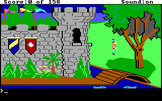

# Original DOS KQ1 host verification — 31 October 2026

PR #76 was checked on exact head
`89a88aa39920a10b400bc07a2e0fa1a7b5ebbab2`. Its canonical
[ordinary workflow](https://github.com/seeker-cyber-maker/fDisBull/actions/runs/41199457329)
and [native workflow](https://github.com/seeker-cyber-maker/fDisBull/actions/runs/41199457216)
passed. The latter includes stable/layers backends and installed-wheel
DOS/boot/PE64 acceptance. The push duplicates also passed. No CI repair was
necessary; these results are for the parent, not an assertion about new code.

The follow-up adds an [explicit DOS host adapter](AGI_DOS_HOST.md), corrects a
native-observed `set.view` model mismatch and tests interruption/recovery.
`execute_il` retains its model-only contract. The authored native runner is
[`examples/agi/verify_host.py`](../examples/agi/verify_host.py).

## Original-backed trials

Fresh private KQ1 copies were run with genuine CPython 3.13.13 on macOS ARM64
and the installed patched native DOSBox backend. These are actual original
interpreter handlers, not ScummVM, supplied synthetic host acknowledgements or
a replacement game. Each trial used a temporary caller-operand intervention,
restored before logic 103 executed, and explicitly authored initial state.
The selected 470-byte logic code remained equal to its captured resource.
All original inputs and the seven private game copies were unchanged after
teardown; each original manifest contains 24 files.

| Trial | Observed source instructions | Result | Returned host operations |
| --- | ---: | --- | --- |
| Baseline | 9 | Verified | None |
| Initialization | 24 | Verified | draw at 173 |
| Horizon boundary | 24 | Verified | draw at 173 |
| Nonblocking print | 31 | Verified | draw at 173, print at 450 |
| Erase after a completed setup invocation | 26 | Verified | print at 413, erase at 427 |
| Blocking print awaiting input | 28 completed, next attempted | Incomplete; recovery required | Prior draw at 173 retained; no print completion |
| Foreign execution breakpoint in draw | 15 completed, next attempted | Incomplete; recovery required | No draw completion claimed |

Offsets in the table are decimal bytes from the logic code start.

The five successful trials matched the source path, 22 scalar bindings and
declared object/resource projection at a stack-matched original evaluator
return. The erase setup invocation also passed. The second erase invocation
was explicit: after the first completed, its native call frame was checked
and execution was redirected to the original CALL site for a new invocation.
This does not demonstrate natural gameplay reachability or an entire campaign.
Repeated `run()` and `readback()` calls preserved their result without replay.

The result names excluded fields: `view_replaced` is a model helper without
qualified native storage; inactive follow/cycler union bytes have no separate
follow meaning; null previous-cel pointers do not establish previous dimensions.
Loaded resource payloads and current/previous cel bindings are checked. This
is equality of a selected final projection, not every intermediate value,
rendered pixel, scheduler tick or whole game. The nonblocking print screenshot
did not establish a visible message box. Its receipt qualifies original handler
return and explicitly records `visual_verified: false`.

## Native discrepancy and regression

At source offset 10 (`set.view`), the horizon probe's original object 13 had
y=50 and horizon=50. The returned original handler kept y=50 and bound a
24-pixel-high cel, with a valid top edge. The previous model independently
clamped y to 51. The corrected model follows the original branch: check the
horizon only while repairing a negative top edge. Unit regressions include
this observed case, a top edge exactly on row zero, and a negative top edge.
The private native step snapshots preserve the before/after witness; a later
position command overwrites y, so final-state equality alone would not detect
this particular defect.

## Contract checks and retained evidence

Authored synthetic tests exercise packed flags, current-record/stack/source
binding, stale epochs, interpreter changes, real-mode bounds, unsupported
motions, source tampering, source-fetch/return handling, foreign/data-access
stops, exhausted budgets, malformed capture schemas, cel pointers, coherent
snapshots after breakpoint cleanup and missing screenshots after completion.
Lost/partial responses preserve attempts and completions and cannot replay.
These tests validate contracts; they are not additional original-game trials.
The final selected local suite passed **424 tests**, with one test skipped
because it requires a case-sensitive filesystem. It includes AGI, compact
control flow, host/effect contracts, IL, decoder modules, Z-machine, UDC,
distribution and both bundled-skill checks.

This is an unedited stored native frame from the controlled initialization
trial, not a claim of natural progress through the game.

The [sanitized receipt](evidence/agi-host-2026-10-31/receipt.json) retains source,
backend and implementation identities, source offsets, exclusions, original
immutability checks and private result digests. The raw projects, model
checkpoints, contexts, bytecode, messages, states, game files and full traces
remain private. Only authored code, selected screenshot evidence and sanitized
metadata are committed. This work does not tag, publish or update an installation.
