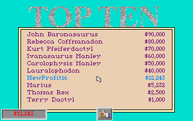
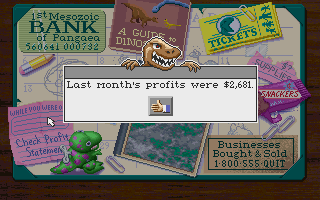
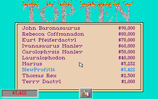

# Profitable NEW GAME and durable leaderboard entry with delivered 0.16.0

The final saved script completed a second, fully automated NEW GAME run:
**$4,028 profit for the completed month, $10,506 cash after full loan repayment,
and NewProfit16 at rank 7 / $12,243** after the original sale. A second fresh
emulator and separate project read back the entire 250-byte table from disk.
The [scripted replay receipt](evidence/0.16.0-newgame-profit/scripted/VERIFICATION.json)
records both reaped processes, zero native-state save/restore calls, no imported
saved games, no memory/register edits, and only `TOPTEN.DAT` changed privately.
Its table SHA-256 is
`5d253805092a73973ff9b13c98b45e5f36db414c7879f56fe6b0268f95f545ba`.



The script stocks food before opening, checks the guide and committed purchase
values, waits within separate guest-time/wall-time limits for the completed
winter quarter and sufficient cash, then verifies the bank and sale transitions
with calibrated RGB masks. Its successful solvency wait recorded 123 polls and
132,710 measured guest milliseconds, including the known quarter-popup handler.
The named parking-hint handler was authored after a separate desync capture;
that hint did not recur in the successful run. This is one qualified automatic
route, not a claim of deterministic replay or arbitrary-popup coverage.

## Earlier interactive NEW GAME result

The original DinoPark executable, driven through the delivered fDisBull 0.16.0
module and its Mac ARM64 DOSBox backend, completed a profitable NEW GAME park.
The game reported **last month's profits of $2,681**. Cash was $6,572 against
$4,650 debt after that settlement. The bank's normal Payoff control repaid the
entire loan, leaving **$1,922 cash and $0 debt**. Selling the park through its
office produced **NewProfit16, rank 8, $3,422** in the original leaderboard.



The accepted fresh emulator and separate project read all **250 bytes** of
`TOPTEN.DAT` through the game's own reader. The guest buffer exactly matched
the written disk table, including NewProfit16 at rank 8 / $3,422. Its SHA-256
was `1e6a8bf26b187faebf9242d1931d7a1eb84059a99fa858fbfcc476f0bf5741b5`.
The fresh reader was stopped at static `27E5:0527`, before any second write.



## Inputs, actions and evidence boundaries

- Exact delivered source: 0.16.0, release target
  `e1e3fb4913d6d8fae7893c2c9b8edf364d144953`.
- Tested backend SHA-256:
  `315beb4e01c7d81a96209dd949c239675517af53102dd97bd0eb30bde7a0fdbb`.
- Original executable SHA-256:
  `2127315b475b560f8c0fe409769fd6d137e26d9390d2fafc7d03a60a266a827c`.
- Native run here: macOS ARM64, Python 3.13.14. This receipt does not claim a
  new Linux gameplay run.
- All eight supplied `DINOSG.*` files were excluded from the private game copy.
  No existing park or imported native checkpoint was loaded. The private copy
  started with 184 files; all 192 original input files remained unchanged.
- The park bought one desert plot ($500), one Coelophysis ($1,250), one wood
  fence ($1,000), and hired one tour guide ($900/month). A later committed food
  order stocked 20 small-feeder units. There were no concessions or code layers.
- All actions used guest mouse/keyboard input. There were no debugger cash,
  loan, RAM or register edits, no host score-file edits, and no native-state
  restoration. One exploratory checkpoint was saved privately and never
  restored; its bytes and database are excluded from this evidence.
- Both accepted processes closed and were reaped. Only `TOPTEN.DAT` changed
  in the private mounted game directory.

The first month lost $15. An initial attempt to buy food only selected its
icon: that reveals the separate **More** control at native (133,108). It did
not commit the intended order. After the corrected order and another operating
period, the original office reported the $2,681 profit. The bank's “paid in
full” message also precedes the live cash/debt update: the receipt checks the
committed values after acknowledging that popup.

## Breakpoints, watches, traces and persistence

The cash write watch covered four bytes at static `4020:5C3A`. It stopped on
an actual $147 increase. Byte-granular watches can interrupt tracing again on
another byte of the same word write: the exploratory trace contains only two
events and is explicitly incomplete. After deleting all four watches, a
complete 128-instruction cash-path trace was captured.

The byte-verified writer breakpoint at static `27E5:0379` stopped before the
leaderboard write; the score file still had its original hash at that stop.
A second complete 128-instruction trace records that writer entry. The fresh
reader has its own complete 128-instruction entry trace, followed by the full
table equality check at `27E5:0527`.

The first fresh-read attempt reached the reader but its host-side memory
request used a short hex address instead of the protocol's required eight
digits. That attempt was not accepted. A new project and emulator repeated the
route with a correctly formatted address and passed the full-table check.

## Saved route and synchronization limits

[verify_newgame_profit.py](../examples/dinopark/verify_newgame_profit.py) and
its [route journal](../examples/dinopark/routes/newgame-profit.json)
preserve the navigation, input and observation operations. The preparation
retains the confirmed shop navigation and buys food before opening. It is not
an optimized strategy.
Private inputs and project output must be outside Git:

```bash
python examples/dinopark/verify_newgame_profit.py \
  --delivery /path/to/fdisbull-0.16.0-e1e3fb4 \
  --game-dir /path/to/your/original/dinopark \
  --work-dir /path/to/new-private-work \
  --evidence-dir /path/to/new-evidence
```

The original successful session was interactive and fully recorded. Two blind
replay attempts diverged and were rejected by the final debt check. Removing
the initial restart calibration fixed the early purchases, but fixed timing
still reached a different month and scene. Those failures are retained as
negative evidence; a sequence of accepted clicks is not proof of navigation.

The example's later settlement/sale path therefore uses bounded guest-time
and wall-time checks, explicit quarter-popup handling and a small task-local
set of [RGB scene masks and named controls](../examples/dinopark/routes/newgame-pixel-patterns.json).
Unexpected scenes pause the route and save a diagnostic frame. These masks
match only calibrated pixels; they do not infer arbitrary widget semantics.
They are an example helper: delivered 0.16.0 still transfers a PNG to sample
those pixels, and has no new native pixel-probe or general scene-overlay API.
The [scene proposal](SCENE_ACTIONS_PROPOSAL.md) records the requested grid-based
named-button model, ordered if/else/exception rules and replaceable recognizers.

## Waiting keyboard PR

[PR #1](https://github.com/seeker-cyber-maker/fDisBull/pull/1), head
`120580f2203c071f9fb2616c177d0eb78e65f264`, adds 70 lines to
`tests/test_keyboard.py`. It is test-only, with no production keyboard fix or
version change. A fresh local run of that exact test file against the delivered
backend passed **17 tests, no skips**, including same-session and fresh-process
restoration while a synthetic guest waits in BIOS INT 16h, with empty and
partially typed input. Source review found no blocking issue in that scope.
Screenshot availability in those tests does not establish general graphics
restore fidelity. The PR remains separate from this game's unchanged 0.16.0
runtime and from any future scene-overlay work.
