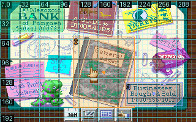

# Scene improvement verification — 0.18.0.dev0

27 October 2026. The locally built and separately installed development wheel
passed a real DinoPark NEW GAME replay on macOS ARM64 / Python 3.13.14, using the
previously qualified native DOSBox backend. This remains an **unreleased local
candidate**. Ordinary and native Linux CI have not run for these uncommitted
changes. Current published packages remain 0.17.0.

The [replay driver](../examples/dinopark/verify_scene_improvements.py) first runs
the original private NEW GAME scene calibration and stop-preservation checks.
It then adds relative outcomes and repeated readiness predicates, exports three
scenes with three clean reference PNGs, imports them into an independent
same-source project, closes/reopens that project and restores a private native
checkpoint into a fresh emulator. No checkpoint is in the scene bundle.

Eight named bank/ledger actions passed from the imported definitions, with eight
distinct pre-action baseline observations. Each required destination pixels and
an unchanged typed `u16` parking counter. This verifies a navigation invariant;
it does **not** establish a relative concession-purchase delta. Repeated counter
increments are independently tested in an authored DOS guest consuming real
BIOS keyboard input. Arithmetic/wrap cases and missing-capture failures have
separate regression tests.

## Measurements and contracts

| Check | Fresh result |
| --- | --- |
| Read deduplication | 17 evaluations, two unique backend reads, 15 cache hits in the office observation. A second check made two fresh reads. The smaller fixture also verified equivalent segmented spellings share a capture. |
| Compact presentation | 1,233 bytes versus 25,210 bytes for the **same retained full observation**, about 95.1% smaller. Both retain the same observation identity; the database keeps the full evidence. |
| Timing | About 9.86 ms for the full check and 9.03 ms for the compact check on one paused guest. These are individual local calls, not a general latency or full-route speed claim. |
| Portability | Three definitions and three clean PNGs imported with new local scene/object/artifact IDs. Fresh native recognition and eight real input actions passed. |
| Numbered overlay | Shared geometry, three markers and an exported legend. The imported project regenerated its overlay byte-for-byte after restart without an emulator. |
| Missing evidence | Missing before/current capture is incomplete, including under `any`; a popup baseline failure prevents input. |
| Debugger stops | The original-game execution breakpoint, two-byte write watch and one-shot hook were preserved. Native relative-outcome tests also retain these stop receipts. |
| Byte isolation | Different patched views and load segments reject the bundle. Original scene and snapshot history remain retrievable. |
| Atomic imports | An invalid later scene rolls back earlier scenes/artifacts/runs, including inside an existing transaction. Extra files and malformed ZIPs are rejected. |
| Input files | All 192 original files and 184 private-copy files remained byte-identical; accepted emulator processes exited. |

See the [installed-wheel receipt](evidence/scenes-0.18.0-dev/IMPROVEMENTS-VERIFICATION.json),
[compact reply](evidence/scenes-0.18.0-dev/deduplicated-compact.json),
[retained full observation](evidence/scenes-0.18.0-dev/deduplicated-full.json),
[portable scene bundle](evidence/scenes-0.18.0-dev/office-scenes.zip),
[number legend](evidence/scenes-0.18.0-dev/office-legend.json),
[saved route](evidence/scenes-0.18.0-dev/portable-navigation.script.json), and
[bounded trace](evidence/scenes-0.18.0-dev/portable-navigation.trace.json).
The saved JSON route pins this run's imported revision IDs. The replay driver
binds those IDs after each import; another project must similarly use its import
maps or resolve the imported scene names before saving a pinned route.

## Verification boundaries

The installed-wheel focused suite passed **33 tests with no skips**. This used
the installed package with pytest's source-path injection disabled. Native tests
exercise actual DOSBox input, RGB capture, memory reads, state restoration and
debugger stops; they do not replace those paths with mock native sessions.
The complete local native profiles passed **54 stable-backend checks** and
**335 layered-backend checks**, with no skips. These were macOS runs of the
expanded CI selections, not GitHub Linux CI results.

The complete final macOS run recorded **1,120 passed, 16 skipped, two failed and
23 setup errors**. All failures/errors are Linux ELF fixture/compiler cases:
Apple's `/usr/bin/gcc` produces Mach-O and rejects Linux assembler/linker flags.
This broad run is not green and is not Linux acceptance. Scene-specific tests
are included in both Linux native CI profiles; hook-only tests remain in the
layered profile. Exact local profile results and package audits are recorded in
the [verification receipt](evidence/scenes-0.18.0-dev/QUALIFICATION.json).

Definitions still depend on authored readiness and blocking conditions. The
calibrated DinoPark selector is a correlation plus verified transitions, not a
universal control-ready flag. No E39 review ZIP was supplied or replayed; these
are independent runs of the repository driver. Wine/PE64 pixel probing, automatic
scene rebasing and script-language engine reconstruction remain outside this
implementation.

Evidence contains authored scripts, clean/derived screenshots, declarative
manifests and bounded trace/stop receipts. Original game files, native state
bytes and byte-retaining project databases stay outside Git. Existing deliveries
and sealed 0.17 evidence were preserved. No commit, push, tag or publication was
performed for this candidate.
