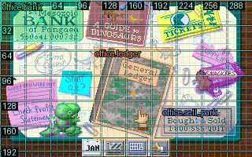

# Scene framework verification — 0.17.0.dev0

The installed development wheel and copied scene-capable DOSBox backend passed
a real DinoPark NEW GAME acceptance run on macOS ARM64 / Python 3.13.14.
This is an unreleased local candidate. Linux CI includes the scene tests in both
native profiles but has not run for these uncommitted changes.

The database retained stable object IDs, trigger/state context, original and
refined action geometry, snapshot evidence, recognition conditions and immutable
revisions. The acceptance renamed `office.bank` while preserving its ID and old
name as an alias. A reopened project retrieved the same object and rendered the
original overlay byte-for-byte without an emulator.

## Original-game checks

The [acceptance driver](../examples/dinopark/verify_scenes.py) made a private copy,
excluding the eight supplied saved games, and navigated from NEW GAME. It used
real mouse input to calibrate the reported office bank, ledger and sale-card
points, then authored definitions from clean native snapshots.

| Requirement | Observed result |
| --- | --- |
| Shared overlays and named actions | The same saved masks/points opened the ledger, returned to the office, opened the sale modal, cancelled it through an authored handler, opened the bank and returned. |
| Composite action masks | The ledger region subtracted the sale-card overlap; a point inside that hole was rejected before saving the definition. The bank region used a union of rectangles. |
| Availability distinctions | Visible-but-not-ready and disabled bank definitions rejected input, retained their separate condition values and saved diagnostic frames/overlays. |
| Recognition collision | A second exclusive scene matched the same office frame. The framework raised ambiguity, recorded both revisions and saved the source frame plus both overlays. A new revision disabled the competing match while retaining its history. |
| Breakpoint preservation | A repeated original-game instruction was selected from a bounded live trace, analyzed in its observed CS and byte-verified. Scene waiting stopped at the execution breakpoint. |
| Hook preservation | A one-shot no-byte-change hook at the observed instruction was reported as a stop; scene waiting did not resume through it. |
| Write-watch preservation | A two-byte watch on static `4020:3C5C` caught the bank transition's selector write. The entire stop receipt was retained before the test driver explicitly removed the watches and resumed. |
| Checkpoint/session invalidation | After closing the project/emulator, a fresh emulator restored the private checkpoint. Scene checks were unavailable until a new completed frame. Fresh checks and named bank navigation then passed with the new native mode generation. |
| Input and file boundaries | Both accepted processes were reaped. All 192 original files and all 184 copied game files remained unchanged. No game files, state bytes or project database are in the exported evidence. |

The write watch reports legacy `run.outcome=breakpoint` with
`stop.trigger=watchpoint` and a `data_access` record. The framework preserves this
existing contract. Its causing instruction was observed at project `0x32F92`;
the receipt distinguishes that instruction from the watched data address.

The readiness condition used an observed dispatch-selector word (`FFFF` during
the calibrated office state), plus independent visual/transition checks. This is
an explicitly labeled calibration, not proof of a universal control-registration
flag. The framework enforces the author's three conditions; it does not infer
arbitrary game semantics or automatically discover unknown popup types.

See the [installed-run receipt](evidence/scenes-0.17.0-dev/dinopark/VERIFICATION.json),
[persisted observations](evidence/scenes-0.17.0-dev/dinopark/observations.json),
[bounded input trace](evidence/scenes-0.17.0-dev/dinopark/scene-input.trace.json), and
[watchpoint stop](evidence/scenes-0.17.0-dev/dinopark/watchpoint-preserved.json).

## Native pixel cost

Ten alternating measurements on the same stopped original-game frame compared
48 native RGB samples against a raw native PNG request:

| Observation | Median call time | Serialized result size |
| --- | --- | --- |
| RGB probe | 0.511 ms | 2,395 bytes |
| PNG | 2.691 ms | 42,600 bytes |

This sample was about 5.3 times faster and 17.8 times smaller. The probe timing
includes persisted event logging, while the raw PNG call excludes artifact
persistence. Sizes are the driver's JSON serialization of each result, not a
network packet accounting claim. No PNG was encoded/transferred by `video.probe`.
These are bounded local measurements, not a speed guarantee or a full-route
benchmark.

## Regression and package checks

- Focused layered-backend checks: **70 passed**, no skips. This covers scenes,
  native debugger/input/wait contracts, grid rendering and distribution guards.
- Stable-backend checks: **38 passed**, no skips.
- Installed-wheel scene checks, with source-path injection disabled: **6 passed**,
  no skips. The actual DinoPark acceptance above also used the installed wheel
  from its separate delivery directory.
- Complete macOS suite: **1,102 passed, 17 skipped, 2 failed, 23 errors**. Every
  failure/error is in the unchanged Linux ELF compiler fixtures. A separate
  reproduction identifies `/usr/bin/gcc` as Apple clang and rejects the Linux
  assembler `.type` directive. The full suite is not represented as green.
- Both complete backend patches replay against pinned upstream
  `029bd65c5dcc7cdc7f2e14e35278620d9707d969`; resulting source hashes match their
  manifests. Both native profiles were rebuilt and tested on this Mac.
- Wheel, sdist and tool ZIP audits passed, including the bundled agent skill and
  exclusion of program files, saved states and project databases.
- The `fdisbull-investigate` skill passed the skill creator's structural validator.
  Its exact packaged files match the wheel. It adapts the relevant user-supplied
  reverse-engineering principles and adds explicit cost/reward prioritization
  alongside confidence; this is authored guidance, not a trained classifier.

Raw test logs, compiler diagnosis and backend source identities are under
[the evidence directory](evidence/scenes-0.17.0-dev/). The [implementation guide](SCENE_FRAMEWORK.md)
documents API behavior, shape conventions, limits and unsupported backends.
