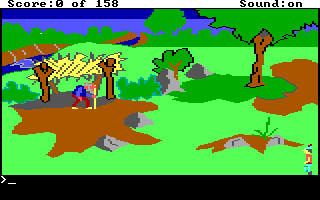
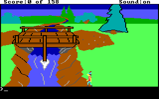

# Bounded alignment and frame/state verification

This source follow-up to MR !38 adds reusable coordinate alignment and paused
frame/state brackets. The new helpers were checked against two fresh ordinary-input
KQ1 sessions using the selected AGI 2.917 original and the tested macOS ARM64
DOSBox backend. The full journals, game copies, states, databases and generated
scene/provenance remain private. See [receipt.json](receipt.json) for identities,
measured progress and the selected artifact hashes.

## Native observations

| Check | Corrected candidate | Separate adjacent-row control |
| --- | --- | --- |
| Starting discriminator | Room 39 `(110,167)` | Room 39 `(110,166)` |
| Same-column observation | `(86,167)`, original water flag false | `(86,166)`, original water flag true |
| Outcome | Room 40 `(151,167)`, dry/alive, score 0, troll unpaid/unremoved | Stop at the first sampled water flag; no further execution for its image |
| Alignment legs | 22 complete | 21 complete |
| Ordinary keyboard inputs | 54 accepted/completed | 51 accepted/completed |
| Measured guest time | 84,196 ms, including 143 ms original dialogue | 74,329 ms |

The one declared approach range is `x=[129,130]`; both runs actually settle at
`(129,44)`. This does not qualify every alternative point in that interval or
plan a path through obstacles. The row 166/167 discriminator remains exact.
The candidate's final ego/control directions and keyboard queue are neutral.
The control remains direction 7 at its paused water observation; it is not
reported as neutral or as having completed a water/death sequence.

All nine frame/state observations complete their paused brackets. Three
explicit freshness requests succeed: candidate row-start: 75 ms, candidate
west-exit: 79 ms and control row-start: 75 ms of measured guest progress. These
figures are returned progress, rather than the requested 20 ms slices. Other
captures request no execution. Every frame retains session, revision, mode,
frame ID and render ticks. Every result still says `atomic:false` and
`frame_state_equivalence:null`; a fresh completed image is not proof of the
exact CPU state or UI readiness.

The default SDK adapter reads session status, probes frame metadata without a
PNG, and reads status again. Both status reads must explicitly say stopped,
and all three responses must agree on session/revision. The surrounding
state/frame/state bracket then checks the material observations and metadata.

An earlier attempt completed 13 alignment legs but stopped at bridge entry
because its video-only status adapter lacked the paused-state field. Its
incomplete receipt, diagnostic image and process record remain separate and
private. The corrected pair uses a new frozen manifest and fresh sessions;
the failed attempt is not counted as a qualified route.

## Reusable scene and checks

The new export has five ordered observations and two completed scene edges.
Its player payload SHA-256 is
`dc383d97d3b394a2435bd7b13a8e4a146bbd28b356bf076271b114dfb8a6bf47`,
byte-identical to the prior shared-native export. The earlier direct/process
player, refusal, stale-token and checkpoint compatibility results are reused
for that identical payload. No new player run or whole-game reconstruction
is claimed.

The final local affected/adapter/scene/skill cohort passes **1,757 tests**
across 23 files on Python 3.13.13/macOS ARM64. Two optional source-resource
checks skip because their specific resource inputs are not configured; the
separate original KQ1 native pair above did run. The exact selected cohort is
in the receipt and [unchanged test log](affected-tests.log). Overlapping earlier
test runs are not added to this total.

Linux CI was not run: CACHE had 21,025,214,464 free bytes and the conservative
1 GiB estimate would cross its 20 GB minimum. No CI container started. This
source follow-up does not tag, release, merge or change an installed fDisBull.

The supplied JPC-RR ZIP was inspected read-only as external evidence. Its
eleven named analysis resources match the selected originals. Its retained
bridge route is room 41 x154, not this room 39 bottom-row case. Supplied stock
playback receipts and checkpointed authoring remain distinct; no archive
scripts or binaries were run here. See the [archive scope](../../BOUNDED_NATIVE_SCENES.md#supplied-jpc-rr-evidence-and-its-limits).

## Selected unedited frames

The western-room frame was requested fresh after ego motion settled.

The adjacent-row image is the last completed frame at the paused water
observation. It does not itself prove the water flag or an atomic image/RAM
relationship. Those limits remain explicit in the retained bracket.
