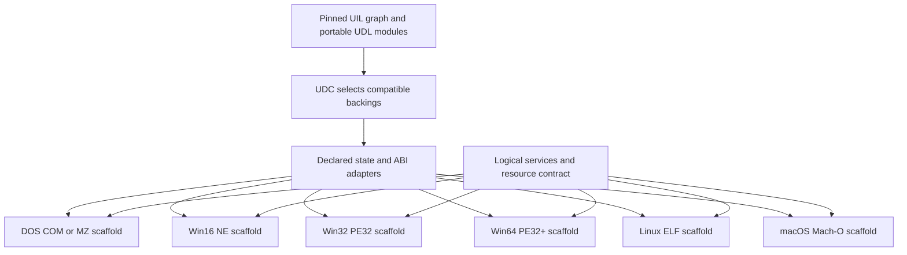

# Milestone: shared UIL reaches selectable source backings and native Windows execution

Recorded 2026-10-30. Implementation: [PR #38](https://github.com/seeker-cyber-maker/fDisBull/pull/38),
source revision `2857c42c5b0754e77ed36ab0a7ee9d258e8b9fa3`, stacked on the
[NE-loading and source-counterpart study in #36](https://github.com/seeker-cyber-maker/fDisBull/pull/36).

A logical operation can now retain its UIL contract while selecting a different
implementation. The project keeps the source relationship, implementation,
adapter and selection as distinct immutable records. Those selections have
reached actual retained-instruction execution, native DOS game variants and a
new Windows PE64 program with a real message box and successful process exit.

The result is a working path from recovered code and declared intent to chosen
native behavior. It establishes a foundation for synthetic programs whose
compatible parts can come from different editions or authored implementations.
The contracts and adapters determine what can be substituted.

## What this milestone demonstrates

| Experiment | Demonstrated result | Evidence boundary |
| --- | --- | --- |
| Colonization food | One food UIL, original DOS/Windows kernels, explicit source-state/ABI adapters; 64 cases per backing, all 128 executions matching | Original instructions executed in an isolated CPU. The Windows containing process and full production system remain unqualified. |
| Independent DOS food execution | Exact 101-byte DOS body ran in DOSBox for terrain/mode `13/0`, `24/1`, `65535/255`, returning `4`, `1`, `3` | Three native harness cases with live body identity, separate from full-game execution. |
| Five-dice RNG | One symbolic UIL selected LCG or xorshift; initial dice changed from `3,4,1,6,5` to `4,6,3,1,3` | Policy deliberately permits a different sequence. Native routes exercised holds, rerolls and scoring; no fairness or full-game equivalence claim. |
| Tic-tac-toe | UIL resources produced `GG!!`/`TIE!`; text-only retained the winner; explicit misere rules changed the awarded player | Selected artifacts match native-tested files. The authored UIL covers terminal handlers; the full game has not been recovered. |
| Native Windows shell | Two persisted, equivalent addition implementations completed DB → Z3 → activation adapter → PE64 → MessageBoxA → acknowledgment → exit0 | Authored Windows program executed under Wine/QEMU. This is separate from an original Win16 program or bare-metal Windows qualification. |

The two Windows builds use the same arithmetic contract, orchestration plan,
resources and notification provider. With inputs 65535 and 2, both return 1.
Deliberate modifications to private callee input/local copies do not escape:
caller left/right/scratch remain 65535/2/12345. Every executable byte outside
the selected math slot is identical between the two builds.

The source-bound fixture builds also reproduce independently native-tested
artifacts byte for byte. Original game programs remain unchanged. The private
archive verifies 68 original programs across 12 target sets; generated variants
remain separate and outside Git. Fixture oracle/source material was available:
these are engineering integration results, not blind or clean-room recovery.

## Why the interfaces matter

The [implementation contract](../UDL_BLOCK_LAYERS.md) and
[pilot/friction report](../UDL_LAYER_PILOT.md) describe the actual schemas and
limits. Four distinctions made the experiments reliable:

- **Identity:** Source hash, byte version, decode context and exact spans identify a snippet. A label or address alone cannot select a backing safely.
- **Intent:** The contract fixes observable outputs/events or explicitly admits a policy variation. Carry-neutralized ADC can implement two-value addition; carry-observing ADC produces a counterexample when it changes the sum.
- **State:** Adapters copy inputs, initialize activation locals and commit declared outputs. ABI, segment and source-global differences stay outside reusable math.
- **Target:** UDC orchestration supplies startup, call frames, layout, imports, services, resources and completion. Model equality, source fidelity and target execution are qualified separately.

A stored correspondence remains an authored declaration. A scalar proof applies
to the supplied models. Native observations qualify the tested output and
boundary. Keeping those evidence edges distinct is what makes later reuse
inspectable.

## Verification ledger

At the implementation revision above:

- New feature tests: **127 passed, 11 native-runtime skips** in the ordinary local run; native experiments were run separately.
- Full local macOS suite: **2,174 passed, 119 skipped, 2 failed, 23 setup errors**. The same 25 Linux-fixture failures were reproduced at unchanged base `cd9b4f8`.
- Fresh installed wheel: source-module readback matched the checkout; actual CPU arithmetic and selected PE/capsule emission passed.
- Wheel, source distribution, standalone-player wheel and tool-source ZIP passed content checks.
- Both ordinary Linux test/package runs passed on the exact implementation head.
- Both stable-backend and layers-backend Linux native profiles passed. The subsequent unified DOS/boot/PE64 installed-wheel jobs were still running at this ledger's check; their completion is not inferred.

The current and historical jobs are available in the
[PR #38 checks](https://github.com/seeker-cyber-maker/fDisBull/pull/38/checks), including
[ordinary Linux acceptance](https://github.com/seeker-cyber-maker/fDisBull/actions/runs/41083236945)
and [native acceptance](https://github.com/seeker-cyber-maker/fDisBull/actions/runs/41083237025).

Private evidence is retained by the target-package owner. These digests identify
receipts without publishing source bytes, project databases or emulator states:

| Receipt | SHA-256 |
| --- | --- |
| Final Colonization layer comparison | `039d51fff3e753f883d10ce4af299a003f73f079b3a59b3c4415d3c975964a13` |
| Accepted DOS fixture/native validation | `66b4f22d68587e9445cca54dd77282ba0cba74b92a63b76b6dc4c7ca17961d96` |
| Persisted fixture selections and artifact identities | `562c0d981dc9d036571492558332fdb2f1ad39d6d4836d13646de618ad5b78c5` |
| Selected Windows native runs and comparison | `173bace7c6f9b4a460c6e3e455eaadddc333bec3d80245df349095686bb02fb4` |
| Published-wheel readback and smoke | `3520d086d55408d61448782ef3b343d29506b379bf5cf01c62530e2322b8d798` |

## Next milestone: the same semantic program in several scaffolds

Freeze one UIL graph and portable UDL definitions, then instantiate different
program shells. Source-specific instruction backings retain their ISA/mode and
ABI requirements. A target may pass through compatible machine code or lower
the same semantics to its own instructions. Changing a scaffold must not
silently change the logical types, overflow, failure or observation contract.

The diagram below is the next architecture, **not a claim that all emitters
already exist**:

### An instruction body and a DOS executable have different requirements

Arithmetic can be independent of the host OS. Byte-identical machine code can
sometimes be reused when ISA, execution mode, private calling convention,
relocations and memory bindings match. A DOS executable additionally expects
its loader, initial state, addressing, DOS/BIOS services and often hardware.
Giving it another file header does not supply that environment.

Intel's [basic-architecture manual](https://www.intel.com/content/dam/develop/external/us/en/documents-tps/253665-sdm-vol-11.pdf)
distinguishes real, protected, compatibility and 64-bit execution contexts.
Compatibility mode has OS-controlled admission and does not provide the
virtual-8086 environment required by legacy real-mode execution. Bitness and
mode therefore remain explicit backing requirements.

Even on the same x86-64 CPU, foreign-call boundaries differ. For example,
[Windows x64](https://learn.microsoft.com/en-us/cpp/build/x64-calling-convention?view=msvc-170)
and the [System V AMD64 ABI](https://gitlab.com/x86-psABIs/x86-64-ABI/-/blob/master/x86-64-ABI/low-level-sys-info.tex)
use different argument-register conventions. A stable internal UDC ABI could
keep a qualified math body identical while each shell adapts its public entry
and service calls. That byte reuse is a next experiment, not a measured result
of the current milestone.

| Target environment | Existing DOS executable | Native output from the shared semantic program |
| --- | --- | --- |
| DOS | Run with its compatible DOS/hardware environment | COM/MZ shell, DOS services and 16-bit memory/ABI; source-bound COM substitutions demonstrated, generalized shell lowering remains future work |
| DOS-based Windows 3.x / Win16 | DOS task/session support; this remains a DOS task | NE shell, selector management, near/far conventions, Win16 services; original kernel comparison demonstrated, native Win16 shell remains future work |
| Win32 on x86 Windows | A supported NTVDM environment can host DOS programs | PE32 shell, x86 calling conventions and Win32 providers; new scaffold remains future work |
| Win64 on x86-64 Windows | A compatible DOS emulator/VM is needed; WOW64 does not provide NTVDM | PE32+ shell and x64 providers; authored Wine/QEMU execution demonstrated here |
| Linux | A compatible DOS runtime or emulator supplies the DOS environment | ELF shell, selected ISA, Linux/System V boundaries and host-service providers; new scaffold remains future work |
| macOS | A compatible DOS runtime or emulator supplies the DOS environment | Mach-O shell and host services; x86-64 and arm64 are separate code targets; new scaffold remains future work |

The historical Windows distinction is documented in Microsoft's
[Windows architecture account](https://learn.microsoft.com/en-us/archive/msdn-magazine/2000/july/under-the-hood-happy-10th-anniversary-windows).
Microsoft limits [NTVDM support](https://learn.microsoft.com/en-us/windows/compatibility/ntvdm-and-16-bit-app-support)
to x86 Windows and documents the
[absence of native 16-bit application support on x64 Windows](https://learn.microsoft.com/en-us/troubleshoot/windows-client/application-management/x64-windows-not-support-16-bit-programs).
Linux's [execution interface](https://man7.org/linux/man-pages/man2/execve.2.html)
requires an admitted executable format/architecture.
[DOSBox-X](https://dosbox-x.com/) provides a separate DOS emulation route across
modern Windows, Linux and macOS hosts.

On Apple silicon, arm64 code generation is the native target. Apple's
[Rosetta documentation](https://developer.apple.com/documentation/apple-silicon/about-the-rosetta-translation-environment)
describes translation for x86-64 Mac programs; it does not make an arbitrary
DOS executable a Mac app. Modern macOS also
[discontinued 32-bit Mac application support](https://support.apple.com/en-us/103076).

### Proposed acceptance sequence

1. **Linux x86-64 next to the existing Win64 shell.** Hold the arithmetic UIL and normalized UDL fixed. Change the container, startup/shutdown and public ABI. Test whether a stable private ABI permits byte-identical pure module reuse; if lowering changes, retain the new implementation and prove/test the same contract.
2. **A shared logical notification.** Bind its content, ordering, outcome and acknowledgment/completion policy to each target's presentation provider. A message box and console output are different presentation profiles until their admitted observation contract is explicit.
3. **macOS arm64.** Keep the same semantic graph and add an arm64 lowering plus Mach-O shell. This tests ISA independence as well as OS independence. Whole-process translation is a separate route.
4. **Win32 and Win16.** Add width-specific shells, loaders, stack/pointer conventions and services. Preserve logical 16-bit arithmetic explicitly in wider carriers; do not truncate native pointers into source-sized integers.
5. **File/resource services.** Map recovered `read_file` intent through declared buffer ownership, handles, partial reads, EOF, errors and cleanup. Source provenance retains the DOS/BIOS/API mechanism; each target supplies its own realization.

Every target needs a manifest binding the exact graph, chosen layers, adapter
revisions, CPU mode, layout, resources and output identity. Acceptance must use
actual emitted programs: boundary inputs, repeated calls with fresh locals,
caller preservation, logical-width behavior, atomic qualification failures,
ordered effects, normal exit and restart/readback. Unsupported obligations must
refuse explicitly. Source preservation and per-edge qualification continue to
apply while the program becomes portable.
