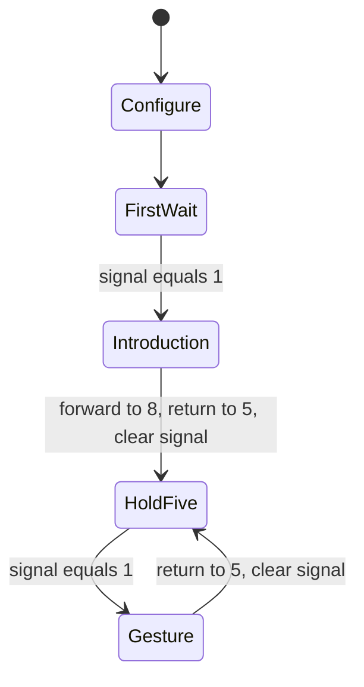

# DinoPark E55 — From recovered code to the game's behavioral story

**Outcome:** we now have a concrete, source-linked way to describe part of the
game independently of its implementation language, and a broader map for
extending that account. E55 adds a verified ABOUT interpreter slice, recovers
its native signal producer, joins those components, and produces a deterministic
research packet for the existing **Universal Interaction Language (UIL)** owner.

The packet contains **122 ACT instruction rules from nine programs**, **six
ABOUT story nodes**, **26 native anchors and 15 source spans**, and **22 broader
game-mechanics cards backed by 14 prior research sources**. The current public
suite passes **117 tests**, with no failures, errors or skips. These counts
describe this handoff; they are not a percentage of the game proved complete.

The earlier work is intact. All **485 protected files** match the preservation
baseline, including the original game's **191-file entry set** and the completed
E54 payload. E55 carries a complete, unchanged E54 baseline and labels its new
sources and observations separately. The final archive and fresh-extraction
result have their own package and delivery receipts.

## 1. What “the story of the game” means here

A useful reconstruction account states what exists, who owns it, what can
change it, the order of those changes, and what a player or external service
can observe. It retains the original's arithmetic, timing, randomness and
partial states without requiring x86, C, Python or another host language to
serve as the game's vocabulary.

The central model is a park with several different kinds of state:

| State domain | Examples | Why it must remain distinct |
|---|---|---|
| Committed park | Cash, debt, herds, fences, active staff, food, calendar, histories | These values drive the qualified simulation and completed transactions. |
| Pending transaction | Working cash, draft roster, pending pens and stock, animal awaiting placement | A purchase or hire can be accepted locally before it becomes committed park state. |
| Continuing session | Shared RNG, preferences, day phase, some allowances | Ordinary park loading does not restore every live session field. |
| Scene and interface | Selected page/item, current and requested context, control registration, focus and modal state | A scene request, usable controls and displayed content can describe different transition phases. |
| Presentation | Actor PC/waits, frame list, visibility, signal words, dirty maps | Presentation can affect scheduling, state and random draws. |
| Services and artifacts | Resource ownership, audio busy/completion, streams, save bytes and score files | Their lifetimes, failure behavior and completion boundaries need explicit contracts. |

The new [game-story map](docs/GAME-STORY-MAP.md) develops this model into 22
scoped cards. It distinguishes static recovery, bounded original execution,
connected components, live interface observations and artifact comparisons.
It preserves remaining holes instead of converting a function or test count
into a semantic coverage claim. [S1]

## 2. ABOUT now supplies a complete small example of semantic lifting

ABOUT.ACT contains one 74-byte program with 20 decoded instructions and 14
opcode values. Its source is pinned by SHA-256, and every exported rule keeps
the original program offset, file offset, consumed span, read span, span hashes
and native dispatcher target. The program has ten sprite resources; its
ordinary story uses frame offsets zero through eight. [S2]

Its behavior can be told without the bytecode syntax:

1. Configure the actor at world position **(13,108)**, using base sprite zero,
   frame-count byte nine, direct frame zero, and visibility one.
2. Wait until shared **signal word zero equals exactly one**.
3. Set cadence word two. Run the initial forward list
   `0,1,2,3,4,5,6,7,8`, holding at the list marker; wait for frame eight.
4. Run `8,7,6,5`, then wait for frame five.
5. Clear signal zero, stop automatic cycling at frame five, and wait for
   another exact-one signal.
6. For later triggers, run `6,7,8,7,6,5`, then return to the clear/hold/wait
   step. The later gesture does not repeat the initial introduction.

That description is useful, but its exact temporal meaning also matters.
Eligible frame-cycle updates use a four-logical-tick interval for cadence
word two. Rendering/cycle work happens before conditional-wait release, which
happens before command scheduling. Releasing a wait advances its retained PC
without executing the command again and resets its frame deadline to the
current tick. A command that selects the next list does not immediately
replace the current drawn frame. [S3]

The original F3 list operation has an unusual storage dependency. It starts
with cursor byte 255. Its first lookahead can read the next 234-byte actor
record at offset C3, and a held initial frame can come from that record's C2.
The bounded interpreter declares a 16-record bank with inactive records zero;
it refuses an out-of-bank read rather than fabricating storage. The semantic
packet preserves this dependency. A future UIL representation can express
the resulting qualified behavior with an explicit storage/environment
contract, but must not silently replace the initial cursor with zero. [S3]

The terminal instruction at program offset 73 is retained in the source map.
It is outside the ordinary closed entry-zero graph because the preceding
branch returns to offset 48. Keeping it is different from claiming that the
comparison profiles executed it. [S2]

## 3. The trigger comes from native initialization

The original ABOUT entry at **3619:1061** loads `about.act` through the
resource-loader call at **3619:1093** and installs **3619:0EE5** as its
initialization callback. These are authenticated source anchors. The entire
loader/page path is statically traced; it is not a newly executed full scene.
[S4]

The freshly qualified shared initializer at **1B29:0044** performs these
operations in order:

1. Consume the original shared PRNG and store its derived 1–500 bookkeeping
   value. The seed transition is `(seed × 22695477 + 1) mod 2^32`.
2. Set the active graphics-page byte to zero.
3. Clear both 520-byte dirty maps.
4. Clear all **32 signal words**.
5. Invoke ABOUT's callback through its actual indirect far-call slot.

The callback receives all-zero signals and the genuine return address
**1B29:00A0**. For overview page `FFFF`, it sets scroll to 320; it copies
current scroll to pending scroll and assigns **signal 0 = 1**. It has no
audio-completion, text-completion or timer predicate in this executed chain.
[S4]

Both initializers preserve every byte of all **16 × 234 actor records** in the
qualified fixtures. Navigation and the separate UI reset preserve them too.
Thus the initialization event can release an existing actor's signal wait;
the initializer itself does not reset the actor's PC or animation state. This
preservation claim covers those four routines. It does not assert that every
intervening picture, resource or graphics service on a full page transition
has been executed and proved to preserve actors. [S4]

The native navigation callback accepts event kind three for topic and
navigation actions. Topic control IDs 100–118 select pages 0–18 and request
scene 99. The original page-reentry jump returns to page setup after the
earlier ACT loading call. Previous/next navigation normally wraps over pages
0–18 despite an initialized page count of 20. Physical mouse semantics,
geometry, focus and completed page readiness remain separate input/interface
obligations. [S4]

A separate helper at **3619:0E57** contains another conditional signal-zero
write. Its caller remains unresolved. The report therefore identifies the
demonstrated initialization producer without claiming it is the only possible
signal-writing path. The earlier nearest-entry inventory association of the
store with 3619:0C75 is preserved as historical data; the recovered callback
boundary is 3619:0EE5. [S4]

### The connected experiment

E55 invokes six original shared initializers on the **same original actor
machine**, then compares 190 actor ticks and 189 ordered draws with the portable
runtime. The native actor receives the signal bank written by original code;
the comparison driver does not replace that bank before the actor runs. The
portable side receives the independently specified clear-all-then-set-zero
effect. All actor, signal, return and draw records match. [S5]

This also demonstrates the distinction between a latch and an event queue.
In the supplied event sequence, writes at tick calls 20 and 72 occur during
active animations. They do not enqueue additional gestures. A later script
clear consumes the same signal word. Trigger timing is an explicit fixture,
not a recovered schedule of physical page changes. The full native scene can
also call its initial scheduler before its first regular update; the joined
fixture explicitly uses update then scheduler at tick zero. [S5]

## 4. The broader mechanics already have strong story-shaped contracts

The 22-card map consolidates prior evidence; it adds no new original
executions. Several examples show why a language-independent account needs
ordered effects and distinct state lifetimes. [S1]

**Employment has nested drafts.** HIRE/FIRE edits pending staff. Detail OK
retains the draft; outer OK commits it. Detail Cancel can reset all role
drafts. An outer equal-cash Cancel can preserve active staff while leaving
stale pending staff on the street until reentry synchronizes it. The scene
request can already change while the old employment posters are visible.

**An ordinary animal purchase is a multistage transaction.** Reservation and
expense posting precede arrival and placement. Confirmation commits pens,
cash and ordinary stock without a second expense posting. Cancellation after
a month change refunds cash but reverses the expense in the current month.
The recorded April-to-May example leaves +1,250 in April and −1,250 in May,
delivers no animal and refunds cash. A generic rollback to the entire before
image would erase this behavior.

**An auction has distinct accepted, animated, paid and placed phases.** An
enabled BID control does not establish that an active bidder actor will
accept the action. The hammer can debit cash before placement becomes
available. Seller preparation removes offered animals before settlement;
an early-exit notice can appear before the credit instructions. A return from
an information page can preserve the lot state while advancing continuing
RNG state.

**Arithmetic is part of the story.** The early auction sale path truncates
per-species estimates, sums them and subtracts `floor(total / 10)`. For gross
7,007 that gives 6,307. Substituting `floor(total × 90 / 100)` gives 6,306.
Likewise, payroll's cash test is strictly greater than a wage, and financial
failure can happen between a debit and a later debt clamp. These differences
are observable even when a rewrite uses the same high-level words.

**Pause is counted ownership, not a universal freeze.** The ordinary loop
performs callback work before testing the calendar hold. Some callbacks and
shared-RNG consumers continue while the calendar is paused. Daily, weekly,
month and quarter work have ordered boundaries; cached progression and
pending transitions survive selected deferrals.

**Save bytes are not the entire continuation state.** The lossless park codec,
immediate load boundary and resumed scene are distinct. Ordinary loads retain
incoming RNG, preferences and day phase in the qualified routes, preserve
some pending state and reconstruct the scene afterward. Opaque save bytes
must survive round trips. Score-file success likewise needs its own byte and
restart boundary; displaying an ending does not establish a complete write.

These examples are individually traced in the source-indexed Guide 0.3,
E42/E47 observations, save-field overlay and later contracts. The map preserves
their fixture and interface limits instead of turning the summaries into
universal rules. [S1]

## 5. What is ready for UIL

The current read-only source check resolved UIL to **Universal Interaction
Language**. PR #3 defines the proposed fDisBull export boundary and PR #7
proposes a linked interface description. The retrieved revisions were
`bdebd9d877c2402722130fc6b1254fd54ef7bda0` and
`82ab246c7e4e6959957329f2b564c7db45c7f2c6`. Both were open proposals at retrieval;
PR #7 was a draft. They establish a direction and ownership boundary, not a
canonical grammar/version or an executed UIL game runtime. No remote changes
or comments were made. [S6]

The deliverable therefore carries ordinary JSON research metadata whose
target version remains null and whose `canonical_uil` flag is false:

| File in `research/uil-input/` | Contents |
|---|---|
| `ACT-RULES.json` | 122 descriptions, source spans, local successors, numeric rules, update phases and constructor-only reference-runtime admission |
| `ABOUT-STORY.json` | Six readable actor nodes, native host events, interface links, latch observation and explicit gaps |
| `GAME-STORY.json` | The 22 broader mechanics cards with sources and evidence boundaries |
| `SOURCE-MAP.json` | Content-addressed original identities, ACT span joins, native anchors/spans and prior source bindings |
| `EVIDENCE-INDEX.json` | Five bounded receipt families and their precise program/routine associations |
| `EXPORT-RECEIPT.json` | Producer hashes, payload hashes, counts, joins, deterministic checks and the claim ceiling |

Original game containers are not copied into this packet. Its source inventory
uses basenames and content hashes; it contains no host-absolute paths. Stored
ACT lookahead remains distinct from consumed bytes. Authored semantic names
are explicitly scoped to this source revision, rather than presented as
recovered symbols or cross-port identities. [S7]

The existing UIL representation needs to retain typed state, guards, ordered
effects, clock domains, random-stream identity/order, output and completion
observations, interface links, external service/artifact contracts, and
evidence/unknowns. A consumer should be able to describe the purchase or ABOUT
story without importing Python object layout. It still needs exact widths,
signedness, wrap, truncation, sentinel values and phase ordering. [S1, S7]

The processor module and the small interpreter now have clear roles. The
processor adapter exposes decoded instructions, source positions and local
control flow through the actual fDisBull 0.20 development API. The bounded
`ACTRuntime` supplies executable reference behavior for ABOUT and DinoMart.
The research exporter lifts those facts into reviewed descriptions. A future
UIL exporter and consumer can use them, but canonical encoding and evaluator
conformance are separate work owned by the existing UIL implementation. [S2,
S3, S6, S7]

## 6. Evidence and validation

| Verification | Accepted scope and result |
|---|---|
| Fresh ABOUT original-code comparison | Eight profiles; 1,059 ticks, 1,059 complete 234-byte actor records, 982 ordered draws; zero mismatches |
| Native host qualifier | 83 unique routine fixtures; all 65,536 DS bytes and ordered writes checked; all 3,744 actor bytes preserved; no service adapters |
| Original host/actor composition | Six host calls, 190 ticks, 189 draws; native signal continuity and exact records match |
| Current DinoMart regression | All 2,491 retained E54 inputs and 19,928 actor records replay; 13,718 draws match; no new original DinoMart executions claimed |
| Portable model comparisons | ABOUT and DinoMart together: 3,550 ticks and 20,987 actor snapshots under declared inputs |
| Public suite | 117 tests; zero failures, errors or skips |
| Research packet | Nine programs and 122 rules source-bound; six ABOUT nodes and all source/evidence joins resolve |
| Preserved E54 rendering evidence | 64 composed frame batches and 308 original wrapper calls remain authenticated; no fresh ABOUT-pixel or whole-scene claim |

The original ABOUT corpus executes 2,118 actor calls with authenticated draw
and device-pump return adapters. Its 973,282 code-hook visits are an emulator
observation count, not retired hardware instructions. The host qualifier
executes the four routine bodies and their original helpers without service
adapters. All use normal MZ relocation and unchanged opcode bytes. [S3–S5]

Independent reviewers checked the runtime against original instruction
spans, audited the complete saved actor streams, reconstructed all 83 native
host DS states and 6,874 ordered writes, and reviewed the semantic exporter.
The host audit independently applies 4,139 ordinary MZ relocations and checks
26 anchors plus 15 spans. No extra unique native coverage is inferred from
those artifact audits. [S8]

Review found and corrected several metadata failure modes: Boolean/integer
type drift, shared mutable catalog constants, altered mandatory unknowns,
unresolved CFG targets being presented as ordinary continuations, and known
opcodes being described without their operand-domain limits. Export acceptance
now requires explicit per-family status, original identities, mandatory
evidence files, matching hashes, required case checks and complete case counts.
The independent malformed-receipt tests exercise those refusals. These gates
check the integrity and declared scope of the research packet; they do not
prove the correctness of prose or a UIL evaluator. [S8]

One evidence-integrity failure is retained: the first host test log was
truncated and no longer matched its receipt. The exporter refused it. The
unchanged verifier was rerun into a fresh directory; all 17 host tests and
the same 83 unique cases passed, with a complete log and matching artifact
hashes. Case/source/fixture/disassembly bytes match the earlier run. The
truncation's cause remains unestablished. The rejected copy is preserved under
`evidence/about-host/calibration-pre-export/`; the accepted receipt is
`evidence/about-host/qualified/RESULT.json`. [S8]

The final extraction gate also rejected an incomplete first candidate ZIP:
the bytes subsequently read were shorter than the completed build command's
reported size. That candidate is retained privately, its rejection is recorded
in `evidence/delivery-integrity/`, and it is not a delivered artifact. The
reviewed packager was rerun; only the separately recorded successful fresh
delivery check identifies the accepted archive. No cause is inferred from
these incomplete-write observations.

## 7. What remains before a complete reconstructed game

The most useful next step is to carry one of these connected stories through
the existing UIL owner's actual representation and compare its evaluated
behavior at the same boundaries. ABOUT and DinoMart are now concrete starting
points. That step should preserve the source/evidence maps, compare exact
states and ordered effects, and keep unsupported capabilities explicit.

The remaining obligations include:

- Full native page/resource/control paths, initial scheduler timing and
  physical event cadence; the unresolved ABOUT redraw-helper caller.
- Background restoration, palette/fades, text/layering and complete visual
  readiness. E54's exact pixel-index/dirty-map seam is narrower than a visible
  scene with original scanout.
- Audio event streams, drivers, scene trigger coverage and completion timing.
  The demonstrated ABOUT initialization signal must not be replaced with an
  inferred speech-completion event.
- Broader portable ACT subsets and native scene producers beyond the selected
  nine programs. E54's 48 decoded programs across all ACT files are inspection
  evidence, not 48 fully reconstructed scenes.
- Backing-store eviction/reload, resize, shutdown, real resource loading,
  failed cleanup and remaining ownership boundaries.
- Complete interface/control lifecycles, incoming-session persistence
  semantics, startup/demo orchestration and the remaining `INTRO.DMO` grammar.
- Remaining indirect targets, unknown data/flags and finite closure of the
  preserved binary ledger. E53's 927 candidate entries and 116 contracts are
  historical inventory measures, not proof of whole-game equivalence.

E55 makes the semantic handoff concrete and executable in its bounded
reference subset. It does not add a whole-game Z3 proof, claim an earned full
campaign, or invent a canonical UIL implementation. The unresolved list is
part of the delivered specification, so a rewrite can distinguish established
behavior from a deliberate future design choice.

## Reproduction and continuation

See [README.md](README.md) for commands. The public CLI accepts repeatable
`--signal TICK:SLOT:VALUE` inputs, validates them before resource decompression,
and records the exact schedule. Runtime snapshots use
`dinopark-act-runtime-state-2`; playback uses `dinopark-e55-playback-2`.
`DinoMartRuntime` remains a compatibility alias for `ACTRuntime`.

`scripts/export_story.py` regenerates the six research files or verifies their
exact bytes. `scripts/check.py` refuses empty suites and binds the complete
test log to all current source/test files. The delivery verifier unpacks a
new archive, checks every payload and retained E54 evidence family, reruns the
current public suite, regenerates the packet, and compares public ABOUT CLI
outputs byte for byte. Original containers and native dependency installations
remain external.

## Source and evidence key

- **S1:** [GAME-STORY-MAP.md](docs/GAME-STORY-MAP.md),
  [RULES.json](evidence/story-map/RULES.json), and
  [SOURCE-INDEX.json](evidence/story-map/SOURCE-INDEX.json).
- **S2:** [ABOUT-INSPECTION.json](evidence/ABOUT-INSPECTION.json),
  [ACT-RULES.json](research/uil-input/ACT-RULES.json), and the pinned
  `src/dinopark_act/processor.py` source.
- **S3:** [ABOUT-RUNTIME.md](docs/ABOUT-RUNTIME.md),
  [ABOUT original receipt](evidence/about-original/accepted/RESULT.json),
  [model receipt](evidence/about-model/accepted/RESULT.json).
- **S4:** [ABOUT-HOST.md](docs/ABOUT-HOST.md),
  [native host receipt](evidence/about-host/qualified/RESULT.json),
  [native source anchors](evidence/about-host/qualified/SOURCE.json).
- **S5:** [joined host/actor receipt](evidence/about-host-actor/accepted/RESULT.json)
  and [timeline](evidence/about-host-actor/accepted/TIMELINE.json).
- **S6:** [UIL boundary PR #3](https://github.com/seeker-cyber-maker/fDisBull/pull/3),
  [interface RFC PR #7](https://github.com/seeker-cyber-maker/fDisBull/pull/7),
  [pinned boundary document](https://github.com/seeker-cyber-maker/fDisBull/blob/bdebd9d877c2402722130fc6b1254fd54ef7bda0/docs/UIL_BOUNDARY.md),
  and the retained [retrieval snapshot](evidence/UIL-PROPOSALS.json).
- **S7:** [EXPORT-RECEIPT.json](research/uil-input/EXPORT-RECEIPT.json),
  [SOURCE-MAP.json](research/uil-input/SOURCE-MAP.json),
  [EVIDENCE-INDEX.json](research/uil-input/EVIDENCE-INDEX.json).
- **S8:** `evidence/review-original/`, `evidence/review-host/`,
  `evidence/about-host/runtime-review/`, `evidence/review-contracts/`,
  `evidence/review-delivery/`,
  and [current full test receipt](evidence/integrated-tests/RESULT.json).

Target executable SHA-256:
`2127315b475b560f8c0fe409769fd6d137e26d9390d2fafc7d03a60a266a827c`.
Current fDisBull wheel SHA-256:
`74655dee308f60ae7fd6cc8bcb44fec4fe31e93054916d09648fa23611d3195a`.
