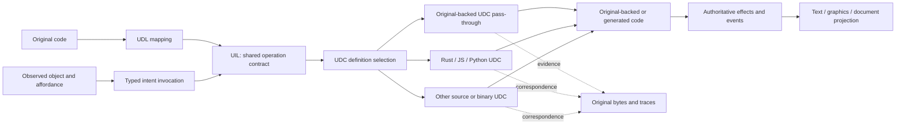

# RFC 0001: UDL mappings, shared UIL intents and learning UDC definitions

- Status: **draft; recommendations, not an accepted language or implementation**
- Author: Codex, from the user's intent/effect, pass-through and compiler-definition requirements
- Date: 29 October 2026 (America/New_York)
- Inspected repository: `75bbd7ee65118c0186844f73ef6c79245854eba0` (0.22.0 source)
- Existing core: `fdisbull-il-1`; proposed extension names below are provisional
- Supersedes: no accepted format; clarifies the input/output wording in the intent pipeline
- Superseded by: none

The 0.23 development source implements the narrow [original-backed DOS target](../UDC_DOS.md)
and its [per-layer checks](../UDC_TESTING.md). The broader catalog, learning and
new shared-language capabilities below remain draft proposals. The original
0.22 investigation and fixture observations retain their original identities.

## 1. Decision

Use **one interaction representation**, with explicit names for its mapping
and reconstruction directions:

- **UDL — User-Defined Language:** maps original code and its evidence into UIL.
- **UIL — Universal Interaction Language:** carries the shared intent and
  behavior representation.
- **UDC — User-Defined Compiler:** reads UIL and transfers its semantics back
  into code through a compiler definition.

The conceptual pipeline is **original code → UDL mapping → UIL → UDC → code**.
UDL mappings and UIL retain the same block vocabulary and source correspondence;
this naming clarification adds no mandatory intermediate copy. A UIL program
with retained original backings can pass through an original-backed UDC without
rewriting its blocks. Existing v1 documents labelled `role: udl` remain usable
unchanged; those legacy role labels are distinct from the UDL/UDC directions.

A **UDC/compiler definition** maps a typed UIL intent contract to an implementation:
original code, an interpreter operation, a source implementation, a precompiled
fragment, or a composition of these. Original-backed DOS pass-through is the first implementation target. It retains
the original native blocks while their UDL mappings are expressed in shared UIL.
That target can grow qualified DOS lowering rules toward a generic DOS compiler.
Rust, JavaScript and Python source backings remain conformance examples and
possible additional targets.
No origin receives an automatic correctness or efficiency preference.

Discovery continuously adds candidate definitions, evidence and counterexamples.
The compiler chooses the most efficient **eligible** implementation under a
specified target, domain, observation contract and cost policy. A new pattern
cannot win merely by sharing a name or producing the same final balance.
Published definitions and active executions remain version-pinned while the
candidate library continues to improve.

This RFC defines the architectural contract and a proposed field vocabulary.
It does not implement automatic discovery, general cross-language propagation,
a complete DOS compiler, whole-game reconstruction or a new player runtime.

## 2. Motivation and inspected evidence

The [investigation](../UDL_UIL_EFFECT_ISOLATION_FINDINGS.md) separates fresh native
experiments, inspected implementation, documented external interfaces and
hypothetical scenarios. In particular:

- `interaction_il.py` already uses the same `fdisbull-il-1` nodes and evaluator
  for both roles. `change_role` changes metadata only. Native execution is not
  implied by `role: udl`; graphics, audio and input remain pending host plans.
- The current Zork recovery links a bounded mailbox action to identified story
  instructions and native interpreter writes, with explicit action-entry
  witnesses. This is evidence that semantic blocks can retain a lower-level
  audit trail, not a general compiler or parser reconstruction.
- A fresh original DinoPark experiment executed the food commit slice in a
  derived office snapshot. The same ordered 35-entry PC trace and selected
  effect fields matched a native-context replay. Forty-eight bytes of prepared
  data, ten stack-argument bytes and ten differing registers were supplied.
  The original binary, helper and guest runtime remained present.
- An unprepared office execution of that same slice added no food. The slice
  consumes a prepared order; it does not itself implement an entire purchase.
- The original Vegasaurus path reserves money, runs animation and releases the
  reservation. Park cash, debt and calendar can change during the animation.
  Effect completion, later navigation and the player's knowledge are distinct.

The smallest missing feature is therefore an explicit, inspectable binding
between a semantic operation and its executable definition, with context,
ordering and qualification. UDL names the original-to-UIL mapping; UDC names
the output compiler definition. This terminology preserves the same behavior.

## 3. Terms and identities

| Term | Contract |
| --- | --- |
| UDL | User-Defined Language: definitions that map original code into UIL, retaining source evidence and unresolved interpretations. |
| UIL | Universal Interaction Language: the common representation of intent, state and ordered behavior. |
| UDC | User-Defined Compiler: reads UIL and realizes it as code, including original-backed pass-through or reconstructed source/binary output. |
| Intent | A named, typed request such as `buy(item, quantity)`; its name alone has no semantics. |
| Operation | A versioned definition of an intent or reusable part of one, including entry conditions, ordered behavior and outcomes. |
| Invocation | One submitted operation with argument values, authority/state revision and a unique attempt identity. |
| Input/trigger | How a request reaches an operation: mouse, key, parser command, API or semantic call. |
| Effect | An ordered state transition, event or external-service interaction; it need not be atomic. |
| Presentation | Text, graphics, audio and interface animation driven by behavior. A callback with logical effects is also part of the behavior. |
| Object/entity | A stable identity with state, relationships and zero or more affordances. |
| Affordance | An object's advertised verb, typed parameters, availability and operation binding. |
| Scene/context | A semantic interaction context or a presentation view. A native scene field is a source-specific correspondence, not the universal definition. |
| Compiler definition / UDC definition | A versioned lowering or realization of a UIL operation contract for a target/runtime profile. |
| Source map | Evidence connecting nodes to bytes, source, guest instructions or observations. A source map is not permission to execute them. |

A button is an object with an interaction facet, commonly `activate`. A unit,
door, document range or cell can expose the same affordance protocol without
becoming a screen widget. One object may support several actions; a decorative
object may support none. Two controls labelled OK must retain distinct dialog,
receiver and revision identities: one can commit an order while another closes
help or commits a name editor.

Use stable node IDs plus immutable definition digests. Keep source names,
addresses, compiler symbols and private branch meanings in privileged evidence.
Player-facing identifiers, labels, errors and available verbs must not leak
undiscovered outcomes, fogged units, hidden cells or future dialogue.

## 4. One representation, multiple executable definitions



UDL mapping derives UIL from original code; UDC realizes UIL as code. These
are directional responsibilities over the same representation, with no required
role-rewrite step. The same operation and its source map can survive every
realization. An original-backed UDC can retain existing code and dependencies
as a pass-through, reference and fallback after portable reconstruction.

Separate two UDC/compiler-definition axes:

- **Authored in:** Rust, JavaScript, Python, the shared IR, or another declared
  language in which the definition itself is written.
- **Emits/runs as:** Rust source/object, JavaScript source, Python source,
  original guest code, a guest bytecode program, DOS MZ/COM, or another declared
  target. These axes need not match.

The first implementation can register trusted Rust/JS/Python definition
modules. A later definition may itself be expressed in the shared IR and
translated to another implementation language. That is optional bootstrapping,
not a prerequisite or an infinite self-hosting requirement.

## 5. Proposed package and definition contract

Keep supported `fdisbull-il-1` programs valid and unchanged. Introduce an
**opt-in companion package/catalog**, provisionally
`fdisbull-compiler-catalog-1-draft`, bound to an exact program/contract digest.
The old evaluator is not taught to execute native code by relabelling a program
or hiding executable instructions in `evidence`.

A package binds:

| Record | Required information |
| --- | --- |
| Shared program | Exact format/version, ordered block graph, typed declarations, node IDs and program digest. |
| Operation contract | Parameters/results, units and numeric rules; logical guards; reads/writes/aliasing; ordered phases and observable events; time, RNG and service behavior; failures, partial effects and persistence. |
| Compiler definition | ID/version, implemented contract digest, authored-in language, definition-source digest, target/runtime/ABI profile, domain guard, lowering/fragment plan, dependencies and resource inventory. |
| Original fragment | Exact artifact and byte-version identity, address space and mapping, entry and exit cuts, original callees/services, live inputs/outputs, clobbers, frame preparation and continuation ownership. |
| Source/binary fragment | Source or object digest, entry symbol/signature, target triple/data layout, compiler/toolchain, imports/relocations, ownership and runtime dependencies. |
| Evidence/qualification | Provenance, comparison/proof receipts, covered domain, counterexamples and unresolved requirements. |
| Selection profile | Required capabilities, permitted assistance/observation profile, assurance threshold, cost metric/measurement identity and pinned winner. |

A schematic definition record is data, not a current fDisBull API:

```json
{
  "id": "example.commit-food.rust",
  "revision": "1",
  "implements": "sha256:<operation-contract-digest>",
  "authored_in": "rust",
  "emits": "rust-source",
  "definition": "sha256:<trusted-definition-source-digest>",
  "target_profile": "sha256:<runtime-and-ABI-profile-digest>",
  "domain": "sha256:<entry-domain-and-guard-digest>",
  "qualification": ["sha256:<comparison-receipt-digest>"],
  "cost": ["sha256:<target-specific-cost-receipt-digest>"]
}
```

An original-backed definition uses the same `implements`, domain and evidence
fields, with an original-fragment plan rather than a source template. A
pass-through can retain the existing original image and dependencies rather
than copying bytes into a new executable. A reassembled fragment is a different
artifact and needs its own closure, relocation and comparison evidence.

Many intents may share a fragment; one intent may require several fragments.
Original file offsets, project addresses, runtime addresses, guest PCs and
managed symbols remain distinct coordinates. Stack/heap addresses outside the
original mapped module must not be represented as invented file offsets.
Code produced or changed at runtime needs an execution-view/byte-version
binding; a static-file hash alone is insufficient.

For example, this **schematic companion vocabulary** connects one order object
to either a button or a text request. It describes a future complete-operation
binding, not a recovered complete DinoPark order or an executable v1 document:

```json
{
  "entity": {"id": "order-17", "kind": "order", "revision": "8"},
  "affordance": {
    "id": "order-17.confirm",
    "receiver": "order-17",
    "verb": "confirm",
    "parameters": {"quantity": "u16"},
    "operation": "sha256:<complete-order-contract>",
    "input_projections": ["confirm-button", "text-confirm"]
  },
  "invocation": {
    "attempt": "request-29",
    "affordance": "order-17.confirm",
    "arguments": {"quantity": "20"},
    "context_token": "opaque-current-state-token"
  },
  "realizations": [
    "sha256:<original-backed-definition>",
    "sha256:<rust-backed-definition>"
  ]
}
```

Both triggers resolve the same receiver and operation. The executor rechecks
freshness and logical admission before choosing an eligible definition. A
direct call to the separate `commit_prepared_order` operation has its own
contract, live prepared-order identity and admitted entry domain. The button's
complete order must not be silently rebound to that smaller operation. Source
spans and native cuts attach to operation nodes rather than to screen geometry.

### Explicit growth beyond v1

Entities/affordances, reusable calls, scheduled processes, external-effect
receipts and staged lowering require semantics not present in v1. Provisional
capabilities are `uil.entities@1-draft`, `uil.invoke@1-draft`,
`uil.processes@1-draft` and `uil.lowering@1-draft`. They require a separately
versioned shared core before those nodes execute. **UDL mapping and UDC output
use the same shared extensions.** No accepted identifiers or implemented runtime
are claimed here.

A definition expressed in the shared IR uses explicit stages: matching a typed
IR pattern, instantiating a template, emitting a fragment and linking declared
dependencies. Quoted IR is data; it cannot execute a runtime operation during
compilation merely because it contains an `invoke`. Stage crossing requires a
bounded, declared operation and capability. Trusted host-language definitions
can bootstrap this mechanism without requiring every compiler to be rewritten.

## 6. Calling an effect without clicking

The default operation bound to `click_button(ok)` is the **complete ordered
behavior** of that control, not an arbitrarily selected numeric store. For an
order it might be:

`resolve receiver → qualify order → reserve → animate/tick → commit or release → request scene → publish result`.

These phases are recovered, not assumed universal. A direct intent call may
remove input delivery while retaining all operation phases and their required
order. Logical prerequisites such as funds, stock, ownership, proximity or a
prepared order remain requirements even if the original caller checked them
before entering the chosen snippet.

Distinguish three dependencies:

1. **World/rule guards:** remain part of the intent's meaning.
2. **Native execution context:** registers, globals, handles, actor state,
   resources and stack/caller frames still needed by an original definition.
   Supply them through a reviewed adapter or retain the original runtime.
3. **Input/presentation mechanics:** hit testing, focus and pointer delivery may
   be bypassed only for a qualified semantic binding under an explicit control
   profile. Removing them does not automatically remove proximity, timers or
   other game rules.

A hidden external player can invoke `commit_prepared_order` from another
presentation context when that operation's contract admits the state. It does
not make `buy_anything_anywhere` a valid interpretation of the same code.
The observed DinoPark slice stops before its scene request; it cannot be
advertised as a complete direct purchase. A full purchase definition must also
retain its actual transition and required animation behavior.

Entry cuts are not necessarily function entries. An inline slice requires
explicit live-ins and an exit trap/continuation; fabricating a RET or guessing
arguments is invalid. Reusing a prepared caller frame is a useful experiment,
but it is not proof that the frame is unnecessary or that a code fragment can
be relocated. A real callable definition must restore or transfer caller
control according to its ABI without erasing committed effects.

## 7. Effects, time, presentation and receipts

Operation bodies and event lists are ordered. Preserve observable causal order
and original input order. Machine instructions may change under optimization
when the chosen equivalence profile permits it; byte/ISA-exact recovery is a
stronger, separate profile. Equal final state is insufficient when callbacks,
intermediate commits, animation events or failures are observable.

Declare the clock, units, scheduling/tie order, input consumption and random
streams. Host time, guest milliseconds, simulation ticks, turns and frames are
different quantities. A continuous game does not become turn-based because a
text player is reasoning. Requested guest-time budgets are not exact simulated
durations. Snapshot restoration declares file/external-service exclusions.

Animations can be:

- presentation of already-defined state/events;
- a timed logical process; or
- a mixture, including simulation, random draws or callbacks hidden in drawing.

Pure drawing may be omitted under a qualified projection. Logical work,
required delays, RNG consumption and event ordering still run. Native headless
execution may draw internally even when no image reaches the player. The
Vegasaurus month crossing is a concrete counterexample to freezing all state
through an animation. Validate tight effect boundaries and report intervening
simulation separately.

Every invocation receipt separates at least:

- dispatch: refused / accepted / unknown;
- effects: none-confirmed / applied-confirmed / partial / unknown;
- presentation/follow-up: not-requested / pending / complete / failed / unknown;
- persistence: memory-only / durable-confirmed / unknown;
- source/definition/profile identities, entry/exit observations, event order,
  clock progress, attempt identity and remaining limits.

A later navigation or rendering failure cannot turn a confirmed commit into an
unknown purchase. A partial native effect cannot inherit the atomic rollback
behavior of v1's pure model evaluator. An invocation ID is an audit handle,
not proof of exactly-once execution after a crash. Reconcile uncertain effects
before retrying; use native idempotency only when independently established.

## 8. Propagating Rust, JS and Python UDC definitions

A definition for one language can seed candidates for others by retaining its
operation contract, parameter mapping, dependencies and source map. The
recipient definition translates its implementation; it does not rediscover the
game intent or rename an incompatible implementation as equivalent.

For example, a 32-bit wrapping expense update can use Rust `wrapping_add`,
Python masking and JavaScript BigInt masking. JavaScript Number is not an
unqualified substitute for a 64-bit integer, and Rust debug overflow behavior
must not accidentally define a recovered wrapping rule. Float rounding, string
index units, reference identity, exceptions, async/event-loop order and external
services need similar treatment. See the primary-language links in the
[investigation](../UDL_UIL_EFFECT_ISOLATION_FINDINGS.md#external-primary-sources).

The [synthetic fixture](0001/README.md) runs one existing shared IL program by
pass-through and compares independently authored Rust, JS and Python backings.
It demonstrates executable backings and numeric/order obligations. These
implementations were not automatically translated from one another; automatic
propagation remains proposed.

A compiler definition is also a program, so a sufficiently supported shared IR
could eventually reconstruct the definition itself into another implementation
language. Such a bootstrap retains a trusted seed, compiler identities and
reproducible tests. It is not an implicit property of being written in Rust,
JavaScript or Python.

## 9. Continuous learning and efficiency selection

For each newly encountered implementation:

1. Preserve its artifact, source span, environment and original interpretation.
2. Propose an intent correspondence and compiler-definition candidate.
3. Establish its entry domain, effect/time/service contract and required ABI.
4. Compare against the same contract and independent observations; retain
   negative cases, numerical boundaries, partial failures and counterexamples.
5. Measure eligible candidates under the same target and cost protocol.
6. Select a winner for an explicit domain/profile and pin that definition.

Equality of names is not equivalence. Contracts must agree on numeric behavior,
reads/writes/aliasing, guards, observable effect/event order, timing, randomness,
exceptions, persistence and required presentation. ABI live-outs matter when a
native caller can observe them. A cheaper specialization can win only in its
proved or tested domain, with a valid fallback outside that domain.

Define eligibility before cost:

`eligible = contract match ∧ target/capability match ∧ entry-domain match ∧ required assurance`.

Then minimize the caller's declared objective among eligible candidates. Cost
receipts identify hardware/runtime/toolchain, input distributions, warm/cold
conditions, repetitions and measurement noise. Possible objectives include
execution latency, instruction count within one target, memory, code size,
compilation cost or a declared weighted/Pareto policy. Language/source line
count is not a runtime cost. Logical game time is a semantic constraint unless
an explicit assistance variant changes it; saving host work must not silently
skip a game deadline.

A definition with missing measurements cannot win a measured objective by
pretending its cost is zero. Ties use a recorded deterministic rule. Candidates
for different targets or differently observed operations are not ranked as one
universal fastest implementation.

Learning stores immutable revisions: discovered, candidate, bounded-reproduced,
locally-proved, rejected or superseded. New evidence can refine a domain or
invalidate the inferred contract itself. Recheck affected definitions; retain
the old receipt rather than relabelling the old run. Compilation can select
newly qualified winners automatically under an opted-in policy, while active
actions/sessions use their pinned versions. A failure leaves a reproducible
counterexample and a rollback choice.

The fixture demonstrates selection using **invented cost units**: a cheaper
correct candidate wins, while a still-cheaper wrong-order candidate is excluded.
It is not a benchmark, learned optimizer or automatic promotion system.

## 10. A later generic DOS UDC/compiler definition

An initial DOS target could lower a supported intent subset to x86-16 MZ with
a declared memory model, runtime services and linker. COM is a different
profile with its own startup/PSP and layout contract. Other DOS extenders or
ISAs require separate profiles.

Candidate rules can reuse an original code closure, emit qualified instruction
templates, or call compiled libraries. Assembly/linking needs startup and
entry state, near/far calls and pointers, segment/data layout, relocations,
callee-saved state, exception/interrupt behavior, code/data separation and
DOS/BIOS or replacement services. Copying an inline span does not supply these.
Precompiled fragments from different languages need compatible interfaces or
explicit adapters; being binary does not remove their runtime dependencies.

A later encounter with another implementation of, for example, a copy or
wrapping arithmetic effect may add a more efficient lowering. Eligibility
includes flags, overlap rules, pointer domains, caller-visible clobbers and
side effects, not just the resulting bytes. A whole program assembled from
locally correct blocks still needs composition and original-observation tests.

Reconstruction can produce equivalent semantic source or a synthetic executable.
Byte-identical reassembly is a separate claim requiring complete bytes, layout,
resources and relocation behavior. Shared intent does not uniquely recover the
original source language or original source text.

## 11. Packages, authority, canonicalization and compatibility

Contract identity excludes editorial role labels, backing choice and appended
evidence, but includes operation definitions, numeric rules, required effects,
clock/RNG/service semantics and the observation/equivalence profile. Package,
compiler-definition and evidence digests cover their own immutable contents.
Changing a rule or broadening its domain creates a new contract revision;
changing a compiler selection creates a new selection receipt.

The proposed companion format uses UTF-8 canonical JSON: ASCII schema keys and
IDs, lexically sorted object keys, ordered arrays, no duplicate keys, floats,
NaN, Infinity, lone surrogates or implicit Unicode normalization. Semantic
integers use canonical decimal strings, with declared width/sign and no leading
zeros or negative zero; small bounded metadata counts may use JSON integers.
This avoids losing u64 values in JavaScript. This is a draft encoding profile,
not a retroactive change to v1 serialization or its evidence hashes.

All required capabilities and imports must be known before effects. An older
consumer rejects an unsupported required catalog/operation/target; it must not
fallback to guessed behavior or accidentally execute an unselected branch.
Partial execution is allowed only under an explicit profile and retains its
actual committed prefix.

Compiler definitions are trusted, explicitly selected build/runtime programs;
IR packages are untrusted data. A package may name a content-addressed,
registered definition but cannot register arbitrary host Python/JS/Rust, load a
native library, fetch a URL, or grant filesystem/network authority by itself.
A digest checks integrity, not trust. Source compilation and binary execution
use an explicit broker with declared build outputs and target/service limits.
Original game data remains in the original guest/owned environment. Office
macros, external links, file saves and other external effects need their own
authority and persistence contracts. No universal sandbox is implemented here.

A package can be partly original-backed and partly reconstructed through UDCs,
with the original correspondences retained by UDL mappings. There is one
authoritative state and explicit ownership of each operation. Do not dual-write
an imagined text world and the original world. Changing a realization is a
state/schema compatibility decision, not merely swapping a function pointer.
An external player submits a named operation under a freshness token; the
executor checks the token and guard at dispatch. Backend capability choices
cannot silently increase player knowledge or assistance.

### Migration

- Keep v1 strict schemas, arithmetic wrapping, role metadata and pending-host
  behavior unchanged. Existing programs need no pass-through role rewrite.
- Use UDL for original-code-to-UIL mappings and UDC for UIL-to-code compiler
  definitions. UDC is an output/compiler designation, not a new `role: udc`
  value. Keep existing format IDs, field names, filenames and receipt identities.
- Add a companion catalog as a new optional artifact; do not smuggle it into
  v1 `evidence` and execute it.
- Recovered source snippets begin as candidates with explicit source and entry
  witnesses. Qualification belongs to definitions/domains, not a role string.
- Version new entities/process/invocation/lowering constructs together in the
  shared representation. Keep old meaning and identify migrations explicitly.
- Preserve the existing fDisBull ownership boundary: evidence, recovery,
  definitions and export contracts here; downstream players and full target
  compilers remain separately owned unless another reviewed change adopts them.

## 12. Workloads and progression

The proposed progression is useful, but it is a matrix of semantic coverage,
not a claim that every later game is harder along every axis:

| Workload | Primary question and next gate |
| --- | --- |
| DinoPark | Native disassembly and rich harness; staged orders, shared buffers, calendars, animation, scene transitions and file persistence. Generalize one complete intent after the commit-slice experiment. |
| Zork | Separate interpreter/story, guest-PC source maps, parser-bound objects, typed state, text and turns. Extend beyond the currently qualified mailbox slice. |
| PQ1 and SQ1 | Edition-bound interpreter/resources; inventory, actor position, timed/global logic and modalities. Preserve physical versus assisted/story policies instead of equating guard widening with extraction. |
| Lost in Time | Supplied edition not yet inspected here. Use it to investigate richer scene/resource/media and interaction dependencies; confirm its actual runtime before asserting code boundaries. |
| Dune II / Warcraft | Concurrent unit orders, ownership, visibility, spatial rules, production and cancellation. An accepted command is not an immediately completed effect. |
| Word / Excel | Documents/workbooks, ranges/cells, typed values, recalculation/events, undo and external persistence. A graphical editor can expose text intents over the same authority. |

Hypothetical RTS extension: an affordance `train(unit)` on an eligible factory
invokes `enqueue_production(factory, type)`. Guards, resource reservation,
queue ordering, build progress, spawn eligibility, cancellation/refund and
concurrent combat remain logical effects; the production button is one trigger.
A text `harvest(worker, field)` command retains routing, visibility and resource
limits. OpenDUNE's structure code and Blizzard's Warcraft II worker guide are
primary implementation/interface motivation, not native parity evidence for a
commercial edition. No costs, rates or cancellation formulas are invented here.

Word `insert_text(range, text)` can bind to its documented Range API rather than
caret clicks. Excel `set_value(cell, value)` can use its documented range API.
A full definition must still model formatting, range expansion, Change versus
Calculate events, dirty state, undo, links and file saves where observed. We did
not execute or reconstruct Office in this investigation. A text frontend is
feasible; generic Office-binary reconstruction is not established by API docs.

## 13. Conformance, implementation plan and adoption gates

The redistributable [fixture](0001/README.md) contains only authored synthetic
programs, Rust/JS/Python source definitions and literal vectors. It checks:

- unchanged shared-IL pass-through (including legacy `role: udl`) plus
  same-result optional role metadata;
- prepared-order admission, stock/expense/cash effect order and u32 wrapping;
- refused/malformed inputs before effects;
- unsupported native operations and pending host capabilities;
- candidate selection that excludes a cheaper wrong-order implementation.

The source definitions are separately authored tiny backings, not generic
compilers. The examples do not prove automatic propagation, a DOS target,
timed-process equivalence or arbitrary host-code safety. Native findings and
public sanitized receipts are separate from synthetic conformance.

Producer prototype: the fixture authors a current-core JSON program; it does
not automatically recover a complete intent from bytes. Consumer prototypes:
the existing evaluator consumes that IL, while the three source backings
consume the same admitted operand contract, not general IL syntax. Independent
catalog/lowering consumers are still required before adoption.

Recommended increments:

1. Capture original ASM-backed blocks and source identities, reconstruct the
   unchanged DOS image, and retain its opaque dependencies.
2. Export ASM-backed UDL into shared UIL; use those same UDL/native backings as
   the first UDC definition. Refuse unsupported edits and require declared
   equivalence checks for semantic selection.
3. Exercise a bounded reduced-C-to-UIL route against the same source and
   observation contract. Record its shared decoder dependency and numeric
   assumptions rather than treating it as independent native evidence.
4. Add qualified DOS lowering rules one region at a time, with layout, fixup,
   caller, event/time and composition tests. Keep the original-backed choice
   available where it is required.
5. Add richer objects/processes and complete native intents, including failures,
   time/RNG, animation, restart and persistence; retain per-layer acceptance.
6. Propagate qualified definitions to other implementation/target languages,
   measure comparable costs, and permit pinned winner selection only under an
   explicitly accepted assurance policy.

Before adoption, reviewers must settle the companion schema, staged-lowering
instruction set, effect/clock observation levels, assurance policies and state
handoff ownership. At least one independent consumer should reproduce the
fixtures. A complete intent needs ordinary UI versus direct-entry comparisons,
including failures, logical guards, time/RNG, animation and persistence. The
current office experiment has not passed that complete-intent gate.

## 14. Alternatives and disposition

**Mandatory handoff copying or role rewriting:** rejected as a default; UDL's
mapping and UDC's output direction use an already shared representation. Keep
optional export/adoption boundaries for consumers.

**Only native execution:** preserves originals but never obtains portable
reconstruction. Retain it as one equally represented definition/reference.

**Only handwritten Rust/JS/Python:** useful initial definitions, but excludes
source-derived fragments and loses continuous reuse. Treat them uniformly.

**Choose the shortest or fastest-looking snippet:** rejected; it can omit
logical effects, ABI state, simulation or event order. Eligibility precedes cost.

**Make every object a widget:** use one affordance protocol instead, preserving
world/document identity and multiple verbs while allowing button projections.

Disposition remains **draft**. This PR asks for architectural review and records
bounded implementation experience. It does not adopt a language version,
activate a compiler-learning service, alter the live harness or publish game
assets. All compiler and gameplay claims retain their stated domains.
