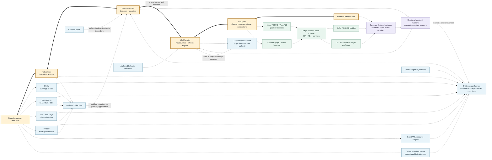

# Branches and confluences: the UIL route map

**REVISION IN PROGRESS. Conceptual map, not a capability or performance claim.**

[Architecture and provider details](AGENT_FIRST_TOPOLOGY.md) | [Research and verification](RESEARCH_AND_VERIFICATION.md) | [Editable Mermaid source](pipeline-map.mmd)

The thick amber line is the architectural reference route, not a prescribed
implementation or a claim that every proposed contract is implemented. Dashed
paths are optional or proposed integrations. Blue routes gather source-bound
facts; purple routes qualify relationships; green routes realize targets.
The map is inspired by branching/rejoining timelines, not an actual chronology.
There is no measured cost/elevation scale and no "best decompiler" claim.

## Convergence rules

- Tool facts meet in an evidence graph with identity and scope intact. Conflicts
  do not disappear merely because the arrows converge.
- Executable UDL retains the source backings. UIL shares its vocabulary; neither
  C nor a text-adventure projection is compulsory.
- An opaque original-backed block may remain usable in its admitted context.
  A missing abstract explanation is not permission to invent behavior.
- Qualification is beside the route and incremental. The arrows are not circular
  proof: source correspondence, contracts and target adapters have distinct checks.
- Target scaffolds are profiles with loaders, ABI and runtime requirements, not
  empty byte containers. A route is executable only for its supported capabilities.

Any decorative rendering of this topology is illustrative. The Mermaid source,
companion definitions and recorded evidence are the reviewable specification.
