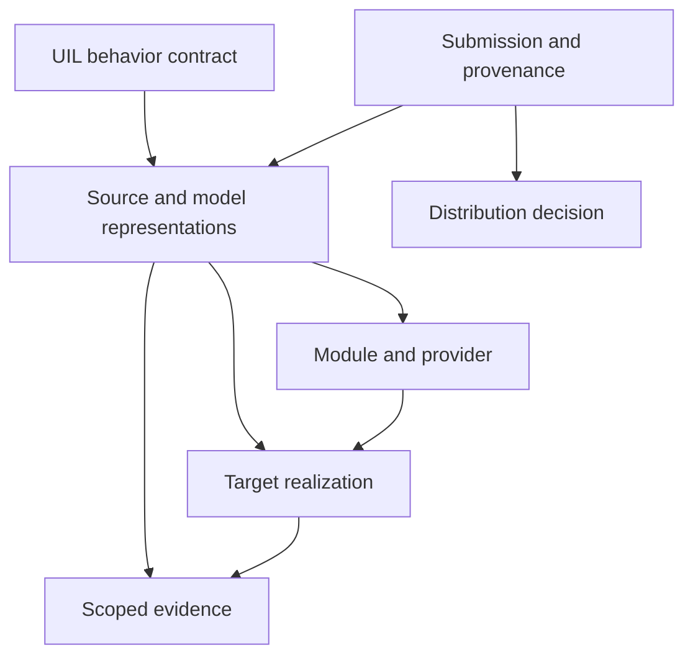

# UIL RFC 0004: Block registry, guided sweding and contribution intake

- Status: draft; additive registry architecture with a bounded local planning example
- Author: ChatGPT, originating task `task:udc-registry-ad5b3685421a`, from TiGa's requirements
- Date: 2026-11-02
- Inspected source: `dc6d7e7709802e743e79cf46e648a4e87b2a0a27`
- Integration base: `f861d17ed4837f753e000f53cc777a7d906fde82`; the reused core validators and source adapters are unchanged
- UIL core version: unchanged; preserve the exact profile of every referenced record
- Proposed extension: a registry and intake envelope outside existing UIL documents
- Supersedes: none

## 1. Decision and scope

Connect sweding, compiler products and agent guidance through a persistent block
registry. A query asks for a behavior under a declared contract, domain and
execution target. The result lists existing representations, their owning
modules/providers, applicable evidence, missing dependencies and the next
supported action. A successfully authored replacement returns to the same
registry so a later task can reuse it.

The registry joins existing records. It does not add an opcode, replace the
compiler/linker, establish equivalence by naming a function, or load submitted
code. Its index is deterministic machinery; interpretation and authoring remain
explicit tasks for an agent or a person when the machinery lacks a backing.

Public contribution is a separate transition from local registration. This RFC
uses **redistribution-authorized material** as the sharing criterion. Authored
code may itself be copyrighted; the relevant question is whether the selected
contents can be redistributed under the declared terms. A game purchase is not
a publication credential. Proof of purchase is neither collected nor required
by this workflow.

The accompanying [local reference example](../../examples/udc_registry/README.md)
exercises persistence, existing validators, representation lookup and planning.
It grants no execution authority, verifies no arbitrary submitted native code,
and implements no public upload service. The broader intake/export and trusted
qualification transitions below are requirements, not claims about that example.
An absent module association must not hide a known catalog implementation. The
example exposes those unbound descriptions and does not claim that its bounded
index establishes global absence; a separate explicit request creates a sweding
work packet.

## 2. Existing machinery and the missing connection

The limitation is integration and discovery, not missing language semantics.
Current source already provides these seams:

| Existing component | Reuse | Boundary to preserve |
| --- | --- | --- |
| [`uil_catalog`](../../src/fdisbull/uil_catalog.py) | Validated groups, `semantic:` and `implementation:` identities, bounded UDL adapters | A semantic ID identifies an exact normalized common-UIL model; it does not prove arbitrary source equivalence. An implementation ID identifies a source/model descriptor, not a compiled file. |
| [`common_uil`](../../src/fdisbull/common_uil.py) | Exact import selection, types, effects, capabilities and copy-in/copy-out checks | Program, Presentation, Orchestration and Catalog retain their existing strict schemas. |
| [`uil_link`](../../src/fdisbull/uil_link.py) | Requirement, module and provider IDs; dependency closure; exact pins; component diagnostics | Generic declarations do not authorize native emission. The current native builder independently admits reconstructed built-in providers. |
| [`uil_native`](../../src/fdisbull/uil_native.py) | Source/build manifests, target, toolchain, closure and output identities | Source emission, compilation, sealing and behavioral qualification are separate facts. |
| [`uil_codegen`](../../src/fdisbull/uil_codegen.py) | Generated Python/JavaScript artifacts, realization and closure identities | An emitted artifact has not thereby executed or passed native/source comparison. |
| [`udc_layers`](../../src/fdisbull/udc_layers.py), [`snippet_links`](../../src/fdisbull/snippet_links.py) | Persisted contracts, alternative layers, selections and correspondence links | These include distinct legacy profiles; preserve profile boundaries and private payload storage. |
| [`udc_qualify`](../../src/fdisbull/udc_qualify.py), [`udl_blocks`](../../src/fdisbull/udl_blocks.py) | Existing bounded proof/qualification receipts | Keep the actual domain, observation boundary, exclusions and dependency identities. |
| [`source_catalog`](../../src/fdisbull/source_catalog.py) | Private source retrieval and candidate discovery | It stores source blobs and search excerpts. It is not the public block database. |
| [`target_storage`](../../src/fdisbull/target_storage.py) | Private content-addressed inputs and availability checks | Storage separation is not sanitation; `publication_ready` remains false. |

The current [sweding reference](../../src/fdisbull/skills/fdisbull-investigate/references/sweding.md)
already calls for searching qualified equivalents and preserving logical meaning
while changing backing. The registry supplies the missing searchable joins,
structured reasons and return path. It must use existing validators rather than
silently extending their accepted fields.

## 3. Records and identities

Store several related records rather than one overloaded `block` row.

| Record | Required information | Identity and lifetime |
| --- | --- | --- |
| Behavior contract | Exact profile/version, normalized model or contract reference, typed logical ports, domain, effects, failure/time/randomness obligations | Preserve the existing semantic/contract identity. A changed meaning is a new revision. |
| Source/model representation | Language/profile, implementation ID, provenance, source bindings and interpretation limits | One behavior can have many representations. Keep origin-specific records even when models match. |
| Provider/module | Immutable module/provider identity, offered and required contracts, entry/export, target and lifecycle requirements | Many blocks can belong to one module; a block can have backings in several modules. Membership is an evidenced relation, not a matching name. |
| Build recipe | Source and dependency identities, admitted compiler/backend, target profile, flags, linker/scaffold and generation options | Changing an input or toolchain invalidates the old recipe/output relationship. A declared recipe is not installed code. |
| Realization | Actual emitted/compiled artifact identity, recipe and manifest references, target/ABI/features, closure and bindings | Each compiler output receives its own identity. A portable source and its x64/ARM64 products are distinct records. |
| Evidence | Which edge/property was assessed, exact identities, domain, observer, method, outcome, exclusions and counterexamples | Append immutable receipts. Imported claims remain attributed until the corresponding trusted check accepts them. |
| Submission and distribution decision | Submitter, provenance category, exact selected contents, declared rights basis/notices, review outcome and export inventory | Separate from semantic validity and local usability. No decision transfers merely because hashes or semantic IDs match. |

The registry may use SQLite locally, with indexes on profile plus semantic ID,
target, owning provider/module, artifact identity and evidence applicability.
Payloads belong in the appropriate private object store or explicitly authored
source package. Indexing a hash does not imply that its object is present.

Logical slot IDs remain part of the UIL binding contract. Physical registers,
addresses, stack offsets and host handles belong to UDL source maps or a target
realization's binding map. A compiled output must not overwrite logical slots
with the register allocation chosen for that build. Original-backed pass-through
can retain its physical binding privately and advertise the narrower contract
that its adapter actually supports.

### Do not confuse equality with qualification

Existing semantic IDs cover normalized models, including material structure,
constants and execution budgets. Two algebraically equivalent implementations
can have different IDs. They may be connected by a qualified relation under an
explicit domain; the registry must not merge them from text similarity.

Conversely, a shared model ID does not prove that recovered source, emitted C,
compiled machine code or a live native operation implements it. Preserve the
source-to-model, model-to-implementation, build-to-execution and composed-observer
edges separately. A proof that both models refuse every input cannot be
advertised as a working computation: retain `reference_completion_possible`
and the refusal-only scope when supplied by the existing qualifier.

## 4. Local and shared views

Use a private project index, a private reusable index if desired, and imported
snapshots of an explicitly published shared catalog. A local query may combine
these authorized views while preserving each result's origin and visibility.

The default shared-catalog operation is download/synchronize and search locally.
Do not automatically send a private UIL model, full-game semantic digest, source
excerpt or local query to a remote service. A digest is an identifier, not a
confidentiality mechanism. Remote search requires an explicitly shareable query
projection; omitted private fields stay omitted from diagnostics and telemetry.

Public results must not reveal the existence, source path or evidence links of a
private implementation that happens to share a semantic group. Deduplication is
scoped to identity and authorization. A publicly distributed generic arithmetic
block and a private game-derived equivalent retain separate origins, relations
and distribution decisions.

## 5. Deterministic query and guidance

### Query parameters

The complete request identifies:

- the exact contract/profile and, where needed, a qualified equivalence relation;
- admitted domain, observer and required effects;
- target OS/ISA/mode/ABI/runtime, feature requirements and ownership semantics;
- available local providers/toolchains and their observed versions;
- assurance policy, objective and applicable performance context;
- permitted registry snapshots and local input/material scopes.

The first implementation can support only the native targets and profiles the
installed tooling actually accepts. A future Rust, browser, console or mixed
runtime record is discoverable as a declaration without becoming a callable
backend. Language and CPU architecture are different query dimensions.

Free-text or embedding retrieval may suggest candidates. Exact validators and
qualified relations determine eligibility. The result lists both applicable
representations and rejected alternatives with stable reason codes.

### Result states

These are proposed workflow meanings, not new core CLI command names.

| Outcome | Tool guidance |
| --- | --- |
| Compatible, qualified realization is available | Pin exact implementation, artifact, module/provider and binding identities; produce the supported execution plan. Execution still uses the host's existing authority. |
| Compatible source exists, output missing | Build it through the installed admitted compiler recipe, then check and register the new realization. |
| Compiler/runtime/device is unavailable | Report the missing prerequisite and supported preparation action. Preserve the existing implementation as a candidate. |
| Module/provider has only a declaration | Produce an adapter/backend implementation task. Registration did not install a compiler or runtime. |
| Candidate evidence does not cover the request | Produce a qualification task with the missing edge, domain or observer. |
| Existing primitives need composition or an ABI adapter | Produce an explicit composition/adapter task and its own obligations before requiring a new algorithm. |
| Contract is complete and no suitable implementation is found | Produce a sweding packet. Preserve the candidates examined and why they failed. |
| Contract is incomplete or unresolved | Produce a semantic-recovery task identifying the unknown behavior. Do not swede a guessed contract. |
| Multiple eligible candidates remain | Apply an explicit recorded selection policy or require an exact pin. The existing resolver must not silently guess. |
| Search was truncated, index unavailable or snapshot stale | Report incomplete discovery. A failed lookup is not evidence of absence. |

Each response includes query identity, snapshot identity/revision, candidate
identities, exact blocking reasons, evidence status, supported next action and
the action's required inputs and expected output. Examples and commands come
from the installed capability catalog; the tool must not prescribe an imagined
method. A cold agent must be able to discover the operation, understand a
refusal and resume from the response without private project lore.

For the same validated request, snapshots and policy, ordering and planning
results must be stable. Use exact provider pins in execution locks. Selection
must recheck file identities and provider/session generations before use;
immutable evidence remains historical when its dependencies no longer match.

### Performance selection

Compatibility and accepted assurance precede cost ranking. Rank only comparable
measurements and account for bridge/marshalling, initialization, allocation and
end-to-end costs where the caller observes them. Store benchmark input/domain,
target and runtime versions, metric/units, measurement procedure and uncertainty.
UIL model steps, game ticks, guest cycles and host elapsed time remain separate.
Unknown performance is unknown; it cannot be represented as zero cost. A
superoptimizer's candidate is another representation with its own qualification
and measurements, not an automatic winner or a claim of global optimality.

## 6. The sweding packet and return path

On a genuine implementation gap, the deterministic tool prepares a work packet
containing:

1. Exact contract/profile and its model, signature, domain and observation boundary.
2. State and slot bindings, ownership, effects, ordering, failure and timing/RNG obligations.
3. Target/runtime, module entry/export interface and allowed capabilities.
4. Existing representations, their reusable parts, and the precise rejection reasons.
5. Local input references and permitted output destinations; private evidence stays local.
6. Required acceptance examples, boundary cases, counterexamples and existing verifier entry points.
7. Required build/qualification artifacts and the registry return schema.
8. Explicit completion and stopping conditions, including missing infrastructure or unresolved semantics.

The agent may implement a block, compose existing blocks, add an adapter or
propose a missing backend. It reports which of these it did. The host chooses
agent context and lifecycle; the registry does not silently launch workers.
An authoring worker receives relevant accepted history. A fresh reviewer can
receive the packet and declared reading list without that history to test
whether the tool guidance is sufficient.

The return path is: validate the new representation; attach exact source/build
identities; run the applicable existing checks; register the resulting records
and receipts; re-query the original request. Success means the original gap is
closed under its declared conditions, not simply that a new row exists. A
candidate that still needs compilation or qualification remains discoverable
with that next action. Counterexamples stay attached and block the contradicted
claim. Repeating identical registration is idempotent.

An accepted simplification or changed behavior uses a disclosed contract
variation. Neither an agent nor a verifier may relax the original assumptions
or tolerances merely to make a candidate pass.

## 7. Concrete compiler example

Use an authored pure contract: one `u16` input, one `u16` output, increment by one
modulo 65536, no external effects. The bounded existing C and Python adapters
admit the example statements `ax += 1;` and `ax = (ax + 1) & 65535`, respectively.
Their normalized models share a behavior identity while their source/model
implementation identities remain distinct.

Suppose the index has a portable-C source representation, a Linux x64 output,
and an ARM64 provider declaration. The query includes the target and installed
backend state:

- Linux x64 with matching evidence and artifact: select the exact realized output.
- macOS ARM64 with the admitted native backend but no output: regenerate the
  target-specific source and manifest from the validated model/closure, then
  compile and qualify that output.
- macOS ARM64 without the needed toolchain: report preparation work.
- A representation requiring an unimplemented provider: report a backend task.
- A target with a complete contract and no viable source/provider combination:
  request a swede, retaining the other-target representations as references.

The execution layer still arranges the target shell, imports/exports, memory,
ABI and register exchanges through the actual compiler/linker and admitted
runtime. The registry records which recipe and provider supplied those duties.
It does not need to reimplement register allocation to remember a reusable block.
The current native builder reconstructs and checks its target-specific source
manifest; it does not compile arbitrary C supplied in a registry row. Reusing
raw registered source requires an actual admitted recipe for that route. If
the recipe or provider is absent, the next task identifies that missing seam.

The same design applies to a recovered HUD operation that formats a typed health
value and displays it. The contract must include the recovered formatting,
display and effect behavior; the original literal/asset bindings may remain
local. A shareable formatter or display backend can accept those local bindings
without publishing the game's resources. This example names behavior, not a new
`text.display` opcode or an assertion that current common-v1 static resource
references provide a general dynamic-string service.

Z-world consumers use these same operation contracts at their declared observer
boundary. A headless effect sink, graphical display or audio backend can be a
different realization. Observer scope matters: a Z-only projection cannot by
itself qualify pixel, audio or full native timing equivalence. Rewind traces and
controlled RNG branches may supply local acceptance evidence, with the existing
TAS/rewind capability and restoration coverage recorded explicitly.

## 8. User contribution pipeline

### Separate local intake from public submission

Two entrances are necessary. A user can register private UDL/UDC material in a
local workspace. A contributor can propose an explicitly selected, reviewed
package for the shared registry. The public service must not receive an entire
private project merely to decide what should have stayed local.

Local intake creates an immutable submission identity, validates bounded data
with the appropriate existing profile validator, inventories dependencies and
records provenance. Unsupported formats receive a precise adapter request.
Raw UDL/source, game-derived UIL, assets, saves and outputs stay in their
authorized local stores. No submitted module path, URL, entry point, build
command or license string is interpreted as permission to import or execute it.

Authored code can be submitted as code in an explicit source package; it is not
smuggled into free-form catalog metadata. Modules supply exported contracts,
requirements, target/runtime information, source/recipe identities and notices.
An installed trusted loader and host execution policy must separately support
that package before any build or run action becomes available.

### Independent state dimensions

| Dimension | Examples | Who can establish it |
| --- | --- | --- |
| Structural admission | pending, accepted, refused, unsupported profile | Actual validator over the exact submitted contents |
| Behavioral evidence | absent, submitted claim, checked bounded result, counterexample, stale dependencies | Existing verifier/observer with retained scope and identities |
| Local availability | descriptor only, source present, toolchain absent, source emitted, built, runnable under host policy | Actual local capability/artifact checks |
| Distribution | local-only, review requested, exact export approved, published, withdrawn | Separate content/provenance review and publication receipt |

A submitter cannot set internal approval or checked-evidence fields. `verified:
true`, a valid signature, a public URL or an SPDX label is insufficient. A
signature can attribute a claim; it does not establish its truth or rights.
Quarantine/staging means nonselectable local data here, not an assertion that
the tool can safely execute arbitrary code.

### Proposed transitions

Local submission progresses through inventory, profile validation, provenance
classification, and candidate indexing. Qualification and provider preparation
then occur as separate applicable tasks. Refusal retains bounded diagnostic
codes and private evidence references; it does not echo raw submitted snippets
into public logs. Imported evidence records their origin and checking status.

Public submission begins only from an explicit export selection. Build a new
package from an allowlist of reviewed records, source files, notices and
fixtures. A review binds the exact inventory, field projection and file hashes.
The server repeats structural and publication-policy admission, stages the
candidate, and records the later acceptance or withdrawal. Server acceptance
does not imply that every consumer will execute the module.

This is an ordinary contribution pipeline with attributable declarations and
review, not an attempt to authenticate everyone's game purchases. Unknown or
disputed provenance keeps the affected contents local/unpublished while the
rest of an independent authored contribution can still be considered.

## 9. Redistribution policy and dependency closure

Under the user's policy, authored or explicitly redistributable selected
material can be proposed for sharing with its terms and notices. Purchased game
bytes, game assets, saves, raw decompilation and original-derived full-game
code/UIL remain local by default. Uncertain origin or rights remains local
pending an item-specific decision. Existing explicit freeware fixture exceptions
retain their narrow scope; they do not extend to other games or generated outputs.

GOG's published user agreement describes personal use and restricts sharing or
transfer of account/content. Its sharing FAQ also describes games as personal
use. These support the project's decision not to use a purchase as upload
authorization; they are not a conclusion about every possible reimplementation
or jurisdiction. Canadian copyright guidance also distinguishes creation of a
protected work from permission to use or license it. See the primary sources
in section 14.

The export check covers the actual payload and its dependency closure:

| Dependency relation | Export treatment |
| --- | --- |
| Contains, embeds, links into, or packages | Inspect included source, data, generated objects, helpers, resources and notices. An eligible wrapper cannot carry a private payload. |
| Requires a user-supplied local resource | A reviewed public adapter may describe the required interface and local binding without shipping or fetching that resource. |
| Was informed or tested by private observations | Preserve the full relation locally. Publish only separately reviewed claims/fixtures that do not reproduce private content. This relation alone neither grants nor denies rights in an independently authored generic block. |
| Qualifies or benchmarks | Review the receipt's text, examples and data as material too. A report or test vector can contain game-derived content. |

Do not infer shareability from file extension, absence of raw machine bytes,
decompilation, slot renaming, sweding, successful tests, source purchase, or the
number of translation stages. UIL may retain narrative, maps, tables or an
entire game's logic. A generated executable can also retain originals through
pass-through blocks, constants or resources.

Export a fresh projection; never dump a project/source/registry SQLite file or
strip a few columns and upload the result. Old pages, journals, FTS text, free
text, local paths and evidence can retain excluded material. The public schema
must be a closed allowlist, with separately reviewed short descriptions.
Unknown fields fail admission. Revalidate actual files immediately before
export; a changed byte or notice requires a new exact decision.

Same-model deduplication cannot transfer distribution approval from an authored
implementation to a private extraction. Similarly, `local-only` does not mean
an implementation is technically incorrect. These dimensions remain independent.

## 10. Capability declaration and agent discovery

A production integration should advertise registry operations through the
existing methods/discovery surface, with request schemas, refusal codes,
examples, effect declarations and supported profiles. Suggested operation
families are lookup/explain, local intake, registration, work-packet generation,
qualification attachment, export preview and explicit publication. These are
design names until registered by a real implementation.

Metadata lookup and planning have no execution or network effects. Building,
testing, installing a provider and publishing are distinct actions whose actual
capabilities and host authorization must be checked. The tool reports unsupported
actions honestly and can generate a bounded implementation task for the missing
tooling. Deterministic exporters remain ordinary tools; an agent should not have
to manually regenerate standard manifests or imitate a missing validator.

The reference example's command discovery and JSON output are authoritative only
for that example. It is not installed into `fdisbull methods` or the production
CLI by this RFC. A cold review should begin from its README and `--help`, then
exercise a miss, registration, repeated query, persistence and a refusal.

## 11. Compatibility, storage and implementation order

Existing catalogs and link documents are immutable inputs to the sidecar index.
Do not add `license`, `visibility`, `native_ready` or recipe fields to strict
existing formats. A registry schema version is distinct from a UIL profile
version. Older consumers may ignore the optional index and use their existing
documents; unsupported required semantics still refuse.

Use transactions for related registrations and idempotent immutable keys.
Changing source, meaning, provider, recipe, target or resource creates new
records and relations; it never overwrites historical evidence. Mutable
availability and withdrawal decisions are recorded separately and rechecked
before selection. Cross-record joins need explicit provenance and cannot be
reconstructed solely from names after restart.

Implement in this order:

1. Local persistent index and deterministic discovery/planning over existing validators.
2. Trusted connections to actual emitted/build manifests, qualification receipts and capability observations.
3. Local contribution intake with closed schemas and generated work packets.
4. Explicit export preview, dependency closure and exact review records.
5. Shared catalog ingestion/publication, followed by scoped optional remote search.

This sequence makes the closed local workflow useful before adding a hosted
service. Each stage has observable behavior and may be independently incomplete.
The reference example covers a bounded part of stage 1 only.

## 12. Conformance and failure cases

The example uses authored arithmetic and existing core validators. Production
acceptance additionally needs the following cases; this table is a requirement
list, not a claim that every check already runs:

| Case | Required result |
| --- | --- |
| Two source representations of one normalized model | Both discoverable with distinct identities and owners after database reopen. |
| Known source, missing compiled output | Build/preparation guidance, not a false absence claim. |
| Wrong target, ABI, ownership, effects or profile | Explicit mismatch; no coercion by language name or similar description. |
| Multiple providers or dependency cycle | Existing resolver diagnostics and exact-pin behavior preserved. |
| Complete contract and genuine miss | A sweding packet with contract, domain, target, rejected candidates and acceptance obligations. |
| Incomplete discovery or unresolved contract | Search/recovery task; do not claim no implementation exists. |
| Candidate inserted with claimed success | Discoverable claim; no trusted qualification or execution authority. |
| Refusal-only equivalence result | Retain its scope; do not advertise a working computation. |
| Successful authored candidate completes required checks | Original query reuses exact records without duplicate registration. |
| Rebuilt source or changed helper/resource | Previous artifact/evidence remains historical; new applicability check required. |
| Purchased game with an MIT label | Conflicting claim stays local; purchase or label does not authorize export. |
| Private and public candidates share a semantic ID | Public view reveals only explicitly eligible records and fields. |
| Authored wrapper depends on a local game resource | Export reviewed wrapper/interface only; require local binding, no automatic resource fetch. |
| Submitted module names executable code | Store/refuse declaration; do not dynamically import or execute it. |
| Export contains a changed or unreviewed dependency | Block that export with the exact dependency reason. |
| A cold agent lacks project conversation | Discovery and refusal responses supply the next supported action and required evidence. |

## 13. Alternatives and disposition

A folder of snippets supplies source but leaves identity, compatibility and
recovery instructions to the agent. A new universal compiler would duplicate
working backends and would not solve provenance or contribution intake. A
shared copy of the private source catalog would mix raw inputs with reusable
records. The proposed sidecar preserves existing compiler/catalog contracts and
adds the missing joins and workflow.

Disposition remains **draft**. The local example is executable planning code,
not adoption of a public schema or execution of arbitrary modules. Maintainers
must record the exact implemented capability and verification evidence before
promoting any later stage. Historical research sanitation labels do not
automatically satisfy this new shared-registry publication decision.

## 14. Sources

- Repository source links in section 2 refer to the inspected baseline named above.
- [Existing sweding requirements](../../src/fdisbull/skills/fdisbull-investigate/references/sweding.md).
- [External target and publication policy](../EXTERNAL_TARGETS.md).
- [Contribution handoff](../AGENT_HANDOFF.md).
- [UIL export boundary](../UIL_BOUNDARY.md).
- [GOG user agreement, sections 2 and 3](https://support.gog.com/hc/en-us/articles/212632089-GOG-User-Agreement), checked 2026-11-02.
- [GOG sharing FAQ](https://support.gog.com/hc/en-us/articles/212184489-Can-I-share-games-with-others), checked 2026-11-02.
- [Canadian Intellectual Property Office: copyright basics](https://ised-isde.canada.ca/site/canadian-intellectual-property-office/en/copyright-learn-basics/copyright-learn-basics-protect-your-original-works-learn-why-copyright-matters), checked 2026-11-02.
